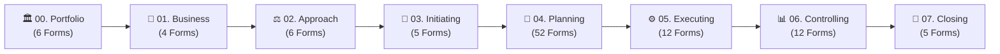
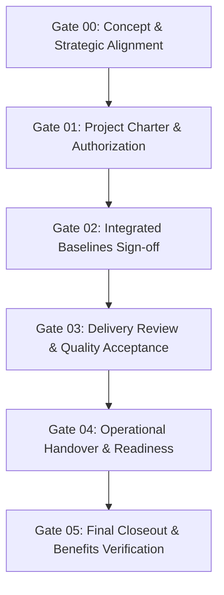

<!--
---
type: Overview
---
-->

<div align="center">

<p align="center">
  
</p>

# 🚀 Tasleemat (تسليمات)
### *The Production-Grade, Bilingual PMO Artifact & AI Toolkit*
**114 Standardized Deliverables • 228 English & Arabic Bundles • 6 Stage-Gates • 4 Sizing Tiers**  
*Fully Aligned with PMI PMBOK® (6th, 7th & 8th Edition Ready), ISO 21500 / 21502 & NIST AI RMF*

<p align="center">
  <a href="https://pypi.org/project/tasleemat/"></a>
  <a href="https://fakhr.me/Tasleemat/"></a>
  <a href="https://fakhr.me/Tasleemat/catalog/en/index.html"></a>
  <a href="README_AR.md"></a>
  <a href="https://github.com/fakhruldeen/Tasleemat/stargazers"></a>
  <a href="https://doi.org/10.5281/zenodo.23193523"></a>
</p>

<p align="center">
  <b><a href="https://fakhr.me/Tasleemat/">🌐 Live Web Portal</a></b> • 
  <b><a href="https://fakhr.me/Tasleemat/catalog/en/index.html">📋 Browse 114 Templates</a></b> • 
  <b><a href="https://fakhr.me/Tasleemat/governance.html">🚪 6 Stage-Gates</a></b> • 
  <b><a href="https://fakhr.me/Tasleemat/LEXICON.html">📖 Bilingual Lexicon</a></b> • 
  <b><a href="https://fakhr.me/Tasleemat/developer.html">💻 Developer & CLI</a></b> • 
  <b><a href="README_AR.md">🇸🇦 النسخة العربية</a></b>
</p>

---

</div>

## 💡 Why Tasleemat?

Most Project Management Offices (PMOs) and Project Managers waste hundreds of hours reinventing the wheel with fragmented Word documents, mismatched Excel sheets, and inconsistent governance forms.

**Tasleemat solves this with a unified, auditable, and automated artifact library:**

| What PMs Usually Struggle With 😫 | How Tasleemat Delivers Excellence 🚀 |
| :--- | :--- |
| **Fragmented templates** scattered across folders and platforms | **114 production-ready deliverables** in structured Markdown, CSV data schemas, and JSON metadata |
| **English-only or poor machine translations** | **Handcrafted 1:1 bilingual parity** with Saudi DGA, PMI & ISO approved terminology |
| **One-size-fits-all overhead** that suffocates small projects | **4 Tailoring Tiers** (from a 5-artifact micro setup to a 45+ enterprise governance pack) |
| **Weak gate transition criteria** leading to scope creep & budget overrun | **6 Formal Stage-Gates** (Gate 0 to 5) with concrete RACI checklists and sign-off criteria |
| **Zero AI readiness** | Built-in **NIST AI RMF compliance**, AI model cards, and ready-to-run prompt templates |

---

## 🧭 Choose Your Persona & Fast-Track

<table>
<tr>
<td width="33%" valign="top">

### 👔 For Project Managers
**Start running projects immediately**
- 🚀 **[Project Charter (PMO-03.01)](forms/en/03_Initiating/01_Project_Charter/03_01_Project_Charter_Template.md)**: Formal authorization
- 📐 **[WBS & Scope Baseline](forms/en/04_Planning/02_Scope/07_WBS_Dictionary/04_02_07_WBS_Dictionary_Template.md)**: Clear work breakdown
- 📊 **[Status Report & EVA](forms/en/06_Monitoring_and_Controlling/01_Project_Status_Report/06_01_Project_Status_Report_Template.md)**: Executive dashboards
- 🚪 **[Stage-Gate Checklists](docs/en/04_stage_gates_and_governance.md)**: Phase transitions
- 📖 **[PM Quick Start Guide](docs/en/01_getting_started.md)**: 5-minute kickoff

</td>
<td width="33%" valign="top">

### 🏛️ For PMO Directors & Executives
**Institutionalize standards across the enterprise**
- ⚖️ **[Tailoring Matrix (Tiers 1–4)](docs/en/05_tailoring_profiles.md)**: Size governance to project risk
- 💎 **[Benefits Management Plan](forms/en/01_Business_and_Value_Delivery/02_Benefits_Management_Plan/01_02_Benefits_Management_Plan_Template.md)**: Strategic value tracking
- 🛡️ **[Stage-Gate Governance Policy](docs/en/04_stage_gates_and_governance.md)**: 3-decision gating control
- 📚 **[PMO Terminology Lexicon](docs/LEXICON.md)**: 164+ standardized bilingual definitions
- 🏆 **[PMO Maturity Assessment](forms/en/00_Program_and_Portfolio_Management/05_PMO_Maturity_Assessment/00_05_PMO_Maturity_Assessment_Template.md)**: Institutional benchmarking

</td>
<td width="33%" valign="top">

### 💻 For Developers & AI Engineers
**Automate documentation & workflows**
- 📦 **[CLI Scaffolder (`tasleemat init`)](TECHNICAL.md#1-tasleemat-cli-scaffolder--search-tool)**: One-command project scaffolding
- 🐍 **[Python SDK (`tasleemat.ai`)](TECHNICAL.md#2-programmatic-python-sdk-tasleematai)**: Programmatic artifact generator
- 🗄️ **[OKF Frictionless Data Schemas](TECHNICAL.md#3-data-architecture--synchronized-5-file-bundles)**: Validate tables with JSON schemas
- 🤖 **[NIST AI Model Cards](forms/en/02_Project_Approach_and_Tailoring/05_AI_Model_Card_and_Fact_Sheet/02_05_AI_Model_Card_and_Fact_Sheet_Template.md)**: AI ethics and governance
- ⚙️ **[TECHNICAL.md Manual](TECHNICAL.md)**: Architecture & pipeline docs

</td>
</tr>
</table>

---

## 🗺️ The Complete 8-Phase Lifecycle Map (114 Deliverables)

Every deliverable is organized chronologically into the standard **8 Lifecycle Phases**. Every folder delivers a **5-file synchronized bundle** (`Template.md`, `Guide.md`, `Example.md`, `schema.json`, `data.csv`).



### 📑 Lifecycle Phase Directory

| Phase | Phase Name | Focus & Scope | Forms Count | Quick Links |
| :---: | :--- | :--- | :---: | :---: |
| **00** | **[Program & Portfolio Strategy](forms/en/00_Program_and_Portfolio_Management/)** | Strategic alignment, OKRs, portfolio roadmap, dependencies, PMO maturity | **6 Forms** | [English](forms/en/00_Program_and_Portfolio_Management/) • [العربية](forms/ar/00_إدارة_البرامج_والمحافظ/) |
| **01** | **[Business & Value Delivery](forms/en/01_Business_and_Value_Delivery/)** | Business case justification, feasibility studies, benefits realization | **4 Forms** | [English](forms/en/01_Business_and_Value_Delivery/) • [العربية](forms/ar/01_الأعمال_وتسليم_القيمة/) |
| **02** | **[Project Approach & Tailoring](forms/en/02_Project_Approach_and_Tailoring/)** | Governance tailoring strategy, agile/hybrid selection, AI ethics & model cards | **6 Forms** | [English](forms/en/02_Project_Approach_and_Tailoring/) • [العربية](forms/ar/02_منهجية_المشروع_وتخصيصه/) |
| **03** | **[Initiating](forms/en/03_Initiating/)** | Project charter, initial assumption log, stakeholder identification register | **5 Forms** | [English](forms/en/03_Initiating/) • [العربية](forms/ar/03_البدء/) |
| **04** | **[Integrated Planning](forms/en/04_Planning/)** | Scope/WBS, schedule, cost/budget, quality, risk, ESG, procurement, security | **52 Forms** | [English](forms/en/04_Planning/) • [العربية](forms/ar/04_التخطيط/) |
| **05** | **[Executing & Delivering](forms/en/05_Executing/)** | Issue logs, change requests, team charter, sprint backlog, retrospectives | **12 Forms** | [English](forms/en/05_Executing/) • [العربية](forms/ar/05_التنفيذ/) |
| **06** | **[Monitoring & Controlling](forms/en/06_Monitoring_and_Controlling/)** | Status reports, Earned Value (EVA), variance tracking, quality acceptance | **12 Forms** | [English](forms/en/06_Monitoring_and_Controlling/) • [العربية](forms/ar/06_المراقبة_والتحكم/) |
| **07** | **[Closing & Transition](forms/en/07_Closing/)** | Operational handover, lessons learned register, contract closeout sign-off | **5 Forms** | [English](forms/en/07_Closing/) • [العربية](forms/ar/07_الإغلاق/) |

---

## 🚪 The 6 Governance Stage-Gates

Ensure auditable decision-making before allocating capital to successive phases:



Every gate produces one of **3 Formal Outcomes**:
1. 🟢 **Proceed (Go)**: 100% exit criteria met, budget unlocked for next phase.
2. 🟡 **Conditional Approval**: Proceed with mandatory 14-day Corrective Action Plan (CAPA).
3. 🔴 **Hold / Terminate**: Significant variance or strategic misalignment; project paused or shelved.

👉 *Explore the interactive gate matrix and checklists in the **[Stage-Gate Governance Portal](https://fakhr.me/Tasleemat/governance.html)**.*

---

## 🎯 4 Tailoring Sizing Profiles

Avoid governance paralysis by matching the paperwork to the actual risk and scale of your initiative:

| Sizing Tier | Profile Description | Typical Scale | Artifact Count | Core Deliverables Included |
| :--- | :--- | :--- | :---: | :--- |
| **Tier 1: Micro** | Fast-paced, low-complexity projects | < \$50K • < 3 months | **5 Artifacts** | Project Charter, Schedule, Action Log, Monthly Status, Closeout Handover |
| **Tier 2: Standard** | Departmental initiatives, medium risk | \$50K–\$500K • 3–9 months | **18 Artifacts** | Full Baselines (Scope, Schedule, Budget), Risk Register, RACI, Change Management |
| **Tier 3: Enterprise** | Strategic transformations, multi-vendor | > \$500K • > 9 months | **45+ Artifacts** | All 6 Stage-Gates, Audit Dossiers, Procurement Pack, ESG & Security Baselines |
| **Tier 4: Agile / AI** | Iterative software & AI model pipelines | Sprint-based / ML lifecycle | **25 Artifacts** | Product Vision, Sprint Backlogs, Flow Metrics, NIST AI Model Cards, Retrospectives |

---

## ⚡ Quick Start: 3 Ways to Use Tasleemat

### Option 1: Explore on the Web *(Fastest)*
Visit the interactive portal to search, preview, and copy templates with one click:
- 🌐 **[https://fakhr.me/Tasleemat/](https://fakhr.me/Tasleemat/)**
- 📋 **[114 Templates Explorer](https://fakhr.me/Tasleemat/catalog/en/index.html)**

### Option 2: Clone & Use Native Markdown Directly in GitHub
All deliverables are plain, clean Markdown files. You can clone the repo and use them directly in VS Code, Obsidian, Notion, or Confluence:
```bash
git clone https://github.com/fakhruldeen/Tasleemat.git
cd Tasleemat
# Browse English templates: forms/en/
# Browse Arabic templates: forms/ar/
```

### Option 3: Automate via CLI Scaffolder
Scaffold an entire project governance directory with customized templates:
```bash
# Clone and use CLI tool
python3 -m cli.tasleemat_cli scaffold FORM-03-01 --lang both
python3 -m cli.tasleemat_cli list --phase 04
```

---

## 📜 International Standards Alignment

Tasleemat is engineered to comply with leading global project governance and technical benchmarks:

- **PMI PMBOK® Guide**: 6th Edition (Process Groups), 7th Edition (Performance Domains), and 8th Edition Ready.
- **ISO 21500:2021 & ISO 21502:2020**: Guidance on project, programme, and portfolio management.
- **Saudi Digital Government Authority (DGA)**: Enterprise architecture and government PMO requirements.
- **NIST AI 100-1 (AI RMF)**: AI model documentation, bias evaluations, and ethical deployment controls.
- **Open Knowledge Foundation (OKF)**: Frictionless Data specifications (JSON schemas + CSV definitions).
- **ESG / UN Sustainable Development Goals**: Sustainability integration in project charter and benefits.

---

## 👨‍💼 Creator & Lead Maintainer

<table border="0">
  <tr>
    <td width="110" align="center" valign="middle">
      <a href="https://fakhruldeen.github.io">
        
      </a>
    </td>
    <td valign="middle">
      <b>Mohamed (Fouad) Fakhruldeen</b><br/>
      <i>Enterprise Project Management & Digital Transformation Leader</i><br/>
      <a href="https://linkedin.com/in/fakhruldeen"></a>
      <a href="https://fakhruldeen.github.io"></a>
      <a href="https://github.com/fakhruldeen"></a>
    </td>
  </tr>
</table>

---

## 📚 Citation & Academic Reference

[](https://doi.org/10.5281/zenodo.23193523)

If you use Tasleemat in your PMO operations, institutional research, or consulting projects, please cite:
```bibtex
@software{fakhruldeen_tasleemat_2026,
  author       = {Fakhruldeen, Mohamed (Fouad)},
  title        = {Tasleemat: The Enterprise Bilingual (English & Arabic) Project Management Artifact & AI Toolkit},
  month        = oct,
  year         = 2026,
  publisher    = {Zenodo},
  version      = {v2.3.0},
  doi          = {10.5281/zenodo.23193523},
  url          = {https://doi.org/10.5281/zenodo.23193523}
}
```

---

## ⚖️ License

Distributed under the **[MIT License](LICENSE)**. Free to use, adapt, and integrate into internal organizational PMOs, public sector transformations, and commercial software.

<div align="center">
  <sub>Built with passion for project excellence across the Arab world and globally. © 2026 Tasleemat Contributors.</sub>
</div>
