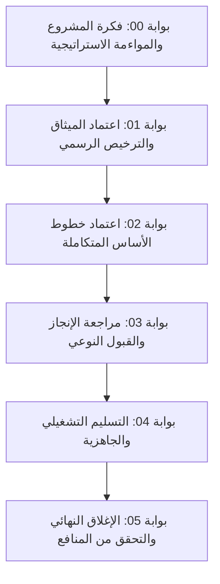

<!--
---
type: Overview
---
-->

<div align="center">

<p align="center">
  
</p>

# 🚀 مكتبة تسليمات لإدارة المشاريع (Tasleemat)
### *المكتبة المؤسسية المعتمدة لنماذج ومخرجات إدارة المشاريع والذكاء الاصطناعي*
**114 مخرجاً قياسياً • 228 حزمة ثنائية (عربي/إنجليزي) • 6 بوابات عبور حوكمية • 4 مستويات لتخصيص المشاريع**  
*متوافقة بالكامل مع الدليل المعرفي لإدارة المشاريع PMI PMBOK® (الإصدار 6 و7 والجاهزية لـ 8)، معايير أيزو ISO 21500 / 21502، وهيئة الحكومة الرقمية*

<p align="center">
  <a href="https://fakhr.me/Tasleemat/README_AR.html"></a>
  <a href="https://fakhr.me/Tasleemat/catalog/ar/index.html"></a>
  <a href="README.md"></a>
  <a href="https://github.com/fakhruldeen/Tasleemat/stargazers"></a>
  <a href="https://doi.org/10.5281/zenodo.23193523"></a>
</p>

<p align="center">
  <b><a href="https://fakhr.me/Tasleemat/README_AR.html">🌐 البوابة الرقمية التفاعلية</a></b> • 
  <b><a href="https://fakhr.me/Tasleemat/catalog/ar/index.html">📋 تصفح 114 قالباً</a></b> • 
  <b><a href="https://fakhr.me/Tasleemat/governance_ar.html">🚪 6 بوابات عبور حوكمية</a></b> • 
  <b><a href="https://fakhr.me/Tasleemat/LEXICON.html">📖 معجم المصطلحات الموحد</a></b> • 
  <b><a href="https://fakhr.me/Tasleemat/developer_ar.html">💻 دليل المطورين وCLI</a></b> • 
  <b><a href="README.md">🇬🇧 English Readme</a></b>
</p>

---

</div>

## 💡 لماذا صُممت تسليمات؟

تعاني معظم مكاتب إدارة المشاريع (PMO) والفرق التنفيذية من إهدار مئات الساعات في إعادة اختراع العجلة باستخدام ملفات Word وExcel مبعثرة وغير متناسقة، أو الاعتماد على ترجمات آلية ضعيفة تفقد المصطلحات الاحترافية دقتها.

**مكتبة تسليمات تقدم الحل المؤسسي الجاهز:**

| التحدي اليومي لمديري المشاريع 😫 | كيف تحل تسليمات هذا التحدي؟ 🚀 |
| :--- | :--- |
| **قوالب مشتتة** في مجلدات متفرقة بصيغ غير موحدة | **114 مخرجاً قياسياً شاملاً** بصيغ ماركداون نظيفة، ومخططات بيانات JSON، وجداول CSV |
| **غياب التعريب المهني الدقيق** أو استخدام ترجمة حرفية ركيكة | **صياغة عربية أصيلة 100% متطابقة 1:1 مع الإنجليزية** وفق مصطلحات PMI وهيئة الحكومة الرقمية |
| **البيروقراطية الزائدة** التي تخنق المشاريع الصغيرة والناشئة | **4 مستويات تخصيص (Tailoring Tiers)** تبدأ من 5 قوالب أساسية وحتى 45+ مخرجاً للمشاريع العملاقة |
| **غياب معايير تدقيق واضحة للمراحل** مما يسبب انحراف النطاق والميزانية | **6 بوابات عبور حوكمية (Stage-Gates)** بقوائم تحقق واضحة ومسؤوليات RACI محددة |
| **عدم جاهزية الوثائق لتقنيات الذكاء الاصطناعي** | دعم كامل لإطار **NIST AI RMF**، وبطاقات نماذج الذكاء الاصطناعي، وموجهات Prompts جاهزة |

---

## 🧭 مسارات التصفح المخصصة (اختر دورك)

<table>
<tr>
<td width="33%" valign="top">

### 👔 لمديري المشاريع
**ابدأ إدارة مشروعك في دقائق**
- 🚀 **[ميثاق المشروع (FORM-03-01)](forms/ar/03_البدء/01_ميثاق_المشروع/03_01_ميثاق_المشروع_قالب.md)**: الترخيص الرسمي
- 📐 **[هيكل تجزئة العمل WBS](forms/ar/04_التخطيط/02_النطاق/07_قاموس_هيكل_تجزئة_العمل/04_02_07_قاموس_هيكل_تجزئة_العمل_قالب.md)**: تفكيك النطاق
- 📊 **[تقرير الحالة وتحليل EVA](forms/ar/06_المراقبة_والتحكم/01_تقرير_حالة_المشروع/06_01_تقرير_حالة_المشروع_قالب.md)**: لوحات المتابعة
- 🚪 **[قوائم بوابات العبور](docs/ar/04_stage_gates_and_governance.md)**: الانتقال بين المراحل
- 📖 **[دليل البدء السريع](docs/ar/01_getting_started.md)**: خطوة بخطوة للممارس

</td>
<td width="33%" valign="top">

### 🏛️ لمديري مكاتب PMO والقيادات
**مأسسة الحوكمة في المنشأة**
- ⚖️ **[مصفوفة التخصيص (4 مستويات)](docs/ar/05_tailoring_profiles.md)**: ملاءمة الحوكمة مع حجم المشروع
- 💎 **[خطة إدارة الفوائد والمنافع](forms/ar/01_الأعمال_وتسليم_القيمة/02_خطة_إدارة_الفوائد/01_02_خطة_إدارة_الفوائد_قالب.md)**: المواءمة الاستراتيجية
- 🛡️ **[سياسة حوكمة البوابات](docs/ar/04_stage_gates_and_governance.md)**: آلية القرارات الثلاثة
- 📚 **[معجم المصطلحات الموحد](docs/LEXICON.md)**: 164+ مصطلحاً معرباً ومعتمداً
- 🏆 **[تقييم نضج مكتب PMO](forms/ar/00_إدارة_البرامج_والمحافظ/05_تقييم_نضج_مكتب_إدارة_المشاريع/00_05_تقييم_نضج_مكتب_إدارة_المشاريع_قالب.md)**: قياس النضج المؤسسي

</td>
<td width="33%" valign="top">

### 💻 للمطورين ومهندسي الأتمتة
**أتمتة الوثائق وحزم البيانات**
- 📦 **[أداة السطر البرمجي CLI](TECHNICAL_AR.md#1-أداة-السطر-البرمجي-tasleemat-cli)**: إنشاء هياكل الوثائق بأمر واحد
- 🐍 **[حزمة بايثون (`tasleemat.ai`)](TECHNICAL_AR.md#2-حزمة-تطوير-البرمجيات-tasleematai)**: توليد الوثائق برمجياً
- 🗄️ **[مخططات OKF JSON](TECHNICAL_AR.md#3-حزم-البيانات-والخمسية-المتزامنة)**: التحقق التلقائي من جداول البيانات
- 🤖 **[بطاقات حوكمة الذكاء الاصطناعي](forms/ar/02_منهجية_المشروع_وتخصيصه/05_بطاقة_نموذج_الذكاء_الاصطناعي/02_05_بطاقة_نموذج_الذكاء_الاصطناعي_قالب.md)**: مواءمة أخلاقيات AI
- ⚙️ **[دليل المطورين TECHNICAL_AR.md](TECHNICAL_AR.md)**: البنية الهندسية الشاملة

</td>
</tr>
</table>

---

## 🗺️ خريطة دورة حياة المشروع (114 تسليمة عبر 8 مراحل)

تنتظم تسليمات زمنياً عبر **8 مراحل قياسية**. يحتوي كل مجلد على **حزمة خماسية متكاملة ومترابطة** (`قالب.md`، `دليل.md`، `مثال.md`، `schema.json`، `data.csv`).


### 📑 دليل مراحل دورة حياة المشروع

| المرحلة | اسم المرحلة | نطاق التركيز والهدف المؤسسي | عدد المخرجات | الروابط المباشرة |
| :---: | :--- | :--- | :---: | :---: |
| **00** | **[إدارة البرامج والمحافظ](forms/ar/00_إدارة_البرامج_والمحافظ/)** | المواءمة الاستراتيجية، توازن المحفظة، خارطة الطريق، الاعتماديات، ونضج مكتب PMO | **6 نماذج** | [العربية](forms/ar/00_إدارة_البرامج_والمحافظ/) • [English](forms/en/00_Program_and_Portfolio_Management/) |
| **01** | **[الأعمال وتسليم القيمة](forms/ar/01_الأعمال_وتسليم_القيمة/)** | دراسات الجدوى الاقتصادية، خطط إدارة المنافع، سجلات تحقيق القيمة، وتحليل الفجوات | **4 نماذج** | [العربية](forms/ar/01_الأعمال_وتسليم_القيمة/) • [English](forms/en/01_Business_and_Value_Delivery/) |
| **02** | **[منهجية المشروع وتخصيصه](forms/ar/02_منهجية_المشروع_وتخصيصه/)** | استراتيجية التخصيص، مستويات الحوكمة، المنهجيات الهجينة، وأخلاقيات الذكاء الاصطناعي | **6 نماذج** | [العربية](forms/ar/02_منهجية_المشروع_وتخصيصه/) • [English](forms/en/02_Project_Approach_and_Tailoring/) |
| **03** | **[البدء والترخيص](forms/ar/03_البدء/)** | ميثاق المشروع الرسمي، رؤية المنتج، سجل الافتراضات الأولية، وسجل حصر المعنيين | **5 نماذج** | [العربية](forms/ar/03_البدء/) • [English](forms/en/03_Initiating/) |
| **04** | **[التخطيط المتكامل](forms/ar/04_التخطيط/)** | الخطوط المرجعية الـ 12 (النطاق، الجدول، التكلفة، الجودة، المخاطر، المشتريات، ESG) | **52 نموذجاً** | [العربية](forms/ar/04_التخطيط/) • [English](forms/en/04_Planning/) |
| **05** | **[التنفيذ والتسليم](forms/ar/05_التنفيذ/)** | سجل القضايا، إدارة التغيير، ميثاق فريق العمل، خطط سبرنت، ومراجعات الدروس | **12 نموذجاً** | [العربية](forms/ar/05_التنفيذ/) • [English](forms/en/05_Executing/) |
| **06** | **[المراقبة والتحكم](forms/ar/06_المراقبة_والتحكم/)** | تقارير الحالة، تحليل القيمة المكتسبة (EVA)، تقييم الجودة، وتدفق العمليات | **12 نموذجاً** | [العربية](forms/ar/06_المراقبة_والتحكم/) • [English](forms/en/06_Monitoring_and_Controlling/) |
| **07** | **[الإغلاق والانتقال](forms/ar/07_الإغلاق/)** | التسليم والقبول التشغيلي، سجل الدروس المستفادة، ومحاضر إغلاق العقود | **5 نماذج** | [العربية](forms/ar/07_الإغلاق/) • [English](forms/en/07_Closing/) |

---

## 🚪 بوابات العبور الحوكمية الست (Stage-Gates)

تضمن البوابات المرحلية اتخاذ قرارات مدروسة وخاضعة للتدقيق قبل صرف الميزانيات للمراحل اللاحقة:



تنتج كل بوابة أحد **3 قرارات حوكمية معتمدة**:
1. 🟢 **موافقة كاملة والعبور (Proceed / Go)**: استيفاء 100% من معايير الخروج، والإذن بصرف الشريحة التالية.
2. 🟡 **موافقة مشروطة (Conditional Pass)**: السماح بالعبور مع خطة عمل تصحيحية (CAPA) بمهلة لا تتجاوز 14 يوماً.
3. 🔴 **إيقاف أو إنهاء (Hold / Terminate)**: وجود انحرافات جوهرية تستدعي إيقاف المشروع أو إعادة هيكلته.

👉 *استكشف المعايير التفاعلية وقوائم التدقيق في **[بوابة حوكمة بوابات العبور](https://fakhr.me/Tasleemat/governance_ar.html)**.*

---

## 🎯 4 مستويات لتخصيص حجم المشروع (Tailoring Tiers)

تجنب الهدر المكتبي والبيروقراطية باختيار حجم الحزمة المناسب لطبيعة مشروعك ومخاطره:

| مستوى التخصيص | وصف الحزمة وطبيعة المشروع | النطاق والميزانية | عدد المستندات | أبرز المخرجات المتضمنة |
| :--- | :--- | :--- | :---: | :--- |
| **المستوى 1: مصغر (Micro)** | مشاريع سريعة ومحدودة المخاطر | < 200 ألف ريال • < 3 أشهر | **5 مخرجات** | ميثاق مصغر، جدول إنجاز، سجل إجراءات، تقرير حالة، محضر تسليم |
| **المستوى 2: أساسي (Core)** | مشاريع إدارية متوسطة التعقيد | 200 ألف - 2 مليون ريال • 3-9 أشهر | **18 مخرجاً** | خطوط الأساس (نطاق، جدول، ميزانية)، مصفوفة مخاطر، مصفوفة RACI، إدارة التغيير |
| **المستوى 3: مؤسسي (Enterprise)** | تحولات استراتيجية ومشاريع متعددة الأطراف | > 2 مليون ريال • > 9 أشهر | **45+ مخرجاً** | كافة بوابات العبور الـ 6، ملفات التدقيق، حزم المشتريات، متطلبات ESG والأمن السيبراني |
| **المستوى 4: مرن / ذكاء اصطناعي** | تطوير البرمجيات ونماذج الذكاء الاصطناعي | دورات سبرنت دورية / ML Lifecycle | **25 مخرجاً** | رؤية المنتج، سجلات سبرنت، مؤشرات التدفق، بطاقات نماذج AI، واجتماعات الدروس |

---

## ⚡ طرق استخدام تسليمات

### 1. الاستعراض السريع عبر الويب *(الأسرع والأسهل)*
تصفح البوابة الرقمية التفاعلية للبحث، الفلترة، ونسخ القوالب بضغطة زر واحدة:
- 🌐 **[https://fakhr.me/Tasleemat/README_AR.html](https://fakhr.me/Tasleemat/README_AR.html)**
- 📋 **[مستكشف الـ 114 تسليمة](https://fakhr.me/Tasleemat/catalog/ar/index.html)**

### 2. النسخ والاستخدام المباشر داخل GitHub
كافة القوالب مكتوبة بلغة ماركداون نظيفة وجاهزة للاستخدام في Notion أو Obsidian أو Confluence:
```bash
git clone https://github.com/fakhruldeen/Tasleemat.git
cd Tasleemat
# تصفح القوالب العربية: forms/ar/
# تصفح القوالب الإنجليزية: forms/en/
```

### 3. الأتمتة عبر أداة السطر البرمجي CLI
توليد هيكل مستندات المشروع تلقائياً على جهازك:
```bash
# استخدام أداة السطر البرمجي
python3 -m cli.tasleemat_cli scaffold FORM-03-01 --lang ar
python3 -m cli.tasleemat_cli list --phase 04
```

---

## 📜 التوافق مع المعايير والاعتمادات الدولية

صُممت مكتبة تسليمات لتتوافق بدقة مع أفضل الممارسات والأطر التنظيمية:

- **الدليل المعرفي PMI PMBOK®**: الإصدار السادس (مجموعات العمليات)، الإصدار السابع (مجالات الأداء)، والجاهزية للإصدار الثامن.
- **معايير أيزو ISO 21500:2021 & ISO 21502:2020**: إرشادات إدارة المشاريع والبرامج والمحافظ.
- **هيئة الحكومة الرقمية (DGA)**: المعايير المعتمدة لحوكمة المشاريع التقنية والتحول الرقمي في المملكة العربية السعودية.
- **إطار المعهد الوطني للمعايير والتقنية NIST AI RMF**: بطاقات توثيق نماذج الذكاء الاصطناعي ومعايير الحوكمة المسؤولة.
- **مؤسسة المعرفة المفتوحة (OKF)**: مخططات البيانات المتزامنة بصيغ Frictionless Data JSON وCSV.
- **معايير الاستدامة والحوكمة البيئية والاجتماعية ESG / UN SDGs**: دمج أهداف التنمية المستدامة في ميثاق المشروع ودراسات الجدوى.

---

## 👨‍💼 المؤسس وقائد التطوير

<table border="0">
  <tr>
    <td width="110" align="center" valign="middle">
      <a href="https://fakhruldeen.github.io">
        
      </a>
    </td>
    <td valign="middle">
      <b>محمد (فؤاد) فخر الدين</b><br/>
      <i>خبير إدارة المشاريع المؤسسية والتحول الرقمي</i><br/>
      <a href="https://linkedin.com/in/fakhruldeen"></a>
      <a href="https://fakhruldeen.github.io"></a>
      <a href="https://github.com/fakhruldeen"></a>
    </td>
  </tr>
</table>

---

## 📚 التوثيق الأكاديمي والاستشهاد العلمي

[](https://doi.org/10.5281/zenodo.23193523)

في حال استخدامك لمكتبة تسليمات في أبحاثك أو ممارساتك المؤسسية، يُرجى الاستشهاد بها كالتالي:
```bibtex
@software{fakhruldeen_tasleemat_2026,
  author       = {Fakhruldeen, Mohamed (Fouad)},
  title        = {Tasleemat: The Enterprise Bilingual (English & Arabic) Project Management Artifact & AI Toolkit},
  month        = oct,
  year         = 2026,
  publisher    = {Zenodo},
  version      = {v2.3.0},
  doi          = {10.5281/zenodo.23193523},
  url          = {https://doi.org/10.5281/zenodo.23193523}
}
```

---

## ⚖️ الترخيص والاستخدام

مشروع مفتوح المصدر مرخص تحت مظلة **[ترخيص MIT](LICENSE)**. متاح للاستخدام الحر والتخصيص داخل المؤسسات الحكومية والخاصة والشركات الناشئة.

<div align="center">
  <sub>صُنع بشغف لتمكين مديري ومكاتب المشاريع في العالم العربي وحول العالم. © 2026 مساهمو تسليمات.</sub>
</div>
