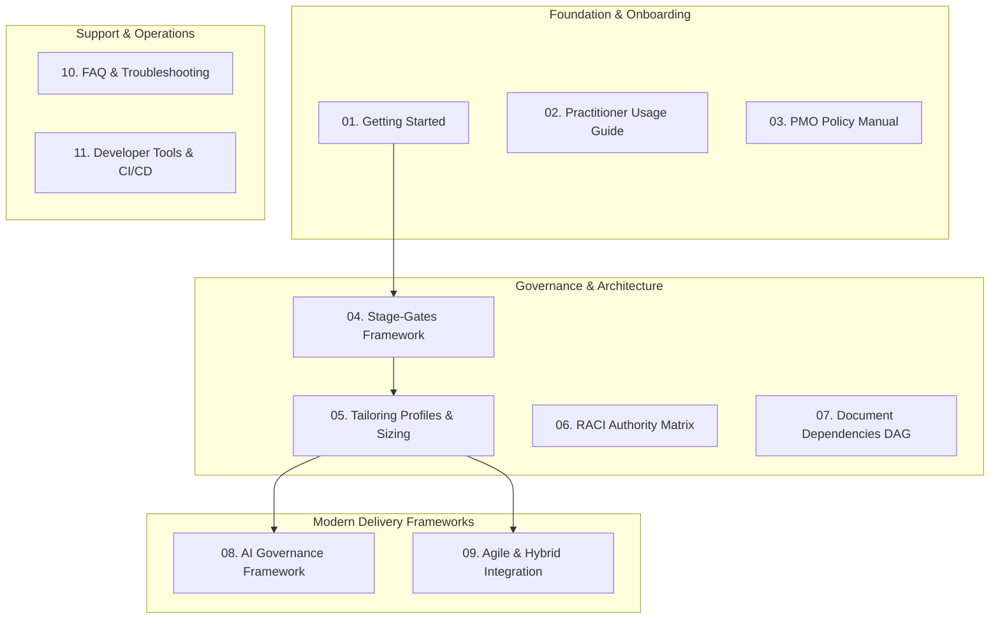

<!--
---
type: Overview
token_pointer: /_tokens/docs/README.npy
token_count: 1243
tokenizer_model_id: tiktoken/o200k_base
created_at: '2026-10-06T16:05:28.037976+00:00'
---
-->

  <picture>
    <source media="(prefers-color-scheme: dark)" srcset="img/logo-dark.jpeg">
    <source media="(prefers-color-scheme: light)" srcset="img/logo-white.jpeg">
    
  </picture>

# 📚 Tasleemat Knowledge Base & Governance Documentation
**Version:** 2.6.2  
**Standard Alignment:** PMI PMBOK® 6th, 7th & 8th Editions • NIST AI RMF • SDAIA AI Ethics • ISO 21500  

---

## 🧭 Master Documentation Directory

Welcome to the central documentation portal of **Tasleemat (تسليمات)**. Below is the curated index of practical guides, governance manuals, and integration frameworks designed to empower project practitioners, PMO directors, agile teams, and enterprise auditors.

---

## 📑 Core Documentation Index

| Guide # | Document Title | Language | Description & Key Value |
| :---: | :--- | :---: | :--- |
| **01** | [**Getting Started**](en/01_getting_started.md) | 🇬🇧 EN | Quick-start lifecycle overview, onboarding steps from Day 1 to Day 30. |
| **02** | [**Practitioner Usage Guide**](en/02_usage_guide.md) | 🇬🇧 EN | Field syntax, Markdown conventions, JSON/CSV integration, and authoring guidelines. |
| **03** | [**PMO Policy Manual**](en/03_pmo_policy_manual.md) | 🇬🇧 EN | Enterprise governance mandates, change control thresholds, and audit rules. |
| **04** | [**Stage-Gates Framework**](en/04_stage_gates_and_governance.md) | 🇬🇧 EN | 6 Stage-Gates (Gate 0 to 5), entry/exit criteria, and executive review gates. |
| **05** | [**Tailoring Profiles**](en/05_tailoring_profiles.md) | 🇬🇧 EN | 3 sizing tiers (Tier 1 Mega, Tier 2 Standard, Tier 3 Lean) and methodology packs. |
| **06** | [**RACI Authority Matrix**](en/06_raci_authority_matrix.md) | 🇬🇧 EN | Full 114-form governance matrix defining author and approval sign-off roles. |
| **07** | [**Document Dependencies**](en/07_document_dependencies.md) | 🇬🇧 EN | Directed acyclic graph (DAG) mapping upstream inputs to downstream outputs. |
| **08** | [**AI Governance Framework**](en/08_ai_governance_framework.md) | 🇬🇧 EN | AI Canvas, Model Cards, Ethics, NIST AI RMF, and MLOps monitoring. |
| **09** | [**Agile & Hybrid Integration**](en/09_agile_hybrid_integration.md) | 🇬🇧 EN | Mapping forms to Scrum/Kanban ceremonies, Flow metrics, and DoD/DoR. |
| **10** | [**FAQ & Troubleshooting**](en/10_faq_and_troubleshooting.md) | 🇬🇧 EN | 25+ practical answers to governance hurdles, sizing disputes, and EVM issues. |
| **11** | [**Tools & Automation Guide**](en/11_tools_and_automation.md) | 🇬🇧 EN | Python validation suite, CI/CD pipelines, JIRA/Azure DevOps integration. |
| **12** | [**Open Knowledge Framework (OKF)**](en/12_open_knowledge_framework.md) | 🇬🇧 EN | Frictionless Data Package standard, FAIR data principles, datapackage.json. |
| **LEX** | [**Master Lexicon & Catalog**](LEXICON.md) | 🌐 Bi | Master bilingual terminology glossary and cross-reference table. |

---

## 👔 Track A: Managerial & Governance Series (Executive Register)

Dedicated high-level playbooks for C-Suite leadership, Project Sponsors, and PMO Directors:

| Document Title | Language | Executive Focus |
| :--- | :---: | :--- |
| [**Executive Stage-Gates Playbook**](en/managerial_stage_gates_playbook.md) | 🇬🇧 EN / 🇸🇦 [AR](ar/managerial_stage_gates_playbook.md) | The 6 decision gates, Go / Conditional / No-Go criteria, and sign-off authorities. |
| [**Portfolio Sizing & Tailoring Guide**](en/managerial_tailoring_and_sizing.md) | 🇬🇧 EN / 🇸🇦 [AR](ar/managerial_tailoring_and_sizing.md) | 3 Sizing Tiers (Mega, Standard, Lean), 5 Methodology Packs, and fiscal thresholds. |
| [**Executive AI Risk & Ethics Guide**](en/managerial_ai_risk_and_ethics.md) | 🇬🇧 EN / 🇸🇦 [AR](ar/managerial_ai_risk_and_ethics.md) | SDAIA AI Ethics, NIST AI RMF, ISO 42001, and Human-in-the-Loop (HITL) policies. |
| [**Audit Readiness & Benefits Realization**](en/managerial_audit_and_benefits.md) | 🇬🇧 EN / 🇸🇦 [AR](ar/managerial_audit_and_benefits.md) | CCB variance thresholds, Operational Transition to BAU, and PIR ROI tracking. |

---

## 💻 Track B: Technical Engineering & Multi-Agent Series (Code & API Register)

Architectural blueprints and code references for AI Engineers, DevOps, and Agent Developers:

| Document Title | Language | Technical Focus |
| :--- | :---: | :--- |
| [**LLM Synthesis & Prompt Grounding**](en/tech_llm_synthesis_and_prompting.md) | 🇬🇧 EN / 🇸🇦 [AR](ar/tech_llm_synthesis_and_prompting.md) | In-context grounding, prompt templates, few-shot examples, and `tasleemat.ai.AIClient`. |
| [**Agentic PMO & Multi-Agent Orchestration**](en/tech_agentic_and_multiagent_orchestration.md) | 🇬🇧 EN / 🇸🇦 [AR](ar/tech_agentic_and_multiagent_orchestration.md) | MCP server integration, multi-agent blueprints (CrewAI, LangGraph), and swarm roles. |
| [**CLI Automation & DevOps Pipelines**](en/tech_cli_and_devops_automation.md) | 🇬🇧 EN / 🇸🇦 [AR](ar/tech_cli_and_devops_automation.md) | Non-interactive CLI flags, batch HTML/PDF export, and GitHub Actions recipes. |
| [**Schemas, RFC Formats & Self-Correction**](en/tech_schemas_and_validation_loops.md) | 🇬🇧 EN / 🇸🇦 [AR](ar/tech_schemas_and_validation_loops.md) | Draft 2020-12 companion schemas, RFC format validation, and automated error feedback loops. |
| [**Autonomous AI Agent Navigation Protocol**](AGENT_NAVIGATION.md) | 🤖 Spec | Machine-readable protocol: JSON-RPC 2.0 tool definitions, DAG traversal, and token pointers. |

---

## 👤 Persona-Based Reading Pathways

* **For C-Level Executives & Project Sponsors:** Read [**Executive Stage-Gates Playbook**](en/managerial_stage_gates_playbook.md) → [**Portfolio Sizing & Tailoring Guide**](en/managerial_tailoring_and_sizing.md) → [**Executive AI Risk & Ethics**](en/managerial_ai_risk_and_ethics.md).
* **For PMO Directors & Governance Leads:** Read [**Audit Readiness & Benefits**](en/managerial_audit_and_benefits.md) → [`03_pmo_policy_manual.md`](en/03_pmo_policy_manual.md) → [`06_raci_authority_matrix.md`](en/06_raci_authority_matrix.md).
* **For AI Engineers & Agent System Architects:** Read [**Agentic PMO & Multi-Agent Orchestration**](en/tech_agentic_and_multiagent_orchestration.md) → [**Schemas & Self-Correction Loops**](en/tech_schemas_and_validation_loops.md) → [**MCP Integration Guide**](MCP_INTEGRATION.md).
* **For DevOps Engineers & Automation Specialists:** Explore [**CLI Automation & DevOps Pipelines**](en/tech_cli_and_devops_automation.md) → [`11_tools_and_automation.md`](en/11_tools_and_automation.md).
* **For Autonomous AI Agents & LLM Run-Times:** Consume [**Agent Navigation Protocol**](AGENT_NAVIGATION.md) directly.
