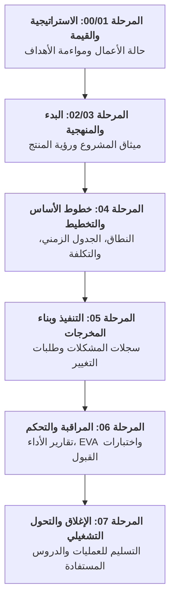

  🌐 <strong>اللغة:</strong> الدليل باللغة العربية
  

    <a class="lang-switch-btn github-btn" href="https://github.com/fakhruldeen/Tasleemat/blob/main/docs/ar/07_document_dependencies.md" target="_blank" rel="noopener noreferrer">🐙 عرض على GitHub ↗</a>
    <a class="lang-switch-btn" href="../en/07_document_dependencies.html">🇬🇧 Switch to English Version (النسخة الإنجليزية) ←</a>
  

---
type: Guide
token_pointer: /_tokens/docs/ar/07_document_dependencies.npy
token_count: 8766
tokenizer_model_id: tiktoken/o200k_base
created_at: '2026-10-06T16:05:28.219181+00:00'
---

  <picture>
    <source media="(prefers-color-scheme: dark)" srcset="../img/logo-dark.jpeg">
    <source media="(prefers-color-scheme: light)" srcset="../img/logo-white.jpeg">
    
  </picture>

# 🔗 شبكة اعتماديات الوثائق وهندسة دورة الحياة في تسليمات
**مرجع الوثيقة:** `TASLEEMAT-DOC-DEPENDENCIES-AR-v2.0`  
**المعايير:** متوافق مع معايير معهد إدارة المشاريع العالمي PMI PMBOK®

---

## 🎯 نظرة عامة تنفيذية

في **نظام تشغيل مكاتب إدارة المشاريع «تسليمات»**، لا توجد وثيقة معزولة. تعمل كل استمارة كعقدة مترابطة في **شبكة اعتماديات موجهة (DAG)** تربط المدخلات الاستراتيجية، وخطوط الأساس المعتمدة، وسجلات المتابعة التشغيلية، وتقارير الرقابة والتحكم، حتى أصول الإغلاق المؤسسي:

---

## 📋 جدول مصفوفة الاعتماديات الشاملة لكافة النماذج الـ 114

| الرمز | اسم المخرج الإداري | بوابة الحوكمة / المرحلة | المدخلات الأساسية (السوابق) | المخرجات الأساسية (اللواحق) |
| :---: | :--- | :--- | :--- | :--- |
| **`PMO-00.01`** | خارطة طريق المحفظة | بوابة 0: المواءمة الاستراتيجية | `الأهداف الاستراتيجية والتكليفات المؤسسية` | `خارطة طريق المحفظة، مواثيق البرامج` |
| **`PMO-00.02`** | ميثاق البرنامج | بوابة 0: المواءمة الاستراتيجية | `الأهداف الاستراتيجية والتكليفات المؤسسية` | `خارطة طريق المحفظة، مواثيق البرامج` |
| **`PMO-00.03`** | سجل الاعتماديات المتبادلة | بوابة 0: المواءمة الاستراتيجية | `الأهداف الاستراتيجية والتكليفات المؤسسية` | `خارطة طريق المحفظة، مواثيق البرامج` |
| **`PMO-00.04`** | مصفوفة سعة الموارد | بوابة 0: المواءمة الاستراتيجية | `الأهداف الاستراتيجية والتكليفات المؤسسية` | `خارطة طريق المحفظة، مواثيق البرامج` |
| **`PMO-00.05`** | تقييم نضج مكتب إدارة المشاريع | بوابة 0: المواءمة الاستراتيجية | `الأهداف الاستراتيجية والتكليفات المؤسسية` | `خارطة طريق المحفظة، مواثيق البرامج` |
| **`PMO-00.06`** | مصفوفة مواءمة الأهداف والنتائج الرئيسية | بوابة 0: المواءمة الاستراتيجية | `الأهداف الاستراتيجية والتكليفات المؤسسية` | `خارطة طريق المحفظة، مواثيق البرامج` |
| **`PMO-01.01`** | دراسة الجدوى | بوابة 0: الفكرة والجدوى | `الأهداف الاستراتيجية، بيان المشكلة` | `حالة الأعمال المعتمدة، خطة إدارة المنافع` |
| **`PMO-01.02`** | خطة إدارة الفوائد | بوابة 0: الفكرة والجدوى | `الأهداف الاستراتيجية، بيان المشكلة` | `حالة الأعمال المعتمدة، خطة إدارة المنافع` |
| **`PMO-01.03`** | سجل تحقيق القيمة | بوابة 0: الفكرة والجدوى | `الأهداف الاستراتيجية، بيان المشكلة` | `حالة الأعمال المعتمدة، خطة إدارة المنافع` |
| **`PMO-01.04`** | تقرير تحليل الفجوات | بوابة 0: الفكرة والجدوى | `الأهداف الاستراتيجية، بيان المشكلة` | `حالة الأعمال المعتمدة، خطة إدارة المنافع` |
| **`PMO-02.01`** | خطة التخصيص | بوابة 1: التكييف والمنهجية | `دراسة الأعمال والخيارات الاستراتيجية` | `خطة التكييف، ضوابط حوكمة الذكاء الاصطناعي` |
| **`PMO-02.02`** | خطة حوكمة الذكاء الاصطناعي | بوابة 1: التكييف والمنهجية | `دراسة الأعمال والخيارات الاستراتيجية` | `خطة التكييف، ضوابط حوكمة الذكاء الاصطناعي` |
| **`PMO-02.03`** | تقييم جاهزية الذكاء الاصطناعي | بوابة 1: التكييف والمنهجية | `دراسة الأعمال والخيارات الاستراتيجية` | `خطة التكييف، ضوابط حوكمة الذكاء الاصطناعي` |
| **`PMO-02.04`** | نموذج حالة استخدام الذكاء الاصطناعي | بوابة 1: التكييف والمنهجية | `دراسة الأعمال والخيارات الاستراتيجية` | `خطة التكييف، ضوابط حوكمة الذكاء الاصطناعي` |
| **`PMO-02.05`** | بطاقة نموذج الذكاء الاصطناعي | بوابة 1: التكييف والمنهجية | `دراسة الأعمال والخيارات الاستراتيجية` | `خطة التكييف، ضوابط حوكمة الذكاء الاصطناعي` |
| **`PMO-02.06`** | تقييم خصوصية البيانات وأخلاقياتها | بوابة 1: التكييف والمنهجية | `دراسة الأعمال والخيارات الاستراتيجية` | `خطة التكييف، ضوابط حوكمة الذكاء الاصطناعي` |
| **`PMO-03.01`** | ميثاق المشروع | بوابة 1: البدء والاعتماد | `حالة الأعمال المعتمدة، خطة التكييف` | `ميثاق المشروع المعتمد، سجل المعنيين` |
| **`PMO-03.02`** | بيان رؤية المنتج | بوابة 1: البدء والاعتماد | `حالة الأعمال المعتمدة، خطة التكييف` | `ميثاق المشروع المعتمد، سجل المعنيين` |
| **`PMO-03.03`** | سجل الافتراضات | بوابة 1: البدء والاعتماد | `حالة الأعمال المعتمدة، خطة التكييف` | `ميثاق المشروع المعتمد، سجل المعنيين` |
| **`PMO-03.04`** | سجل المعنيين | بوابة 1: البدء والاعتماد | `حالة الأعمال المعتمدة، خطة التكييف` | `ميثاق المشروع المعتمد، سجل المعنيين` |
| **`PMO-03.05`** | تحليل المعنيين | بوابة 1: البدء والاعتماد | `حالة الأعمال المعتمدة، خطة التكييف` | `ميثاق المشروع المعتمد، سجل المعنيين` |
| **`PMO-04.01.01`** | خطة إدارة المشروع | بوابة 2: خط الأساس للتخطيط | `ميثاق المشروع، سجل المعنيين والافتراضات` | `خطوط الأساس المعتمدة (النطاق، الجدول، التكلفة)` |
| **`PMO-04.01.02`** | خطة إدارة التغيير | بوابة 2: خط الأساس للتخطيط | `ميثاق المشروع، سجل المعنيين والافتراضات` | `خطوط الأساس المعتمدة (النطاق، الجدول، التكلفة)` |
| **`PMO-04.01.03`** | خارطة طريق المشروع | بوابة 2: خط الأساس للتخطيط | `ميثاق المشروع، سجل المعنيين والافتراضات` | `خطوط الأساس المعتمدة (النطاق، الجدول، التكلفة)` |
| **`PMO-04.02.01`** | خطة إدارة النطاق | بوابة 2: خط الأساس للتخطيط | `ميثاق المشروع، سجل المعنيين والافتراضات` | `خطوط الأساس المعتمدة (النطاق، الجدول، التكلفة)` |
| **`PMO-04.02.02`** | خطة إدارة المتطلبات | بوابة 2: خط الأساس للتخطيط | `ميثاق المشروع، سجل المعنيين والافتراضات` | `خطوط الأساس المعتمدة (النطاق، الجدول، التكلفة)` |
| **`PMO-04.02.03`** | وثائق المتطلبات | بوابة 2: خط الأساس للتخطيط | `ميثاق المشروع، سجل المعنيين والافتراضات` | `خطوط الأساس المعتمدة (النطاق، الجدول، التكلفة)` |
| **`PMO-04.02.04`** | مصفوفة تتبع المتطلبات | بوابة 2: خط الأساس للتخطيط | `ميثاق المشروع، سجل المعنيين والافتراضات` | `خطوط الأساس المعتمدة (النطاق، الجدول، التكلفة)` |
| **`PMO-04.02.05`** | بيان نطاق المشروع | بوابة 2: خط الأساس للتخطيط | `ميثاق المشروع، سجل المعنيين والافتراضات` | `خطوط الأساس المعتمدة (النطاق، الجدول، التكلفة)` |
| **`PMO-04.02.06`** | هيكل تجزئة العمل | بوابة 2: خط الأساس للتخطيط | `ميثاق المشروع، سجل المعنيين والافتراضات` | `خطوط الأساس المعتمدة (النطاق، الجدول، التكلفة)` |
| **`PMO-04.02.07`** | قاموس هيكل تجزئة العمل | بوابة 2: خط الأساس للتخطيط | `ميثاق المشروع، سجل المعنيين والافتراضات` | `خطوط الأساس المعتمدة (النطاق، الجدول، التكلفة)` |
| **`PMO-04.02.08`** | قائمة تراكم المنتج | بوابة 2: خط الأساس للتخطيط | `ميثاق المشروع، سجل المعنيين والافتراضات` | `خطوط الأساس المعتمدة (النطاق، الجدول، التكلفة)` |
| **`PMO-04.02.09`** | نموذج تخطيط قصص المستخدم | بوابة 2: خط الأساس للتخطيط | `ميثاق المشروع، سجل المعنيين والافتراضات` | `خطوط الأساس المعتمدة (النطاق، الجدول، التكلفة)` |
| **`PMO-04.03.01`** | خطة إدارة الجدول الزمني | بوابة 2: خط الأساس للتخطيط | `ميثاق المشروع، سجل المعنيين والافتراضات` | `خطوط الأساس المعتمدة (النطاق، الجدول، التكلفة)` |
| **`PMO-04.03.02`** | قائمة الأنشطة | بوابة 2: خط الأساس للتخطيط | `ميثاق المشروع، سجل المعنيين والافتراضات` | `خطوط الأساس المعتمدة (النطاق، الجدول، التكلفة)` |
| **`PMO-04.03.03`** | سمات النشاط | بوابة 2: خط الأساس للتخطيط | `ميثاق المشروع، سجل المعنيين والافتراضات` | `خطوط الأساس المعتمدة (النطاق، الجدول، التكلفة)` |
| **`PMO-04.03.04`** | قائمة المعالم | بوابة 2: خط الأساس للتخطيط | `ميثاق المشروع، سجل المعنيين والافتراضات` | `خطوط الأساس المعتمدة (النطاق، الجدول، التكلفة)` |
| **`PMO-04.03.05`** | المخطط الشبكي | بوابة 2: خط الأساس للتخطيط | `ميثاق المشروع، سجل المعنيين والافتراضات` | `خطوط الأساس المعتمدة (النطاق، الجدول، التكلفة)` |
| **`PMO-04.03.06`** | تقديرات المدة | بوابة 2: خط الأساس للتخطيط | `ميثاق المشروع، سجل المعنيين والافتراضات` | `خطوط الأساس المعتمدة (النطاق، الجدول، التكلفة)` |
| **`PMO-04.03.07`** | ورقة عمل تقدير المدة | بوابة 2: خط الأساس للتخطيط | `ميثاق المشروع، سجل المعنيين والافتراضات` | `خطوط الأساس المعتمدة (النطاق، الجدول، التكلفة)` |
| **`PMO-04.03.08`** | الجدول الزمني للمشروع | بوابة 2: خط الأساس للتخطيط | `ميثاق المشروع، سجل المعنيين والافتراضات` | `خطوط الأساس المعتمدة (النطاق، الجدول، التكلفة)` |
| **`PMO-04.03.09`** | خطة الإصدار | بوابة 2: خط الأساس للتخطيط | `ميثاق المشروع، سجل المعنيين والافتراضات` | `خطوط الأساس المعتمدة (النطاق، الجدول، التكلفة)` |
| **`PMO-04.03.10`** | سجل تخطيط دورة تطوير | بوابة 2: خط الأساس للتخطيط | `ميثاق المشروع، سجل المعنيين والافتراضات` | `خطوط الأساس المعتمدة (النطاق، الجدول، التكلفة)` |
| **`PMO-04.04.01`** | خطة إدارة التكلفة | بوابة 2: خط الأساس للتخطيط | `ميثاق المشروع، سجل المعنيين والافتراضات` | `خطوط الأساس المعتمدة (النطاق، الجدول، التكلفة)` |
| **`PMO-04.04.02`** | تقديرات التكلفة | بوابة 2: خط الأساس للتخطيط | `ميثاق المشروع، سجل المعنيين والافتراضات` | `خطوط الأساس المعتمدة (النطاق، الجدول، التكلفة)` |
| **`PMO-04.04.03`** | ورقة عمل تقدير التكلفة | بوابة 2: خط الأساس للتخطيط | `ميثاق المشروع، سجل المعنيين والافتراضات` | `خطوط الأساس المعتمدة (النطاق، الجدول، التكلفة)` |
| **`PMO-04.04.04`** | الخط المرجعي للتكلفة | بوابة 2: خط الأساس للتخطيط | `ميثاق المشروع، سجل المعنيين والافتراضات` | `خطوط الأساس المعتمدة (النطاق، الجدول، التكلفة)` |
| **`PMO-04.05.01`** | خطة إدارة الجودة | بوابة 2: خط الأساس للتخطيط | `ميثاق المشروع، سجل المعنيين والافتراضات` | `خطوط الأساس المعتمدة (النطاق، الجدول، التكلفة)` |
| **`PMO-04.05.02`** | مقاييس الجودة | بوابة 2: خط الأساس للتخطيط | `ميثاق المشروع، سجل المعنيين والافتراضات` | `خطوط الأساس المعتمدة (النطاق، الجدول، التكلفة)` |
| **`PMO-04.05.03`** | تعريف الجاهزية والاكتمال | بوابة 2: خط الأساس للتخطيط | `ميثاق المشروع، سجل المعنيين والافتراضات` | `خطوط الأساس المعتمدة (النطاق، الجدول، التكلفة)` |
| **`PMO-04.06.01`** | خطة إدارة الموارد | بوابة 2: خط الأساس للتخطيط | `ميثاق المشروع، سجل المعنيين والافتراضات` | `خطوط الأساس المعتمدة (النطاق، الجدول، التكلفة)` |
| **`PMO-04.06.02`** | متطلبات الموارد | بوابة 2: خط الأساس للتخطيط | `ميثاق المشروع، سجل المعنيين والافتراضات` | `خطوط الأساس المعتمدة (النطاق، الجدول، التكلفة)` |
| **`PMO-04.06.03`** | هيكل تجزئة الموارد | بوابة 2: خط الأساس للتخطيط | `ميثاق المشروع، سجل المعنيين والافتراضات` | `خطوط الأساس المعتمدة (النطاق، الجدول، التكلفة)` |
| **`PMO-04.06.04`** | مصفوفة تعيين المسؤوليات | بوابة 2: خط الأساس للتخطيط | `ميثاق المشروع، سجل المعنيين والافتراضات` | `خطوط الأساس المعتمدة (النطاق، الجدول، التكلفة)` |
| **`PMO-04.06.05`** | ميثاق الفريق | بوابة 2: خط الأساس للتخطيط | `ميثاق المشروع، سجل المعنيين والافتراضات` | `خطوط الأساس المعتمدة (النطاق، الجدول، التكلفة)` |
| **`PMO-04.06.06`** | مؤشر الأمان النفسي وصحة الفريق | بوابة 2: خط الأساس للتخطيط | `ميثاق المشروع، سجل المعنيين والافتراضات` | `خطوط الأساس المعتمدة (النطاق، الجدول، التكلفة)` |
| **`PMO-04.07.01`** | خطة إدارة الاتصالات | بوابة 2: خط الأساس للتخطيط | `ميثاق المشروع، سجل المعنيين والافتراضات` | `خطوط الأساس المعتمدة (النطاق، الجدول، التكلفة)` |
| **`PMO-04.07.02`** | مصفوفة توزيع وقنوات التواصل | بوابة 2: خط الأساس للتخطيط | `ميثاق المشروع، سجل المعنيين والافتراضات` | `خطوط الأساس المعتمدة (النطاق، الجدول، التكلفة)` |
| **`PMO-04.08.01`** | خطة إدارة المخاطر | بوابة 2: خط الأساس للتخطيط | `ميثاق المشروع، سجل المعنيين والافتراضات` | `خطوط الأساس المعتمدة (النطاق، الجدول، التكلفة)` |
| **`PMO-04.08.02`** | سجل المخاطر | بوابة 2: خط الأساس للتخطيط | `ميثاق المشروع، سجل المعنيين والافتراضات` | `خطوط الأساس المعتمدة (النطاق، الجدول، التكلفة)` |
| **`PMO-04.08.03`** | تقييم الاحتمالية والأثر | بوابة 2: خط الأساس للتخطيط | `ميثاق المشروع، سجل المعنيين والافتراضات` | `خطوط الأساس المعتمدة (النطاق، الجدول، التكلفة)` |
| **`PMO-04.08.04`** | مصفوفة الاحتمالية والأثر | بوابة 2: خط الأساس للتخطيط | `ميثاق المشروع، سجل المعنيين والافتراضات` | `خطوط الأساس المعتمدة (النطاق، الجدول، التكلفة)` |
| **`PMO-04.08.05`** | ورقة بيانات المخاطر | بوابة 2: خط الأساس للتخطيط | `ميثاق المشروع، سجل المعنيين والافتراضات` | `خطوط الأساس المعتمدة (النطاق، الجدول، التكلفة)` |
| **`PMO-04.08.06`** | تقرير المخاطر | بوابة 2: خط الأساس للتخطيط | `ميثاق المشروع، سجل المعنيين والافتراضات` | `خطوط الأساس المعتمدة (النطاق، الجدول، التكلفة)` |
| **`PMO-04.08.07`** | خطة عمل التخفيف من المخاطر | بوابة 2: خط الأساس للتخطيط | `ميثاق المشروع، سجل المعنيين والافتراضات` | `خطوط الأساس المعتمدة (النطاق، الجدول، التكلفة)` |
| **`PMO-04.09.01`** | خطة إدارة المشتريات | بوابة 2: خط الأساس للتخطيط | `ميثاق المشروع، سجل المعنيين والافتراضات` | `خطوط الأساس المعتمدة (النطاق، الجدول، التكلفة)` |
| **`PMO-04.09.02`** | استراتيجية المشتريات | بوابة 2: خط الأساس للتخطيط | `ميثاق المشروع، سجل المعنيين والافتراضات` | `خطوط الأساس المعتمدة (النطاق، الجدول، التكلفة)` |
| **`PMO-04.09.03`** | معايير اختيار المصدر | بوابة 2: خط الأساس للتخطيط | `ميثاق المشروع، سجل المعنيين والافتراضات` | `خطوط الأساس المعتمدة (النطاق، الجدول، التكلفة)` |
| **`PMO-04.09.04`** | بيان العمل | بوابة 2: خط الأساس للتخطيط | `ميثاق المشروع، سجل المعنيين والافتراضات` | `خطوط الأساس المعتمدة (النطاق، الجدول، التكلفة)` |
| **`PMO-04.09.05`** | طلب تقديم العروض | بوابة 2: خط الأساس للتخطيط | `ميثاق المشروع، سجل المعنيين والافتراضات` | `خطوط الأساس المعتمدة (النطاق، الجدول، التكلفة)` |
| **`PMO-04.10.01`** | خطة إشراك المعنيين | بوابة 2: خط الأساس للتخطيط | `ميثاق المشروع، سجل المعنيين والافتراضات` | `خطوط الأساس المعتمدة (النطاق، الجدول، التكلفة)` |
| **`PMO-04.10.02`** | مصفوفة تقييم انخراط المعنيين | بوابة 2: خط الأساس للتخطيط | `ميثاق المشروع، سجل المعنيين والافتراضات` | `خطوط الأساس المعتمدة (النطاق، الجدول، التكلفة)` |
| **`PMO-04.11.01`** | استراتيجية وخطة إدارة التغيير المؤسسي | بوابة 2: خط الأساس للتخطيط | `ميثاق المشروع، سجل المعنيين والافتراضات` | `خطوط الأساس المعتمدة (النطاق، الجدول، التكلفة)` |
| **`PMO-04.11.02`** | خطة وسجل التدريب | بوابة 2: خط الأساس للتخطيط | `ميثاق المشروع، سجل المعنيين والافتراضات` | `خطوط الأساس المعتمدة (النطاق، الجدول، التكلفة)` |
| **`PMO-04.12.01`** | خطة إدارة الاستدامة والمعايير البيئية والاجتماعية والحوكمة | بوابة 2: خط الأساس للتخطيط | `ميثاق المشروع، سجل المعنيين والافتراضات` | `خطوط الأساس المعتمدة (النطاق، الجدول، التكلفة)` |
| **`PMO-04.13.01`** | خطة أمن المعلومات والامتثال التنظيمي | بوابة 2: خط الأساس للتخطيط | `ميثاق المشروع، سجل المعنيين والافتراضات` | `خطوط الأساس المعتمدة (النطاق، الجدول، التكلفة)` |
| **`PMO-05.01`** | سجل المشكلات | بوابة 3: التنفيذ والتنسيق | `الخطط المرجعية، حزم العمل المعتمدة` | `المخرجات المنجزة، سجلات المتابعة والتنسيق` |
| **`PMO-05.02`** | سجل القرارات | بوابة 3: التنفيذ والتنسيق | `الخطط المرجعية، حزم العمل المعتمدة` | `المخرجات المنجزة، سجلات المتابعة والتنسيق` |
| **`PMO-05.03`** | طلب تغيير | بوابة 3: التنفيذ والتنسيق | `الخطط المرجعية، حزم العمل المعتمدة` | `المخرجات المنجزة، سجلات المتابعة والتنسيق` |
| **`PMO-05.04`** | سجل التغييرات | بوابة 3: التنفيذ والتنسيق | `الخطط المرجعية، حزم العمل المعتمدة` | `المخرجات المنجزة، سجلات المتابعة والتنسيق` |
| **`PMO-05.05`** | تقرير تدقيق الجودة | بوابة 3: التنفيذ والتنسيق | `الخطط المرجعية، حزم العمل المعتمدة` | `المخرجات المنجزة، سجلات المتابعة والتنسيق` |
| **`PMO-05.06`** | تقييم أداء الفريق | بوابة 3: التنفيذ والتنسيق | `الخطط المرجعية، حزم العمل المعتمدة` | `المخرجات المنجزة، سجلات المتابعة والتنسيق` |
| **`PMO-05.07`** | سجل الدروس المستفادة | بوابة 3: التنفيذ والتنسيق | `الخطط المرجعية، حزم العمل المعتمدة` | `المخرجات المنجزة، سجلات المتابعة والتنسيق` |
| **`PMO-05.08`** | مراجعة المرحلة | بوابة 3: التنفيذ والتنسيق | `الخطط المرجعية، حزم العمل المعتمدة` | `المخرجات المنجزة، سجلات المتابعة والتنسيق` |
| **`PMO-05.09`** | سجل مكتبة الأوامر | بوابة 3: التنفيذ والتنسيق | `الخطط المرجعية، حزم العمل المعتمدة` | `المخرجات المنجزة، سجلات المتابعة والتنسيق` |
| **`PMO-05.10`** | سجل العوائق | بوابة 3: التنفيذ والتنسيق | `الخطط المرجعية، حزم العمل المعتمدة` | `المخرجات المنجزة، سجلات المتابعة والتنسيق` |
| **`PMO-05.11`** | محضر الاجتماع | بوابة 3: التنفيذ والتنسيق | `الخطط المرجعية، حزم العمل المعتمدة` | `المخرجات المنجزة، سجلات المتابعة والتنسيق` |
| **`PMO-05.12`** | قائمة التحقق لتهيئة فريق العمل | بوابة 3: التنفيذ والتنسيق | `الخطط المرجعية، حزم العمل المعتمدة` | `المخرجات المنجزة، سجلات المتابعة والتنسيق` |
| **`PMO-05.13`** | سجل بنود العمل والتكليفات | بوابة 3: التنفيذ والتنسيق | `الخطط المرجعية، حزم العمل المعتمدة` | `المخرجات المنجزة، سجلات المتابعة والتنسيق` |
| **`PMO-05.14`** | سجل التنسيق بين مسارات العمل واللقاءات اليومية | بوابة 3: التنفيذ والتنسيق | `الخطط المرجعية، حزم العمل المعتمدة` | `المخرجات المنجزة، سجلات المتابعة والتنسيق` |
| **`PMO-05.15`** | قائمة فحص وتثبت المخرجات الفنية | بوابة 3: التنفيذ والتنسيق | `الخطط المرجعية، حزم العمل المعتمدة` | `المخرجات المنجزة، سجلات المتابعة والتنسيق` |
| **`PMO-06.01`** | تقرير حالة المشروع | بوابة 3: المتابعة والتحكم | `بيانات أداء العمل، المخرجات الميدانية` | `تقارير الحالة، مقاييس EVM، نماذج القبول` |
| **`PMO-06.02`** | تقرير حالة عضو الفريق | بوابة 3: المتابعة والتحكم | `بيانات أداء العمل، المخرجات الميدانية` | `تقارير الحالة، مقاييس EVM، نماذج القبول` |
| **`PMO-06.03`** | تقرير حالة المقاول | بوابة 3: المتابعة والتحكم | `بيانات أداء العمل، المخرجات الميدانية` | `تقارير الحالة، مقاييس EVM، نماذج القبول` |
| **`PMO-06.04`** | تحليل التباين | بوابة 3: المتابعة والتحكم | `بيانات أداء العمل، المخرجات الميدانية` | `تقارير الحالة، مقاييس EVM، نماذج القبول` |
| **`PMO-06.05`** | تقرير تحليل القيمة المكتسبة | بوابة 3: المتابعة والتحكم | `بيانات أداء العمل، المخرجات الميدانية` | `تقارير الحالة، مقاييس EVM، نماذج القبول` |
| **`PMO-06.06`** | تقرير تدقيق المخاطر | بوابة 3: المتابعة والتحكم | `بيانات أداء العمل، المخرجات الميدانية` | `تقارير الحالة، مقاييس EVM، نماذج القبول` |
| **`PMO-06.07`** | تقرير تدقيق المشتريات | بوابة 3: المتابعة والتحكم | `بيانات أداء العمل، المخرجات الميدانية` | `تقارير الحالة، مقاييس EVM، نماذج القبول` |
| **`PMO-06.08`** | نموذج قبول المنتج | بوابة 3: المتابعة والتحكم | `بيانات أداء العمل، المخرجات الميدانية` | `تقارير الحالة، مقاييس EVM، نماذج القبول` |
| **`PMO-06.09`** | بطاقة أداء المورد | بوابة 3: المتابعة والتحكم | `بيانات أداء العمل، المخرجات الميدانية` | `تقارير الحالة، مقاييس EVM، نماذج القبول` |
| **`PMO-06.10`** | نموذج اعتماد اختبار قبول المستخدم | بوابة 3: المتابعة والتحكم | `بيانات أداء العمل، المخرجات الميدانية` | `تقارير الحالة، مقاييس EVM، نماذج القبول` |
| **`PMO-06.11`** | مصفوفة الفحص الصحي للمشروع | بوابة 3: المتابعة والتحكم | `بيانات أداء العمل، المخرجات الميدانية` | `تقارير الحالة، مقاييس EVM، نماذج القبول` |
| **`PMO-06.12`** | لوحة مقاييس التدفق وتدفق القيمة | بوابة 3: المتابعة والتحكم | `بيانات أداء العمل، المخرجات الميدانية` | `تقارير الحالة، مقاييس EVM، نماذج القبول` |
| **`PMO-06.13`** | لوحة معلومات اللجنة التوجيهية التنفيذية | بوابة 3: المتابعة والتحكم | `بيانات أداء العمل، المخرجات الميدانية` | `تقارير الحالة، مقاييس EVM، نماذج القبول` |
| **`PMO-06.14`** | تحليل اتجاهات المعالم والانزلاق الزمني | بوابة 3: المتابعة والتحكم | `بيانات أداء العمل، المخرجات الميدانية` | `تقارير الحالة، مقاييس EVM، نماذج القبول` |
| **`PMO-06.15`** | سجل تتبع العيوب والملاحظات | بوابة 3: المتابعة والتحكم | `بيانات أداء العمل، المخرجات الميدانية` | `تقارير الحالة، مقاييس EVM، نماذج القبول` |
| **`PMO-06.16`** | تقرير تصعيد المخاطر والمشكلات الحرجة | بوابة 3: المتابعة والتحكم | `بيانات أداء العمل، المخرجات الميدانية` | `تقارير الحالة، مقاييس EVM، نماذج القبول` |
| **`PMO-07.01`** | ملخص الدروس المستفادة | بوابة 4/5: التسليم والإغلاق | `المخرجات المعتمدة، محاضر الاستلام الفني` | `العقود المغلقة، محاضر التسليم التشغيلي، الدروس المستفادة` |
| **`PMO-07.02`** | تقرير إغلاق العقد | بوابة 4/5: التسليم والإغلاق | `المخرجات المعتمدة، محاضر الاستلام الفني` | `العقود المغلقة، محاضر التسليم التشغيلي، الدروس المستفادة` |
| **`PMO-07.03`** | تقرير إغلاق المشروع أو المرحلة | بوابة 4/5: التسليم والإغلاق | `المخرجات المعتمدة، محاضر الاستلام الفني` | `العقود المغلقة، محاضر التسليم التشغيلي، الدروس المستفادة` |
| **`PMO-07.04`** | قائمة التحقق للانتقال إلى العمليات | بوابة 4/5: التسليم والإغلاق | `المخرجات المعتمدة، محاضر الاستلام الفني` | `العقود المغلقة، محاضر التسليم التشغيلي، الدروس المستفادة` |
| **`PMO-07.05`** | تقرير مراجعة ما بعد التنفيذ | بوابة 4/5: التسليم والإغلاق | `المخرجات المعتمدة، محاضر الاستلام الفني` | `العقود المغلقة، محاضر التسليم التشغيلي، الدروس المستفادة` |
| **`PMO-07.06`** | محضر نقل المعرفة وأرشفة الأصول الرقمية | بوابة 4/5: التسليم والإغلاق | `المخرجات المعتمدة، محاضر الاستلام الفني` | `العقود المغلقة، محاضر التسليم التشغيلي، الدروس المستفادة` |
| **`PMO-07.07`** | نموذج إبراء الذمة وتسريح الموارد | بوابة 4/5: التسليم والإغلاق | `المخرجات المعتمدة، محاضر الاستلام الفني` | `العقود المغلقة، محاضر التسليم التشغيلي، الدروس المستفادة` |

---

> [!NOTE] **إخلاء مسؤولية أطر الحوكمة المقترحة**
> تمثل علاقات التبعية والمدخلات والمخرجات الموضحة في هذا الدليل مساراً تشغيلياً مرجعياً موصى به وفق معايير إدارة المشاريع العالمية (PMI / DGA). يتعين على كل مكتب إدارة مشاريع مواءمة واعتماد هذه التبعيات حسب طبيعة المشروع، والاشتراطات التعاقدية، وتدفقات العمل المعتمدة.