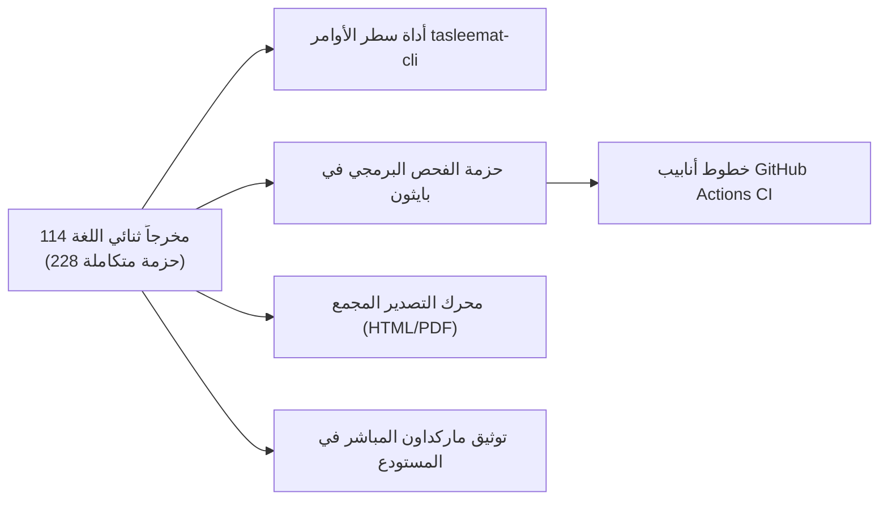

<div class="lang-switch-bar">
  <span class="lang-switch-label">🌐 <strong>اللغة:</strong> الدليل باللغة العربية</span>
  <div class="lang-switch-actions">
    <a class="lang-switch-btn github-btn" href="https://github.com/fakhruldeen/Tasleemat/blob/main/docs/ar/11_tools_and_automation.md" target="_blank" rel="noopener noreferrer">🐙 عرض على GitHub ↗</a>
    <a class="lang-switch-btn" href="../en/11_tools_and_automation.html">🇬🇧 Switch to English Version (النسخة الإنجليزية) ←</a>
  </div>
</div>

---
type: Guide
token_pointer: /_tokens/docs/ar/11_tools_and_automation.npy
token_count: 2313
tokenizer_model_id: tiktoken/o200k_base
created_at: '2026-10-06T16:05:28.216685+00:00'
---

<p align="center">
  <picture>
    <source media="(prefers-color-scheme: dark)" srcset="../img/logo-dark.jpeg">
    <source media="(prefers-color-scheme: light)" srcset="../img/logo-white.jpeg">
    
  </picture>
</p>

---

# 🛠️ دليل الأدوات البرمجية والأتمتة والتكامل السحابي (CI/CD)
**مرجع الوثيقة:** `TASLEEMAT-GUIDE-11-TOOLS-AUTOMATION-AR`  
**الإصدار:** 2.0  
**الفئات المستهدفة:** مهندسو DevOps، مسؤولو أنظمة PMO، المطورون ومدراء المشاريع  

---

## 🎯 قدرات الأتمتة والحوكمة البرمجية (Governance-as-Code)

صُمم نظام «تسليمات» بفلسفة **الوثائق كشيفرة برمجية (Docs-as-Code)** و**الحوكمة كشيفرة برمجية (Governance-as-Code)**؛ مما يتيح تتبع النسخ عبر Git، والتحقق التلقائي في خطوط أنابيب CI/CD، وتوليد مساحات العمل المخصصة للمشاريع في ثوانٍ معدودة.



---

## 🚀 1. بيئة الطرفية التفاعلية TUI وأداة السطر البرمجي (`tasleemat`)

يوفر نظام "تسليمات" حزمة بايثون (SDK)، أداة سطر أوامر، وبيئة عمل تفاعلية في الطرفية (TUI) لتسهيل تأسيس مساحات عمل المشاريع، استعراض النماذج، وربط وكلاء الذكاء الاصطناعي. يمكنك تثبيتها عالمياً عبر PyPI:

```bash
# التثبيت الأساسي
pip install tasleemat

# تثبيت بيئة الطرفية التفاعلية الكاملة (مع Textual ودعم تشكيل الحروف العربية BiDi)
pip install "tasleemat[tui]"
```

### 🖥️ بيئة الطرفية التفاعلية الثنائية (`tasleemat tui`)
تشغيل بيئة العمل التفاعلية الكاملة في الطرفية:
```bash
# التشغيل التفاعلي (باللغة الإنجليزية افتراضياً)
tasleemat tui

# التشغيل المباشر باللغة العربية مع دعم الخط العربي BiDi
tasleemat tui --lang ar
```

تضم الطرفية التفاعلية 7 مساحات عمل:
1. **🚀 مُنشئ المشاريع (Scaffolder)**: معالج بصري متكامل لتوليد بيئة العمل مع حزم الحوكمة وربط الوكلاء.
2. **📋 مستكشف التسليمات (Catalog)**: متصفح متقدم لـ 114 مخرجاً مع معاينة فورية لمحتوى الماركداون ومخططات JSON.
3. **🚪 بوابات الحوكمة (Stage-Gates)**: استعراض معايير الدخول والخروج لبوابات العبور من 0 إلى 5 وقوائم التدقيق.
4. **📖 المعجم الثنائي (Lexicon)**: بحث فوري في 114 مصطلحاً معتمداً من PMI وهيئة الحكومة الرقمية (DGA).
5. **🤖 مختبر الذكاء الاصطناعي (AI Studio)**: صياغة وتوليد الوثائق برمجياً وتصديرها.
6. **🔑 إعدادات المزودين (LLM API)**: حرية تامة لاختيار أي نموذج ودعم OpenRouter، Gemini، OpenAI، Claude، ومزودي واجهات OpenAI المتوافقة.
7. **🔌 ربط الوكلاء (Agent Hub)**: تهيئة بيئة العمل بضغطة زر لـ Cursor، AGY، Claude Desktop، VS Code، OpenCode، Cline، Windsurf، وOpenAI CLI.

---

### أ. تأسيس مساحة عمل مخصصة لمشروع جديد (`init`)
توليد مجلد مشروع متكامل يضم فقط النماذج الإلزامية وفقاً لمستوى الحوكمة (Tier 1 أو 2 أو 3) وحزمة المنهجية المختارة:

```bash
# وضع المعالج التفاعلي (يسألك خطوة بخطوة في الطرفية)
tasleemat init

# وضع المعاملات السريعة: المستوى 2 (المتوسط) مع حزمة أجايل باللغة العربية
tasleemat init \
  --tier 2 \
  --pack agile \
  --lang ar \
  --name "منصة الخدمات الرقمية الموحدة" \
  --code "PRJ-2026-DIGITAL-01" \
  --pm "سارة الأحمد" \
  --sponsor "خالد المنصور" \
  --out ./my_new_project

# مشروع استراتيجي من المستوى 1 باللغتين العربية والإنجليزية
tasleemat init \
  --tier 1 \
  --pack hybrid \
  --lang both \
  --name "برنامج التحول المؤسسي الشامل" \
  --code "PRJ-2026-CORE-01" \
  --pm "محمد السعيد" \
  --sponsor "فهد العتيبي" \
  --out ./enterprise_workspace
```

#### ما تقوم به الأداة تلقائياً:
1. تصفية الـ 114 مخرجاً لاختيار الباقة الإلزامية المناسبة لحجم المشروع وحزمة المنهجية (`agile`, `ai`, `predictive`, `hybrid`).
2. نسخ القوالب، والأدلة، ومخططات JSON، وقواميس CSV.
3. التعبئة التلقائية لبيانات الترويسة (اسم المشروع، رمزه، اسم المدير، الراعي، وتاريخ اليوم) في كافة الملفات المستنسخة.
4. إنشاء ملف `PROJECT_README.md` تفصيلي يحتوي على قائمة تدقيق لبوابات العبور وروابط مباشرة للنماذج.

---

### ب. البحث في فهرس النماذج (`search`)
البحث في كافة المخرجات الـ 114 عبر الكلمات المفتاحية باللغتين العربية والإنجليزية:

```bash
# البحث باللغة العربية
tasleemat search "مخاطر" --lang ar
tasleemat search "ميثاق" --lang ar
tasleemat search "ذكاء اصطناعي" --lang ar
tasleemat search "سبرنت" --lang ar

# البحث باللغة الإنجليزية
tasleemat search "Risk" --lang en
tasleemat search "Charter" --lang en
tasleemat search "Model Card" --lang en
```

---

### ج. استعراض الفهرس الشامل للنماذج (`list`)
عرض قائمة المخرجات الكاملة (114 مخرجاً) مع رموزها ومجلداتها:

```bash
tasleemat list --lang ar
tasleemat list --lang en
```

### د. إدارة إعدادات وحسابات الذكاء الاصطناعي (`config`)
ضبط وتكوين مفاتيح الربط البرمجي (API Keys) ومزودي نماذج الذكاء الاصطناعي للتوليد التلقائي للوثائق:

```bash
# عرض الإعدادات الحالية
tasleemat config show

# ضبط المزود والنموذج الافتراضي (يدعم: gemini, openai, anthropic, ollama, mock)
tasleemat config set --provider gemini --model gemini-2.5-flash
tasleemat config set --provider openai --model gpt-4o

# ضبط المفتاح البرمجي مباشرة (أو تعيين المتغير GEMINI_API_KEY في البيئة)
tasleemat config set --provider gemini --key "AIzaSy..."
```

---

### هـ. التوليد والاستيفاء التلقائي للوثائق بالذكاء الاصطناعي (`generate`)
توليد واستيفاء مخرجات المشروع الاحترافية تلقائياً باستخدام حساب الذكاء الاصطناعي وملاحظات الاجتماعات:

```bash
# استيفاء ميثاق المشروع (PMO-03.01) تلقائياً من ملاحظات الاجتماع
tasleemat generate --form PMO-03.01 --notes ./meeting_notes.txt --out ./03_01_Project_Charter.md

# استيفاء سجل المخاطر باللغة العربية باستخدام نموذج OpenAI
tasleemat generate --form PMO-04.08.02 --notes ./risk_workshop_notes.txt --lang ar --provider openai --out ./04_08_02_Risk_Register.md

# تشغيل تجربة توليد وهمية (Mock) دون استهلاك رصيد المفتاح البرمجي
tasleemat generate --form PMO-03.01 --notes "مشروع التحول الرقمي السحابي" --mock
```

---

### و. تشغيل حزمة الفحوصات والاختبارات الآلية (`test`)
تشغيل حزمة الفحص الشاملة (بما في ذلك فحوصات عميل الذكاء الاصطناعي):

```bash
# تشغيل حزمة الاختبارات مع الملخص
tasleemat test

# تشغيل الاختبارات بالوضع المفصل
tasleemat test -v

# أو التشغيل عبر أداة unittest القياسية في بايثون
python3 -m unittest discover -s tests -v
```

---

### ز. تشغيل خادم بروتوكول سياق النموذج (`mcp`)
تشغيل خادم Model Context Protocol (MCP) الرسمي عبر الإدخال/الإخراج القياسي (stdio) لإتاحة جميع المخرجات الـ 114 ومخططات Draft 2020-12 وأدوات الحوكمة لبيئات ووكلاء الذكاء الاصطناعي (مثل Claude Desktop و Cursor و Antigravity):

```bash
# التشغيل عبر الأمر الفرعي في أداة tasleemat
tasleemat mcp

# أو التشغيل عبر الأمر المباشر المستقل
tasleemat-mcp
```

### ح. التدقيق الحوكمي والتحقق الهيكلي للمشاريع (`audit`)
تدقيق والتحقق من امتثال أي بيئة عمل للمشروع وفق مستويات الحوكمة (المستوى 1 أو 2 أو 3) وحزمة المنهجية المتبعة. يقوم المدقق بالتحقق من اكتمال الملفات، واحتساب نسب الإنجاز المئوية ودرجة الحوكمة، وتقييم جاهزية بوابات المرحلة (البوابات 0 إلى 5)، والتحقق من صحة مخططات البيانات JSON Schema:

```bash
# تدقيق مجلد المشروع الحالي (يكتشف المستوى والمنهجية تلقائياً)
tasleemat audit

# تدقيق مجلد محدد مع تفعيل الإغلاق الصارم لاختبارات أنظمة CI/CD
tasleemat audit ./projects/PRJ-2026-CLOUD --tier 2 --pack agile --strict

# استخراج تقرير التدقيق بصيغة JSON المعيارية لخطوط الإنتاج المؤتمتة
tasleemat audit ./projects/PRJ-2026-CLOUD --json --out audit_report.json
```

---

## 🐍 2. المرجع البرمجي لحزمة بايثون الرسمية (`import tasleemat`)

توفر حزمة `tasleemat` واجهة برمجية برمجية مستقرة وعالية الأداء لبناء خطوط أنابيب الحوكمة، وأتمتة مساحات العمل، وتكامل وكلاء الذكاء الاصطناعي.

### الدوال الأساسية في الحزمة (SDK Core Functions)

| الدالة البرمجية | المعاملات المدخلة | نوع القيمة المعادة | الوصف والوظيفة |
| :--- | :--- | :--- | :--- |
| `list_artifacts()` | `category: str = None` | `list[dict]` | استرجاع قائمة كافة المخرجات الـ 114 المعتمدة مع إمكانية التصفية حسب المرحلة. |
| `get_artifact_definition(artifact_id)` | `artifact_id: str` | `dict` | جلب البيانات الوصفية، والتعريفات، والمخططات لمخرج محدد (مثل `"PMO-03.01"`). |
| `get_artifact_assets(artifact_id, lang)` | `artifact_id: str`, `lang: str = "ar"` | `list[dict]` | استرجاع واصفات الأصول المرفقة بالمخرج باللغة المحددة (`template`, `schema`, `dictionary`, `guide`, `example`). |
| `get_artifact_asset(artifact_id, role, lang)` | `artifact_id: str`, `role: str`, `lang: str = "ar"` | `str \| dict` | قراءة المحتوى الأصلي أو كائن JSON لأصل محدد (`"template"`, `"schema"`, `"dictionary"`). |
| `get_tailoring_profile(tier, pack)` | `tier: int \| str`, `pack: str` | `dict` | تحديد قائمة المخرجات الإلزامية والاختيارية لفئة الحوكمة (1 أو 2 أو 3) وحزمة المنهجية (`general`, `agile`, `ai`, `predictive`, `hybrid`). |
| `get_lexicon(lang)` | `lang: str = "ar"` | `dict` | استرجاع المعجم المؤسسي الموحد لمصطلحات إدارة المشاريع وبوابات العبور الحوكمية. |
| `validate_artifact_data(artifact_id, data, strict)` | `artifact_id: str`, `data: dict`, `strict: bool = True` | `dict` | التحقق البرمجي الصارم من بيانات النموذج مقابل مخطط Draft 2020-12 المعتمد. |
| `audit_project(project_path, tier, pack, strict_schema)` | `project_path: str`, `tier: str = None`, `pack: str = None`, `strict_schema: bool = True` | `ProjectAuditReport` | فحص وتدقيق بيئة عمل المشروع بالكامل واستخراج مؤشرات الأداء والنسب المئوية وجاهزية البوابات. |
| `render_artifact(artifact_id, data, format, lang)` | `artifact_id: str`, `data: dict`, `format: str = "html"`, `lang: str = "ar"` | `str` | تصيير وتوليد صفحة HTML مستقلة أو نص منسق للنموذج دون اتصال بالإنترنت. |

### التنسيقات المدعومة لمخططات Draft 2020-12 (Supported Formats)

يدعم محرك التحقق البرمجي المدمج (`tasleemat.formats`) التحقق التام والمطابق لمعايير RFC الدولية:
- `date`: التاريخ الكامل بصيغة RFC 3339 القياسية (`YYYY-MM-DD`).
- `date-time`: الطابع الزمني المدمج للتاريخ والوقت وفق RFC 3339 (`YYYY-MM-DDTHH:MM:SSZ`).
- `time`: الوقت بصيغة RFC 3339 (`HH:MM:SS`).
- `uuid`: المعرف الفريد عالمياً المتوافق مع RFC 4122.
- `uri`: المعرف الموحد للموارد وفق RFC 3986.
- `uri-reference`: مرجع المعرف الموحد للموارد النسبي أو المطلق وفق RFC 3986.
- `email`: عنوان البريد الإلكتروني المتوافق مع RFC 5322.
- `duration`: الفترة الزمنية المتوافقة مع ISO 8601 (مثل `P3M`, `P14D`).

### نموذج تطبيقي متكامل لاستخدام الحزمة البرمجية (Python Example)

```python
import tasleemat

# 1. استكشاف التسليمات الإلزامية لمشروع متوسط (Tier 2) بمنهجية أجايل
profile = tasleemat.get_tailoring_profile(tier=2, pack="agile")
print(f"عدد التسليمات الإلزامية: {len(profile['artifacts'])}")

# 2. جلب تعريف ميثاق المشروع ومخطط البيانات العربي
charter_def = tasleemat.get_artifact_definition("PMO-03.01")
charter_schema = tasleemat.get_artifact_asset("PMO-03.01", role="schema", lang="ar")

# 3. التحقق الصارم من صحة بيانات النموذج وفق مخطط Draft 2020-12
payload = {
    "project_name": "منصة التحول الرقمي السحابي",
    "project_code": "PRJ-2026-CLOUD",
    "start_date": "2026-11-01",
    "sponsor": "سعادة مدير عام التقنية",
    "estimated_budget": 2500000.00
}
result = tasleemat.validate_artifact_data("PMO-03.01", payload, strict=True)
if result["valid"]:
    print("البيانات متطابقة تماماً مع المخطط الهيكلي المعتمد!")

# 4. تصيير النموذج مباشرة كصفحة HTML مستقلة وجاهزة للعرض والطباعة
html_output = tasleemat.render_artifact("PMO-03.01", payload, format="html", lang="ar")
with open("Project_Charter_Preview_AR.html", "w", encoding="utf-8") as f:
    f.write(html_output)
```

---

## 🖨️ 3. محرك التصدير المجمع للوثائق (`tools/export_deliverables.py`)

تحويل أي وثيقة أو مجلد مشروع كامل من صيغة Markdown إلى صفحات HTML منسقة وجاهزة للطباعة وتصدير PDF، مع دعم كامل للاتجاه العربي (RTL) وخطوط Cairo و Inter:

```bash
# تصدير وثيقة مفردة
python3 tools/export_deliverables.py forms/ar/03_البدء/01_ميثاق_المشروع/03_01_ميثاق_المشروع_قالب.md -o output.html

# تصدير نموذج عربي مع دعم RTL
python3 tools/export_deliverables.py forms/ar/03_البدء/01_ميثاق_المشروع/03_01_ميثاق_المشروع_قالب.md -o charter.html

# تصدير مجلد مشروع بالكامل
python3 tools/export_deliverables.py my_project_workspace/
```

---

## 🌐 4. هيكلية التوثيق المباشر عبر المستودع (Repository-First)

تحتفظ تسليمات بكافة أدلة الحوكمة، والأدلة التشغيلية، والنماذج ثنائية اللغة بصيغة ماركداون الأصلية المباشرة داخل مستودع GitHub. تم إيقاف بوابة الويب السابقة لضمان بقاء التوثيق خاضعاً لإدارة النسخ وتدقيق التغييرات جنباً إلى جنب مع الشيفرات والقوالب. يمكن تصفح جميع الأدلة بدءاً من [`docs/README.md`](../README.md).

---

## 🛡️ 5. حزمة التدقيق والفحص البرمجي في بايثون

يحتوي مجلد `tests/` و `tools/` على منظومة اختبارات وتدقيق آلية متكاملة:

### 1. حزمة الاختبارات الرئيسية (`tests/`)
- **طريقة التشغيل:** `pytest -v tests` أو `python3 -m unittest discover -s tests -v`
- **التغطية:** **130 اختباراً مؤتمتاً عبر 15 وحدة فحص** تشمل: التماثل اللغوي (`test_parity.py`)، المخططات الهيكلية (`test_schemas.py`)، حزمة البيانات المفتوحة (`test_okf_datapackage.py`)، قوالب الحوكمة (`test_governance_templates.py`)، الامتثال للبيانات الافتراضية (`test_fictional_compliance.py`)، أدوات CLI (`test_cli_and_exporters.py`)، الأدلة التوثيقية (`test_documentation.py`)، وخادم بروتوكول سياق النموذج MCP بكافة اختبارات التكامل والطرفية (`test_mcp_server.py`, `test_mcp_advanced.py`, `test_mcp_audit.py`, `test_mcp_stdio_e2e.py`).

### 2. مدقق جودة النماذج والمخططات (`tools/audit_forms.py`)
- **طريقة التشغيل:** `python3 tools/audit_forms.py`
- **الوظيفة:** يفحص جميع النماذج الـ 114 باللغتين العربية والإنجليزية (228 ملفاً وحزمة) للتأكد من وجود جدول الاعتماد وتسلسل العناوين وصحة الروابط.

### 3. مدقق حزمة البيانات المفتوحة Frictionless OKF (`tools/validate_okf.py`)
- **طريقة التشغيل:** `python3 tools/validate_okf.py`
- **الوظيفة:** يتحقق من مطابقة ملف `datapackage.json` والمخططات الـ 228 لمعايير حزم البيانات المفتوحة الدولية.

### 4. فاحص التماثل والتطابق اللغوي (`tools/parity.py`)
- **طريقة التشغيل:** `python3 tools/parity.py forms/en forms/ar`
- **الوظيفة:** يضمن التطابق التام 1:1 في البنية والملفات بين المجلدات العربية والإنجليزية.

---

## ⚙️ 6. خط أنابيب التكامل المستمر (`.github/workflows/ci.yml`)

يتم تشغيل فحص آلي عبر GitHub Actions مع كل عملية دفع أو سحب (Pull Request) إلى الفرع الرئيسي `main` يشمل:
1. التحقق من سلامة المخططات الهيكلية لكافة حزم النماذج الـ 228 (`audit_forms.py`).
2. فحص العرض والتنسيق للجداول والمخططات (`check_rendering.py`).
3. التحقق من التماثل الثنائي التام عربي/إنجليزي 1:1 (`parity.py`).
4. فحص حزمة البيانات المفتوحة Frictionless (`validate_okf.py`).
5. تشغيل حزمة الاختبارات الآلية الشاملة المكونة من 130 فحصاً عبر 15 وحدة (`tests/`).
6. اختبار واجهة الأوامر وخادم بروتوكول MCP (`tasleemat_cli.py` & MCP server).