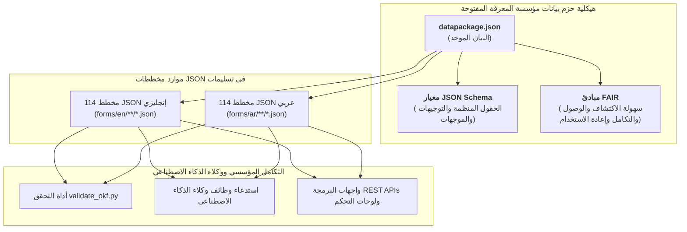

<div class="lang-switch-bar">
  <span class="lang-switch-label">🌐 <strong>اللغة:</strong> الدليل باللغة العربية</span>
  <div class="lang-switch-actions">
    <a class="lang-switch-btn github-btn" href="https://github.com/fakhruldeen/Tasleemat/blob/main/docs/ar/12_open_knowledge_framework.md" target="_blank" rel="noopener noreferrer">🐙 عرض على GitHub ↗</a>
    <a class="lang-switch-btn" href="../en/12_open_knowledge_framework.html">🇬🇧 Switch to English Version (النسخة الإنجليزية) ←</a>
  </div>
</div>

---
type: Guide
token_pointer: /_tokens/docs/ar/12_open_knowledge_framework.npy
token_count: 1290
tokenizer_model_id: tiktoken/o200k_base
created_at: '2026-10-06T16:05:28.224180+00:00'
---

<p align="center">
  
</p>

---

# 🌐 معيار مؤسسة المعرفة المفتوحة (OKF) وهيكلية مخططات JSON الرقمية
**مرجع الوثيقة:** `TASLEEMAT-GUIDE-12-OPEN-KNOWLEDGE-AR`  
**الإصدار:** 2.0  
**المعايير المرجعية:** معيار حزم البيانات الصادر عن مؤسسة المعرفة المفتوحة (Open Knowledge Foundation - OKF)، ومعيار JSON Schema (Draft 2020-12)، ومبادئ FAIR للبيانات المفتوحة.  

---

## 🎯 نظرة عامة تنفيذية

تلتزم حزمة **«تسليمات»** بمواصفات حزم البيانات الصادرة عن **مؤسسة المعرفة المفتوحة (OKF)** بالاعتماد على **مخططات JSON الرقمية القياسية**؛ مما يجعلها إطار عمل مكاتب إدارة المشاريع (PMO) الأكثر ملاءمة للأتمتة ووكلاء الذكاء الاصطناعي عالمياً.

من خلال توفير ملف البيان الموحد [`datapackage.json`](../../datapackage.json) في جذر المستودع، تمكّن تسليمات المطورين ووكلاء الذكاء الاصطناعي (AI Agents) ومهندسي النظم من قراءة وتدقيق واستدعاء كافة مخططات النماذج الـ 228 مباشرة عبر واجهات البرمجة (APIs) دون الحاجة إلى أي وسائط تحويل وسيطة.



---

## 🗂️ طبقات البيانات والمخططات الأربع في تسليمات

لمنع الخلط المعماري بين تعريفات النماذج وبيانات المشاريع الفعلية أثناء التشغيل، تحدد تسليمات أربع طبقات مستقلة للبيانات والمخططات:

1. **الطبقة 1: مخططات أقسام وحقول النماذج (`forms/{en,ar}/**/*.json`):** تعريفات الأقسام والحقول والتوجيهات والإرشادات المستخدمة لتوليد القوالب.
2. **الطبقة 2: حزمة البيانات المفتوحة Frictionless OKF (`datapackage.json`):** فهرس الموارد المفتوحة على مستوى المستودع الذي يربط كافة موارد النماذج الثنائية الـ 228.
3. **الطبقة 3: المخططات المرجعية للتحقق وفق مسودة Draft 2020-12 (`schemas/completed/PMO-*.schema.json`):** عقود التحقق البرمجي للمخرجات المكتملة في وضعي التحقق الصارم (`strict`) والمسودة (`draft`).
4. **الطبقة 4: حمولات بيانات المشاريع التشغيلية (Runtime Payloads):** البيانات الواقعية للمشاريع المدخلة بواسطة الفرق أو وكلاء الذكاء الاصطناعي والمفحوصة مقابل الطبقة 3.

---

## 📦 مواصفة ملف `datapackage.json`

يقوم ملف [`datapackage.json`](../../datapackage.json) بفهرسة كافة المخططات الـ 228 كموارد JSON رقمية:

```json
{
  "profile": "data-package",
  "name": "tasleemat-pmo-framework",
  "title": "Tasleemat: Enterprise Bilingual (English & Arabic) Project Management Framework",
  "version": "2.0.0",
  "licenses": [{"name": "MIT", "path": "https://opensource.org/licenses/MIT"}],
  "resources": [
    {
      "name": "ar-03-01-project-charter",
      "title": "ميثاق المشروع",
      "reference": "PMO-03.01",
      "path": "forms/ar/03_البدء/01_ميثاق_المشروع/03_01_ميثاق_المشروع.json",
      "format": "json",
      "mediatype": "application/json",
      "encoding": "utf-8",
      "language": "ar-SA",
      "direction": "rtl",
      "schema": {
        "$schema": "https://json-schema.org/draft/2020-12/schema",
        "type": "object",
        "required": ["form_name", "document_reference", "fields"]
      }
    }
  ]
}
```

---

## 🛠️ التحقق من الامتثال لمعايير OKF

يتضمن المستودع أداة فحص آلية مدمجة:

```bash
# تشغيل أداة التحقق لمخططات JSON
python3 tools/validate_okf.py
```

---

## 💡 مزايا اعتماد مخططات JSON في معايير OKF
 
 1. **الاستدعاء المباشر لوكلاء الذكاء الاصطناعي (Function Calling):** تستخدم نماذج الذكاء الاصطناعي الحديثة مخططات JSON بشكل طبيعي لتوليد المخرجات المنسقة دون أخطاء هيكلية.
 2. **شجرة بيانات هرمية ومتكاملة:** يحمل كل حقل خصائص `section` (القسم) و `label` (المسمى) و `guidance` (الإرشادات التفصيلية) و `value` (القيمة المستهدفة).
 3. **التماثل الثنائي الكامل (en / ar-SA):** دعم كامل لاتجاه النص العربي (`rtl`) والترميز الموحد `utf-8` عبر كافة المخططات الـ 228.
 
 ---
 
 ## 🤖 التطبيق العملي لمخططات OKF مع نماذج الذكاء الاصطناعي (LLMs)
 
 ### 1. تعريف الأدوات واستدعاء الدوال الذكية (OpenAI Tools & Anthropic Claude)
 يتيح تمرير مخططات JSON المعتمدة تقييد استجابة النماذج لتوليد بيانات هيكلية مطابقة بدقة متناهية:
 
 ```python
 import tasleemat
 
 # 1. استخراج مخطط البيانات المعتمد للتسليمة باللغة العربية
 schema = tasleemat.get_artifact_asset("PMO-03.01", role="schema", lang="ar")
 
 # 2. تعريف الأداة الذكية لنماذج OpenAI أو Claude
 pmo_tool = {
     "name": "generate_project_charter",
     "description": "توليد ميثاق مشروع رسمي معتمد وفق معايير PMI",
     "parameters": schema
 }
 ```
 
 ### 2. حلقة التحقق والتصحيح الذاتي التلقائي
 عند قيام النموذج بتوليد بيانات معقدة للمشروع، يمكن ربط التحقق الهيكلي بإعادة التوجيه الذاتي التلقائي:
 
 ```python
 import tasleemat
 
 def generate_and_validate(llm_client, meeting_notes):
     # طلب توليد JSON من النموذج
     raw_payload = llm_client.generate_json(meeting_notes)
 
     # التحقق البرمجي وفق عقد تسليمات الصارم
     report = tasleemat.validate_artifact_data("PMO-03.01", raw_payload, mode="strict")
 
     if not report.valid:
         # بناء موجه تصحيحي دقيق يحدد مسارات الحقول غير المطابقة
         errors_summary = [f"الحقل: {err.field_path} -> {err.message}" for err in report.errors]
         correction_prompt = "البيانات المولدة تحتوي أخطاء هيكلية:\n" + "\n".join(errors_summary)
         # إعادة التوجيه ليصحح النموذج خطأه ذاتياً
         return llm_client.generate_json(correction_prompt)
 
     return raw_payload
 ```