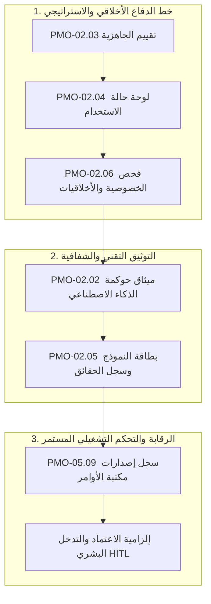

<!--
---
type: Guide
---
-->

<div class="lang-switch-bar">
  <span class="lang-switch-label">🌐 <strong>اللغة:</strong> الدليل التنفيذي باللغة العربية</span>
  <div class="lang-switch-actions">
    <a class="lang-switch-btn github-btn" href="https://github.com/fakhruldeen/Tasleemat/blob/main/docs/ar/managerial_ai_risk_and_ethics.md" target="_blank" rel="noopener noreferrer">🐙 عرض على GitHub ↗</a>
    <a class="lang-switch-btn" href="../en/managerial_ai_risk_and_ethics.html">🇬🇧 Switch to English Version (النسخة الإنجليزية) ←</a>
  </div>
</div>

---

# 🤖 دليل القيادات التنفيذية: إدارة مخاطر وأخلاقيات الذكاء الاصطناعي (AI Governance)
**مرجع الوثيقة:** `TASLEEMAT-EXEC-AI-RISK-ETHICS-AR`  
**الفئات المستهدفة:** الرؤساء التنفيذيون للتقنية (CTO)، مسؤولو أمن المعلومات (CISO)، المستشارون القانونيون، مدراء مكاتب PMO، ولجان أخلاقيات الذكاء الاصطناعي  
**المعايير المرجعية:** مبادئ أخلاقيات الذكاء الاصطناعي الصادرة عن الهيئة السعودية للبيانات والذكاء الاصطناعي (سدايا SDAIA)، إطار عمل NIST AI RMF 1.0، ومعيار أيزو ISO/IEC 42001  

---

> [!NOTE]
> **إقرار نموذج الحوكمة المؤسسي المقترح**  
> يمثل تصنيف المخاطر ومستويات الرقابة الواردة في هذا الدليل ممارسات مؤسسية رائدة مقترحة. ويتعين على المنشآت مواءمتها مع نظام حماية البيانات الشخصية ولوائح الهيئات التنظيمية المعنية.

---

## 🎯 الأهمية الاستراتيجية: الاستثمار الآمن والمسؤول في الذكاء الاصطناعي

توفر أنظمة الذكاء الاصطناعي والنماذج التوليدية والوكلاء الأذكياء سرعة إنتاجية غير مسبوقة. ومع ذلك، فإن إدماج الذكاء الاصطناعي في صلب عمليات المنشأة ينطوي على مخاطر جوهرية تختلف كلياً عن البرمجيات التقليدية:
- **المخرجات غير الحتمية (Non-deterministic)**: قد يؤدي نفس المدخل إلى مخرجات متباينة عند تحديث النماذج.
- **الانحياز والتمييز الخوارزمي**: تسرب التشوهات الإحصائية من بيانات التدريب إلى قرارات الفرز والتوظيف وتقييم الائتمان.
- **الهلوسة وانحراف الحقائق**: توليد ادعاءات وأرقام مضللة أو غير صحيحة بثقة إحصائية عالية.
- **تسرب البيانات الحساسة والملكية الفكرية**: إدخال وثائق المنشأة السرية أو بيانات المواطنين المحمية في نماذج سحابية عامة دون حماية.

تؤسس **حزمة حوكمة الذكاء الاصطناعي في تسليمات** خط دفاع استباقي يحمي سمعة المنشأة، ويضمن الامتثال التام للمعايير الوطنية (مثل مبادئ سدايا)، ويحافظ على مبدأ المسؤولية البشرية في كل قرار مؤتمت.



---

## 🛡️ التصنيف الثلاثي لمخاطر الذكاء الاصطناعي في المنشأة

تصنّف تسليمات مشاريع الذكاء الاصطناعي إلى ثلاثة مستويات مخاطرة واضحة تفرض متطلبات رقابية متدرجة:

| فئة المخاطرة | أمثلة الاستخدام المؤسسي | المتطلبات الحوكمية الإلزامية | سياسة التدخل البشري (HITL) |
| :--- | :--- | :--- | :--- |
| **المستوى 1: عالي المخاطر (High Risk)** | التقييم الائتماني الآلي، الفرز والتوظيف الآلي للكوادر، التشخيص الطبي، البنية التحتية الوطنية الحرجة، أنظمة التعرف البيومتري. | **كافة وثائق حوكمة AI الست** + تدقيق خارجي مستقل قانوني وأخلاقي + بصمة تجزئة مشفرة لبيانات التدريب. | **تدخل واعتماد بشري إلزامي (HITL)**: يجب على خبير بشري معتمد مراجعة واعتماد كل قرار عالي الأثر قبل سريانه. يُحظر التفويض الذاتي المطلق. |
| **المستوى 2: محدود المخاطر (Limited Risk)** | المساعدات الآلية لخدمة العملاء، استرجاع المعرفة المؤسسية (RAG)، تنبيهات الصيانة التنبؤية، خدمات الترجمة المتخصصة. | لوحة الاستخدام (`PMO-02.04`)، بطاقة النموذج (`PMO-02.05`)، وسجل الأوامر (`PMO-05.09`). | **تدخل بشري عند الاستثناء**: عمل مؤتمت بالكامل مع التصعيد الفوري والآلي للإنسان عند انخفاض نسبة ثقة النموذج عن $85\%$. |
| **المستوى 3: منخفض المخاطر (Minimal Risk)** | تلخيص التقارير الداخلية، توليد مسودات الشيفرات التوثيقية، تجميع مشاعر المستفيدين من التقييمات العامة. | لوحة حالة الاستخدام (`PMO-02.04`). | **مراجعة دورية بالعينات**: تدقيق ربع سنوي لسجلات النظام للتأكد من عدم وجود انحراف سلوكي في المخرجات. |

---

## 🏛️ مواءمة المخرجات مع معايير سدايا (SDAIA) ومبادئ NIST العالمية

تتطابق وثائق تسليمات بشكل مباشر مع المعايير الأخلاقية الوطنية والدولية:

```
┌───────────────────────────────────────┬────────────────────────────────────────┐
│ معيار سدايا وإطار عمل NIST AI RMF     │ مخرج الحوكمة المعتمد في تسليمات         │
├───────────────────────────────────────┼────────────────────────────────────────┤
│ العدالة وعدم التمييز (Fairness)       │ PMO-02.06 تقييم الخصوصية والأخلاقيات   │
│ الشفافية وقابلية التفسير              │ PMO-02.05 بطاقة النموذج ووثيقة الحقائق │
│ الأمان والاعتمادية (Safety)           │ PMO-02.02 خطة حوكمة الذكاء الاصطناعي   │
│ المسؤولية والمساءلة (Accountability)  │ PMO-03.01 ميثاق المشروع (تحديد الراعي)  │
│ الخصوصية وسرية البيانات الشخصية      │ PMO-02.06 فحص البيانات المحمية PII     │
│ الرقابة المستمرة وضبط الانحراف         │ PMO-05.09 سجل إصدارات مكتبة الأوامر    │
└───────────────────────────────────────┴────────────────────────────────────────┘
```

1. **العدالة والنزاهة الخوارزمية**:
   - يلزم النموذج `PMO-02.06` بإجراء فحوصات إحصائية مثبتة عبر الشرائح المجتمعية لمنع أي انحياز خوارزمي قبل النشر في بيئة الإنتاج.
2. **شفافية النماذج وتتبع البيانات**:
   - يعمل النموذج `PMO-02.05` بمثابة "جواز سفر فني للنموذج"، يوثق مصادر التدريب، والقيود الفنية، وعدد المعاملات، والاستخدامات غير المصرح بها.
3. **ضبط النسخ والأوامر البرمجية**:
   - يتيح `PMO-05.09` تتبع التغييرات في الموجهات البرمجية ودرجة الحرارة (Temperature)، مما يمنع التدهور الصامت في أداء التطبيقات عبر الزمن.

---

## 🔒 حماية بيانات المنشأة والتعامل مع النماذج التوليدية

لحماية الأصول المعرفية للمنظمة، يتعين على القيادة التنفيذية تفعيل أربع قواعد تشغيلية صارمة:

1. **حظر الاستخدام الاستهلاكي المجاني**:
   - منع إدخال العقود المالية، ومحاضر الاجتماعات السرية، أو بيانات الموظفين في المواقع العامة المفتوحة للذكاء الاصطناعي.
2. **الاشتراك المؤسسي الآمن (Enterprise APIs)**:
   - حصر التعامل بالربط البرمجي السحابي المخصص للمنشآت الذي يضمن عدم استخدام بيانات المنظمة لتدريب النماذج العامة.
3. **التحقق الهيكلي بدلاً من النصوص الحرة**:
   - إلزام الأنظمة الذكية بالتحقق من مخرجاتها مقابل مخططات JSON المعيارية عبر دالة `tasleemat.validate_artifact_data` لضمان صحة البيانات المكتوبة.
4. **التوثيق الرقمي والمسؤولية البشرية**:
   - احتفاظ كل وثيقة منشأة بمساعدة الذكاء الاصطناعي بكتلة ضبط المستند التي توضح اسم المشغّل، وطراز النموذج، وتاريخ التوليد لضمان المساءلة الكاملة.
