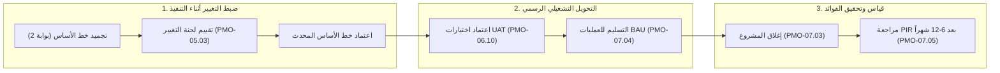

<!--
---
type: Guide
---
-->

<div class="lang-switch-bar">
  <span class="lang-switch-label">🌐 <strong>اللغة:</strong> الدليل التنفيذي باللغة العربية</span>
  <div class="lang-switch-actions">
    <a class="lang-switch-btn github-btn" href="https://github.com/fakhruldeen/Tasleemat/blob/main/docs/ar/managerial_audit_and_benefits.md" target="_blank" rel="noopener noreferrer">🐙 عرض على GitHub ↗</a>
    <a class="lang-switch-btn" href="../en/managerial_audit_and_benefits.html">🇬🇧 Switch to English Version (النسخة الإنجليزية) ←</a>
  </div>
</div>

---

# 📈 دليل القيادات التنفيذية: الجاهزية للتدقيق، حوكمة التغيير، وتحقيق الفوائد
**مرجع الوثيقة:** `TASLEEMAT-EXEC-AUDIT-BENEFITS-AR`  
**الفئات المستهدفة:** المدراء الماليون (CFO)، مدراء المراجعة والتدقيق الداخلي، مسؤولو تحقيق الفوائد المؤسسية، ورؤساء لجان التحكم بالتغيير (CCB)  
**المعايير المرجعية:** معيار معهد إدارة المشاريع لإدارة البرامج PMI Standard for Program Management، ومعايير أيزو ISO 21500، وحوكمة تقنية المعلومات COBIT 2019  

---

> [!NOTE]
> **إقرار نموذج الحوكمة المؤسسي المقترح**  
> تمثل حدود الانحراف المالي والزمني وآليات قياس الفوائد الموضحة في هذا الدليل معايير استرشادية قياسية تتطلب المواءمة الرسمية مع لائحة الصلاحيات المالية وسياسات العقود والمشتريات المعتمدة في المنشأة.

---

## 🎯 الأهمية الاستراتيجية: استدامة القيمة المؤسسية لما بعد التسليم

في الفكر القيادي الحديث، لا يُعد إنجاز المشروع في الوقت والميزانية المحددة المعيار الوحيد للنجاح؛ بل يقاس النجاح الحقيقي بقدرة المشروع على:
1. **الصمود أمام التدقيق والمراجعة**: إثبات الشفافية الكاملة، وسلامة سلاسل الاعتماد، ووجود سجلات مالية وقرارات حوكمية قابلة للتدقيق.
2. **التحكم الصارم بتعديلات خطوط الأساس**: منع زحف النطاق العشوائي من خلال لجنة رسمية للتحكم بالتغيير (CCB).
3. **التسليم والتحويل التشغيلي السلس**: نقل المخرجات إلى العمليات اليومية المستمرة (BAU) مع اتفاقيات مستوى خدمة محددة.
4. **تحقيق العائد الاستثماري على المدى الطويل**: قياس وتحصيل الفوائد المالية والتشغيلية الملموسة بعد أشهر من إغلاق المشروع.

تُقدم **منظومة التدقيق وتحقيق الفوائد في تسليمات** الربط المتكامل بين مرحلة التنفيذ الرأسمالي ومرحلة جني العوائد المستمرة.



---

## 🏛️ ميثاق وصلاحيات لجنة التحكم بالتغيير (CCB)

تُعد لجنة التحكم بالتغيير (Change Control Board) المرجع الحوكمي الأعلى لأي تعديل يمس خطوط قياس الأداء المعتمدة للمشروع. ولا تتدخل اللجنة في إدارة المهام اليومية، بل ينصب تركيزها حصرياً على فحص وتقييم التغييرات المقترحة على نطاق العمل، أو الميزانية، أو الجدول الزمني المعتمد.

### جدول مصفوفة تصعيد التغييرات الحوكمية

```
┌─────────────────────────────────┬──────────────────────────────────┬─────────────────────────────────┐
│ نسبة وحجم الانحراف              │ المستوى الإجرائي                  │ جهة الاعتماد الحوكمية المطلوبة  │
├─────────────────────────────────┼──────────────────────────────────┼─────────────────────────────────┤
│ انحراف التكلفة: أقل من 5%       │ تباين تشغيلي طبيعي للمشروع       │ مفوض لمدير المشروع (احتياطي)   │
│ انحراف التكلفة: من 5% إلى 10%   │ تباين مرتفع يستوجب الرقابة       │ راعي المشروع ومدير PMO          │
│ انحراف التكلفة: أكثر من 10%     │ خرق خط الأساس المالي             │ لجنة التحكم بالتغيير (CCB) كاملة │
│ انحراف الجدول: أقل من 10%       │ تذبذب زمني روتيني للأنشطة        │ مفوض لمدير المشروع             │
│ انحراف الجدول: من 10% إلى 15%   │ تأخر في المحطات الرئيسية         │ راعي المشروع ومدير PMO          │
│ انحراف الجدول: أكثر من 15%      │ مساس بالمسار الحرج للمشروع       │ لجنة التحكم بالتغيير (CCB) كاملة │
│ النطاق: حزمة عمل غير حرجة       │ مقايضة وظيفية مرنة               │ مدير المشروع وراعي المشروع      │
│ النطاق: حذف أو إضافة مخرج رئيسي │ تعديل جوهري في القيمة الاستثمارية│ لجنة التحكم بالتغيير (CCB) كاملة │
└─────────────────────────────────┴──────────────────────────────────┴─────────────────────────────────┘
```

### دورة حياة دراسة التغيير في 4 خطوات
1. **التسجيل وتحليل الأثر المتكامل (`PMO-05.03`)**:
   - يُوثّق مدير المشروع طلب التغيير محل الدراسة، مع تحليل كمي لأثره المتشابك على التكلفة، الجدول، المخاطر، والاعتماديات.
2. **المراجعة والتدقيق المبدئي**:
   - يتحقق مدير PMO من استيفاء الوثائق. وتُرفض الطلبات التي تفتقر للتقديرات المالية الدقيقة دون عرضها.
3. **انعقاد لجنة CCB الرسمي**:
   - تعقد اللجنة اجتماعها لإصدار القرار (اعتماد، رفض، أو طلب تعديل إضافي).
4. **تحديث خط الأساس والأرشفة التدقيقية**:
   - تُحدّث خطوط الأساس المعتمدة رسميّاً (`PMO-04.03.08`, `PMO-04.04.04`) مع إرفاق رقم قرار الاعتماد لمنع زحف النطاق.

---

## 🏁 بروتوكول التحويل للعمليات التشغيلية (بوابة 4 إلى BAU)

تتعثر العديد من المبادرات الكبرى أثناء التسليم لعدم جاهزية الفرق التشغيلية لاستيعاب المخرج الجديد. تلزم تسليمات بتطبيق **قائمة تدقيق التسليم التشغيلي (`PMO-07.04`)**:

1. **اكتمال واعتماد اختبارات قبول المستخدمين (`PMO-06.10`)**:
   - اجتياز اختبارات سيناريوهات الأعمال بنسبة $100\%$ للحالات الحرجة؛ وانعدام العيوب البرمجية أو الفنية من الدرجة الأولى.
2. **توقيع اتفاقيات مستوى الخدمة (SLAs)**:
   - تحديد أزمنة الاستجابة، وفترات ضمان الموردين، وإجراءات تصعيد المشكلات التشغيلية.
3. **نقل المعرفة وتسليم الأدلة الإجرائية**:
   - تسليم أدلة التشغيل، ودليل المستخدم، وسجلات التدريب للفرق المستلمة بشكل رسمي.
4. **نقل الأصول والتراخيص النظامية**:
   - تحويل الشيفرات البرمجية، والأصول المادية، وتراخيص البرمجيات، وحسابات الفوترة إلى الإدارة التشغيلية المستمرة.

---

## 📊 مراجعة ما بعد التنفيذ (PIR) وتتبع الفوائد

يمثل الإغلاق التعاقدي (**بوابة 5**) نهاية الإنفاق الرأسمالي المؤقت، ولكن جني العائد الاستثماري يبدأ في العمليات. يتابع نموذج **مراجعة ما بعد التنفيذ (`PMO-07.05`)** استدامة القيمة:

```
┌─────────────────────────────────┬──────────────────────────────────┬─────────────────────────────────┐
│ المستهدف في دراسة الجدوى الأصلية│ المراجعة بعد 6 أشهر (PIR 1)      │ المراجعة بعد 12 شهراً (PIR 2)   │
├─────────────────────────────────┼──────────────────────────────────┼─────────────────────────────────┤
│ خفض التكاليف: 10 ملايين ريال    │ التحقق الفعلي: 7.2 مليون (72%)   │ التحقق الفعلي: 10.8 مليون (108%) │
│ تقليص دورة الخدمة: أقل من ساعتين│ الدورة الفعلية: ساعتان و 20 دقيقة│ الدورة الفعلية: ساعة و 45 دقيقة │
│ نسبة تبني المستخدمين: 10,000 مستخدم│ التبني الفعلي: 8,200 مستخدم      │ التبني الفعلي: 11,400 مستخدم    │
└─────────────────────────────────┴──────────────────────────────────┴─────────────────────────────────┘
```

- **دورية المراجعة:** تُجرى مراجعات PIR مرتين: بعد **6 أشهر** ثم بعد **12 شهراً** من التسليم التشغيلي.
- **مسؤولية المتابعة:** يقود المراجعة **مالك الفوائد / مدير الإدارة المستفيدة** بمشاركة تدقيقية من مكتب إدارة المشاريع PMO.
- **الإجراء التصحيحي:** إذا تراجعت الفوائد الفعلية بأكثر من $20\%$ عن المخطط، يُعقد اجتماع طارئ لتحديد المعوقات التشغيلية واتخاذ التدابير العلاجية وتوثيقها في قاعدة الدروس المستفادة للمنظمة.
