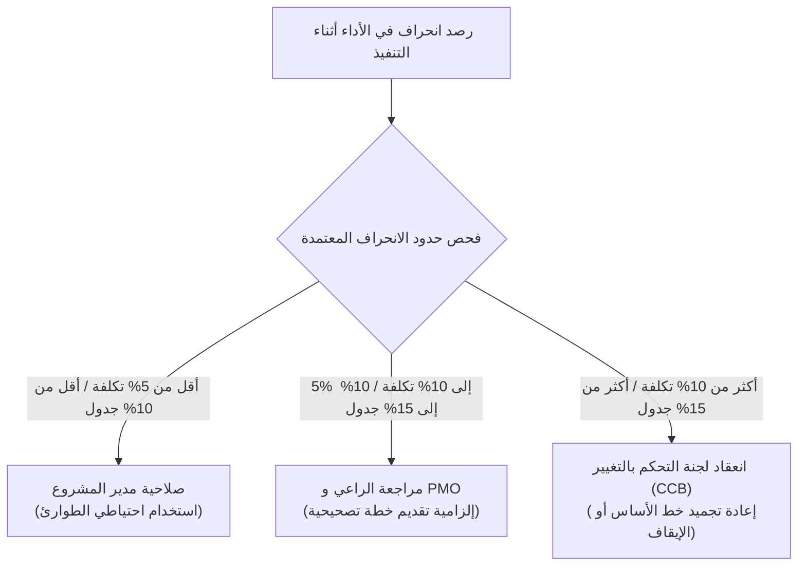

<!--
---
type: Guide
---
-->

  🌐 <strong>اللغة:</strong> الدليل التنفيذي باللغة العربية
  

    <a class="lang-switch-btn github-btn" href="https://github.com/fakhruldeen/Tasleemat/blob/main/docs/ar/managerial_stage_gates_playbook.md" target="_blank" rel="noopener noreferrer">🐙 عرض على GitHub ↗</a>
    <a class="lang-switch-btn" href="../en/managerial_stage_gates_playbook.html">🇬🇧 Switch to English Version (النسخة الإنجليزية) ←</a>
  

---

# 🏛️ دليل القيادات التنفيذية: منظومة بوابات العبور الحوكمية (Stage-Gates)
**مرجع الوثيقة:** `TASLEEMAT-EXEC-STAGE-GATES-PLAYBOOK-AR`  
**الفئات المستهدفة:** رعاة المشاريع (Sponsors)، مدراء مكاتب إدارة المشاريع (PMO)، أعضاء لجان التوجيه (SteerCo)، والقيادات التنفيذية  
**المعايير المرجعية:** معايير معهد إدارة المشاريع العالمي PMI PMBOK® الإصدارات 6 و 7 و 8، ومعايير أيزو ISO 21500 / ISO 21502:2021  

---

> [!NOTE]
> **إقرار نموذج الحوكمة المؤسسي المقترح**  
> يمثل هذا الدليل إطار عمل مؤسسي استرشادي مقترح يتطلب التخصيص والاعتماد الرسمي وفق اللوائح الداخلية لكل منظومة. ولا يمثل سلطة نظامية إلزامية أو متطلبات تشريعية عامة لكافة المنشآت.

---

## 🎯 ملخص تنفيذي والهدف الاستراتيجي

في بيئات الأعمال الحديثة ومشاريع التحول الرقمي والرأسمالي، نادراً ما تفشل المبادرات بسبب نقص الكفاءة الهندسية؛ بل تفشل المشاريع عادة نتيجة **الانحراف الحوكمي، وضبابية صلاحيات الاعتماد، وغياب الرقابة على صرف الميزانيات المرحلية**. وغالباً ما يُنظر إلى الحوكمة التقليدية كعبء مكتبي لاحق بدلاً من كونها أداة استباقية للحد من المخاطر.

تؤسس **منظومة بوابات العبور الحوكمية (Stage-Gates)** في تسليمات هيكلاً تدقيقياً محكماً يغطي دورة حياة المشروع بأكملها، بدءاً من دراسة الفكرة المبدئية ومواءمتها مع الأهداف المؤسسية (**بوابة 0**) وصولاً إلى التسوية التعاقدية الشاملة وقياس تحقيق الفوائد الاستراتيجية (**بوابة 5**).

تعمل كل بوابة عبور بمثابة **محطة اتخاذ قرار حاسمة** تقوم فيها القيادات المعتمدة بمراجعة المخرجات المكتملة، وتقييم الجدوى الاقتصادية، وتحديد ما إذا كان يجب الإفراج عن الدفعة المالية اللاحقة وتفويض مرحلة العمل التالية.

---

## 🚦 قرارات العبور الحوكمية الثلاثة

في كل اجتماع مراجعة رسمي لبوابة العبور، يتعين على الجهة الحوكمة المعتمدة إصدار أحد القرارات الثلاثة التالية:

| قرار البوابة | التعريف والأثر الإجرائي | أثر الميزانية والصلاحيات |
| :--- | :--- | :--- |
| 🟢 **موافقة بالانتقال (Go)** | المخرجات مستوفية لكافة شروط الخروج المحددة، والبيانات الفنية والمالية ضمن الحدود المقبولة. | تفويض رسمي بالانتقال الفوري للمرحلة التالية، وصرف الدفعة المالية المخصصة لها. |
| 🟡 **موافقة مشروطة (Conditional Go)** | وجود ملاحظات أو انحرافات طفيفة قابلة للتصحيح، مع بقاء المسار الاستراتيجي العام سليماً. | صرف جزئي أو مشروط للميزانية، مع إلزام فريق العمل بإكمال الإجراءات التصحيحية خلال **14 يوماً تقويمياً**. |
| 🔴 **إيقاف أو إعادة توجيه (No-Go)** | رصد انحرافات جوهرية حرجة (تجاوز كبير للتكاليف، فقدان الجدوى الاستراتيجية، أو مخاطر غير قابلة للعلاج). | إيقاف المشروع فوراً والبدء بإعادة التخطيط الشامل أو إنهاء المشروع نظامياً لحماية أموال المنشأة. |

---

## 🚪 المواصفات التفصيلية لبوابات العبور الست

### بوابة 0: المواءمة الاستراتيجية ودراسة الجدوى
*التحقق من جدوى الفكرة قبل استنزاف الموارد*

- **المراحل المشمولة:** المرحلة 00 (الاستكشاف) والمرحلة 01 (الأعمال والقيمة).
- **الجهة الحوكمة المعتمدة:** لجنة الاستثمار والمراجعة، المدير المالي (CFO)، أو لجنة المحفظة الاستراتيجية.
- **الهدف المحوري:** التأكد من ارتباط المبادرة بالأهداف الاستراتيجية المؤسسية ومستهدفات رؤية 2030، والتحقق من المردود الاستثماري المتوقع قبل تخصيص فرق العمل والميزانيات.
- **معايير الخروج الإلزامية:**
  1. [ ] توثيق الارتباط المباشر بالأهداف الاستراتيجية ومؤشرات الأداء (OKRs).
  2. [ ] تقديم دراسة جدوى استثمارية تتضمن كلفة عدم التنفيذ (Cost of Inaction) وحساب القيمة الحالية الصافية (NPV) ومعدل العائد الداخلي (IRR).
  3. [ ] التحقق من السلامة الفنية والامتثال القانوني والتنظيمي المبدئي.
- **المخرجات المعتمدة للمراجعة:**
  - `PMO-00.06`: تقييم المواءمة مع الأهداف الاستراتيجية (OKR Alignment)
  - `PMO-01.01`: دراسة جدوى الأعمال (Business Case)
  - `PMO-01.02`: تقرير الجدوى الفنية والتنظيمية (Feasibility Study)

---

### بوابة 1: ميثاق المشروع والترخيص الرسمي
*تمكين القيادة وتفويض فريق العمل المؤسسي*

- **المراحل المشمولة:** المرحلة 02 (التخصيص والجاهزية) والمرحلة 03 (البدء والترخيص).
- **الجهة الحوكمة المعتمدة:** راعي المشروع التنفيذي (Project Sponsor) ومدير مكتب إدارة المشاريع (PMO).
- **الهدف المحوري:** الإعلان الرسمي عن تأسيس المشروع، ومنح مدير المشروع الصلاحيات المالية والإدارية اللازمة، واعتماد الحدود الأولية للعمل.
- **معايير الخروج الإلزامية:**
  1. [ ] توقيع ميثاق المشروع رسمياً من راعي المشروع ومدير المشروع.
  2. [ ] اكتمال سجل أصحاب المصلحة وتحديد الجهات المؤثرة والمستفيدة الرئيسية.
  3. [ ] تحديد فئة حوكمة المشروع (فئة 1 ضخمة، فئة 2 قياسية، فئة 3 رشيقة) وباقة المنهجية المتبعة (`general`, `agile`, `ai`, `predictive`, `hybrid`).
- **المخرجات المعتمدة للمراجعة:**
  - `PMO-02.01`: خطة مواءمة وتخصيص المشروع (Tailoring Plan)
  - `PMO-03.01`: ميثاق المشروع المعتمد (Project Charter)
  - `PMO-03.04`: سجل أصحاب المصلحة (Stakeholder Register)

---

### بوابة 2: اعتماد خطوط الأساس المتكاملة والتخطيط
*تجميد عقود النطاق، والجدول الزمني، والميزانية، والمخاطر*

- **المراحل المشمولة:** المرحلة 04 (التخطيط - مجالات الإدارة الـ 12).
- **الجهة الحوكمة المعتمدة:** لجنة التوجيه ومكتب إدارة المشاريع المؤسسي.
- **الهدف المحوري:** تجميد خطوط قياس الأداء المعتمدة (نطاق العمل، الجدول الزمني، الميزانية المالية) التي سيقاس عليها انحراف المشروع لاحقاً.
- **معايير الخروج الإلزامية:**
  1. [ ] تفكيك نطاق العمل بالكامل وهيكل تجزئة العمل (WBS) حتى مستوى حزم العمل.
  2. [ ] اعتماد الجدول الزمني لمسار الأنشطة الحرج مع توثيق الاعتماديات والمحطات الرئيسية.
  3. [ ] اعتماد موازنة التكاليف التفصيلية والتفريق بين احتياطي الطوارئ والاحتياطي الإداري.
  4. [ ] اكتمال سجل المخاطر ووضع خطط استجابة ممولة للمخاطر الحرجة.
- **المخرجات المعتمدة للمراجعة:**
  - `PMO-04.01.01`: خطة إدارة المشروع المتكاملة
  - `PMO-04.02.05`: بيان نطاق المشروع
  - `PMO-04.02.06`: هيكل وقاموس تجزئة العمل (WBS)
  - `PMO-04.03.08`: خط الأساس للجدول الزمني
  - `PMO-04.04.04`: خط الأساس للتكلفة والميزانية
  - `PMO-04.08.02`: سجل المخاطر الشامل

---

### بوابة 3: مراجعة صحة الأداء ومنتصف التنفيذ
*مراقبة النزاهة التنفيذية والتحكم في الانحرافات*

- **المراحل المشمولة:** المرحلة 05 (التنفيذ) والمرحلة 06 (المراقبة والتحكم).
- **الجهة الحوكمة المعتمدة:** راعي المشروع ومسؤول الرقابة والأداء في PMO.
- **الهدف المحوري:** تقييم تسليم المخرجات المرحلية، ومؤشرات تحليل القيمة المكتسبة (EVA)، ومخرجات الموردين الرئيسيين، والمخاطر المصعدة.
- **معايير الخروج الإلزامية:**
  1. [ ] بقاء مؤشر أداء التكلفة (CPI) ومؤشر أداء الجدول (SPI) ضمن الحدود الحوكمية المقبولة ($0.90 \le \text{CPI, SPI} \le 1.10$).
  2. [ ] تقييم واعتماد طلبات التغيير الحرجة عبر لجنة التحكم بالتغيير (CCB).
  3. [ ] عدم وجود قضايا حرجة مفتوحة دون خطط علاجية ممولة ومعتمدة.
- **المخرجات المعتمدة للمراجعة:**
  - `PMO-05.01`: سجل القضايا والعوائق (Issue Log)
  - `PMO-05.03`: سجل طلبات التغيير (Change Request Register)
  - `PMO-06.01`: تقرير الحالة التنفيذي الدوري
  - `PMO-06.05`: تقرير تحليل القيمة المكتسبة (EVA Report)

---

### بوابة 4: الجاهزية التشغيلية والقبول النهائي (UAT)
*التحقق من تسليم القيمة قبل إطلاق العمليات*

- **المراحل المشمولة:** المرحلة 06 (التحكم) والمرحلة 07 (الإغلاق).
- **الجهة الحوكمة المعتمدة:** مدير العمليات التشغيلية (مالك الخدمة المستمر) وراعي المشروع المستفيد.
- **الهدف المحوري:** التأكد من استيفاء المخرجات لكافة المعايير التشغيلية والفنية ومعايير الجودة قبل إتاحتها للمستخدمين النهائيين ونقل المسؤولية للفرق التشغيلية.
- **معايير الخروج الإلزامية:**
  1. [ ] توقيع محضر اكتمال اختبارات قبول المستخدمين (UAT) بنسبة 100% للحالات الحرجة.
  2. [ ] توقيع بروتوكول التسليم والقبول التشغيلي وتحديد اتفاقيات مستوى الخدمة (SLAs).
  3. [ ] تدريب الفرق التشغيلية وتسليم الأدلة الفنية والمستندات الإجرائية.
- **المخرجات المعتمدة للمراجعة:**
  - `PMO-06.10`: محضر توقيع واعتماد اختبارات قبول المستخدمين (UAT)
  - `PMO-07.04`: قائمة تدقيق ومحضر التسليم والقبول التشغيلي

---

### بوابة 5: الإغلاق التعاقدي والأرشفة وتحقيق الفوائد
*تسوية الحسابات المالية وإرساء منظومة متابعة العائد*

- **المراحل المشمولة:** المرحلة 07 (الإغلاق).
- **الجهة الحوكمة المعتمدة:** راعي المشروع، المدير المالي (CFO)، ولجنة المراجعة والتدقيق.
- **الهدف المحوري:** إغلاق العقود مع الموردين والمقاولين، وتحرير الكوادر البشرية، وأرشفة الدروس المستفادة، وتحديد مواعيد مراجعة ما بعد التنفيذ (PIR).
- **معايير الخروج الإلزامية:**
  1. [ ] إغلاق كافة العقود المالية وإصدار المخالصات النهائية وشهادات براءة الذمة.
  2. [ ] أرشفة التقرير الختامي للمشروع وسجل الدروس المستفادة في قاعدة المعرفة المؤسسية.
  3. [ ] جدولة مراجعة ما بعد التنفيذ (PIR) مع مالك الفوائد بعد 6 إلى 12 شهراً لقياس الأثر الحقيقي مقابل الأثر المخطط.
- **المخرجات المعتمدة للمراجعة:**
  - `PMO-07.01`: ملخص الدروس المستفادة (Lessons Learned)
  - `PMO-07.02`: تقرير الإغلاق التعاقدي والمخالصات
  - `PMO-07.03`: التقرير الختامي للمشروع
  - `PMO-07.05`: خطة مراجعة ما بعد التنفيذ وتحقيق الفوائد

---

## ⚖️ ضوابط التصعيد ولجنة التحكم بالتغيير (CCB)

في حال حدوث انحرافات في الأداء أثناء التنفيذ، تعتمد الحوكمة على نسب وحدود واضحة ومسبقة التفويض بدلاً من التقديرات الشخصية:

1. **ضمن الصلاحيات التشغيلية المفوضة:**
   - الانحرافات التي تقل عن **$5\%$ في التكلفة** و **$10\%$ في الجدول الزمني** تقع ضمن صلاحيات مدير المشروع وتُغطى من احتياطي الطوارئ المعتمد.
2. **الانحرافات المتوسطة المصعدة:**
   - الانحرافات بين **$5\%$ و $10\%$ في التكلفة** أو **$10\%$ و $15\%$ في الجدول الزمني** تتطلب إشعاراً رسمياً لراعي المشروع التنفيذي وتقديم خطة تصحيحية خلال 7 أيام تقويمية.
3. **تجاوز خطوط الأساس (انعقاد CCB الإلزامي):**
   - أي انحراف يتجاوز **$10\%$ في الميزانية** أو **$15\%$ في المدة الزمنية** يستوجب انعقاد لجنة التحكم بالتغيير (CCB) لاتخاذ قرار رسمي بشأن إعادة رسم خط الأساس أو توفير احتياطيات إدارية أو إيقاف المشروع.
