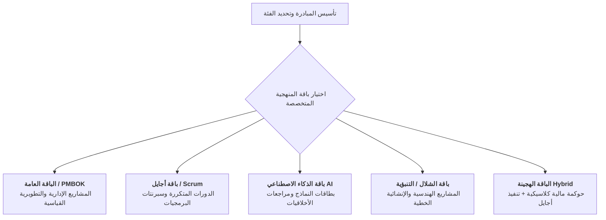

<!--
---
type: Guide
---
-->

  🌐 <strong>اللغة:</strong> الدليل التنفيذي باللغة العربية
  

    <a class="lang-switch-btn github-btn" href="https://github.com/fakhruldeen/Tasleemat/blob/main/docs/ar/managerial_tailoring_and_sizing.md" target="_blank" rel="noopener noreferrer">🐙 عرض على GitHub ↗</a>
    <a class="lang-switch-btn" href="../en/managerial_tailoring_and_sizing.html">🇬🇧 Switch to English Version (النسخة الإنجليزية) ←</a>
  

---

# ⚖️ دليل القيادات التنفيذية: مستويات تخصيص وتصنيف المشاريع (Sizing & Tailoring)
**مرجع الوثيقة:** `TASLEEMAT-EXEC-TAILORING-SIZING-AR`  
**الفئات المستهدفة:** رعاة المشاريع، مدراء مكاتب إدارة المشاريع (PMO)، مدراء المحافظ الاستثمارية، وقادة التحول المؤسسي  
**المعايير المرجعية:** معهد إدارة المشاريع العالمي PMI PMBOK® الإصدارات 6 و 7 و 8، ومعايير أيزو ISO 21500  

---

> [!NOTE]
> **إقرار نموذج الحوكمة المؤسسي المقترح**  
> تعد الحدود المالية وحزم النماذج الموضحة في هذا الدليل معايير استرشادية قياسية تتطلب مراجعة واعتماد القيادات التنفيذية بكل منشأة بما يتناسب مع درجة تقبل المخاطر واللوائح المالية المعتمدة.

---

## 🎯 الهدف الاستراتيجي: القضاء على الهدر والبيروقراطية الحوكمية

أحد أكثر أسباب الفشل شيوعاً في المنظمات هو تطبيق **سياسة الحوكمة الموحدة على الجميع (One-Size-Fits-All)**:
- إجبار مشروع برمجي داخلي سريع على إعداد 50 وثيقة ونموذجاً يؤدي لشلل الفريق وتأخر الإنجاز في أعباء شكلية.
- السماح لمشروع بنية تحتية بقيمة 50 مليون ريال بالعمل بأدنى حدود التوثيق يُعرّض المنشأة لمخاطر تعاقدية ومالية جسيمة.

تُعالج **منظومة التخصيص والتصنيف في تسليمات** هذه المعضلة عبر الفصل التام بين مسارين مستقلين:
1. **فئات الحوكمة المؤسسية (Governance Sizing Tiers)**: تحدد **كمية وعمق** التسليمات الإلزامية المطلوبة (3 فئات رئيسية).
2. **باقات المنهجيات التشغيلية (Methodology Packs)**: تحدد **نوعية النماذج المتخصصة** الواجب تفعيلها وفق طبيعة العمل (5 باقات).

---

## 🏛️ فئات الحوكمة الثلاث لحجم المشاريع (Tiers)

تُصنّف تسليمات كافة المبادرات المؤسسية إلى ثلاث فئات واضحة بناءً على الميزانية، والمدة، والمخاطر، وتعقيد أصحاب المصلحة:

| المعيار الحوكمي | الفئة 1: المشاريع الضخمة والاستراتيجية (Mega) | الفئة 2: المشاريع القياسية المؤسسية (Standard) | الفئة 3: المشاريع الرشيقة والسريعة (Lean) |
| :--- | :--- | :--- | :--- |
| **سقف الميزانية (ريال سعودي)** | **أكثر من 40,000,000 ريال** | **من 4,000,000 إلى 40,000,000 ريال** | **أقل من 4,000,000 ريال** |
| **سقف الميزانية (دولار أمريكي)** | **أكثر من \$10,000,000** | **من \$1,000,000 إلى \$10,000,000** | **أقل من \$1,000,000** |
| **المدى الزمني** | أكثر من 12 شهراً (متعدد السنوات) | من 3 إلى 12 شهراً | أقل من 3 أشهر |
| **مستوى التعقيد التشغيلي** | تعدد المقاولين، متطلبات رقابية عالية، مساس بالأنظمة الجوهرية | فرق عمل مشتركة، مورد خارجي رئيسي، رقابة عادية | فريق عمل داخلي، اعتمادية منخفضة، مخاطر محدودة |
| **عدد النماذج الإلزامية** | **35 إلى 50 مخرجاً معتمداً** | **18 إلى 25 مخرجاً معتمداً** | **7 إلى 9 مخرجات أساسية** |
| **دورية المراجعة والتقارير** | تقرير ومضي كل أسبوعين؛ اجتماع رسمي شهري للجنة التوجيه | تقرير شهري رسمي لمكتب إدارة المشاريع PMO | اجتماع أسبوعي سريع لمراجعة المحطات الرئيسية |
| **صلاحية الاعتماد النهائي** | لجنة التوجيه العليا، المدير المالي، مدير PMO | راعي المشروع التنفيذي ومسؤول الرقابة في PMO | راعي المشروع ومدير المشروع المباشر |

---

## 📦 باقات المنهجيات الخمس المتخصصة (Packs)

بينما تحدد الفئة (Tier) عمق التوثيق، تحدد باقة المنهجية طريقة التنفيذ. وتختار المنشأة باقة واحدة رئيسية لكل مشروع:

### 1. الباقة العامة (`general`)
- **الاستخدام:** مشاريع التحول الإداري، تطوير العمليات، والتحسين المؤسسي القياسي.
- **التسليمات المحورية:** الميثاق، نطاق العمل، الجدول الزمني، الميزانية، سجل المخاطر، تقارير الحالة، ومحضر التسليم.

### 2. باقة أجايل وسكرام (`agile`)
- **الاستخدام:** تطوير المنتجات الرقمية والتطبيقات سريعة التغير.
- **التسليمات المتخصصة:** لوحة رؤية المنتج، سجل مهام السبرنت، مقاييس التدفق وسلسلة القيمة (`PMO-06.12`)، سجل مراجعات الدروس (Retrospectives)، وقوائم التحقق من الجاهزية (DoD).

### 3. باقة حوكمة وهندسة الذكاء الاصطناعي (`ai`)
- **الاستخدام:** مشاريع التعلم الآلي، النماذج اللغوية الكبيرة، ومبادرات علم البيانات المتقدمة.
- **التسليمات المتخصصة:** تقييم الجاهزية (`PMO-02.03`)، لوحة حالات الاستخدام (`PMO-02.04`)، بطاقة النموذج وحقائقه (`PMO-02.05`)، تقييم الخصوصية والأخلاقيات (`PMO-02.06`)، وسجل مكتبة الأوامر (`PMO-05.09`).

### 4. باقة الشلال والمنهجية التنبؤية (`predictive`)
- **الاستخدام:** الإنشاءات، البنية التحتية، وشبكات الاتصالات الخاضعة لعقود توريد هندسية صارمة.
- **التسليمات المتخصصة:** قاموس تفصيلي لهيكل تجزئة العمل، خط الأساس للمسار الحرج (CPM)، ومحاضر القبول الفني المتدرجة.

### 5. الباقة الهجينة (`hybrid`)
- **الاستخدام:** المعيار المؤسسي السائد—حوكمة ورقابة مالية تنبؤية على مستوى المحفظة، مع تنفيذ مرن ورشيق لفرق العمل.
- **التسليمات المتخصصة:** تجمع بين مؤشرات تحليل القيمة المكتسبة (EVA) وسجلات السبرنتات وقوائم تسليم المخرجات السريعة.

---

## 🧮 خطوات اتخاذ قرار التخصيص للمشاريع

عند اعتماد بوابة العبور 1، تتبع القيادة التنفيذية الخطوات الأربع التالية:

1. **فحص الالتزام المالي:**
   - إذا تجاوزت الميزانية 40 مليون ريال (\$10M) $\leftarrow$ **تصنيف إلزامي كفئة 1 (Mega)**.
   - إذا قلت الميزانية عن 4 ملايين ريال والمدة أقل من 90 يوماً $\leftarrow$ **تأهيل فوري للفئة 3 (Lean)**.
   - كافة المشاريع الأخرى تُدرج تلقائياً ضمن **الفئة 2 (Standard)**.
2. **تقييم الرقابة التنظيمية الخارجية:**
   - المبادرات الخاضعة لجهات رقابية خارجية (مثل هيئة الحكومة الرقمية DGA أو البنك المركزي SAMA) تُرفع تلقائياً فئة واحدة للأعلى.
3. **تحديد أسلوب التنفيذ:**
   - اختيار باقة المنهجية المتوافقة مع أسلوب عمل الفريق.
4. **تثبيت التخصيص رسمياً:**
   - توثيق الفئة والباقة وأسباب استبعاد أي نموذج اختياري ضمن **خطة المواءمة والتخصيص (`PMO-02.01`)** قبل التوقيع الرسمي على ميثاق المشروع.
