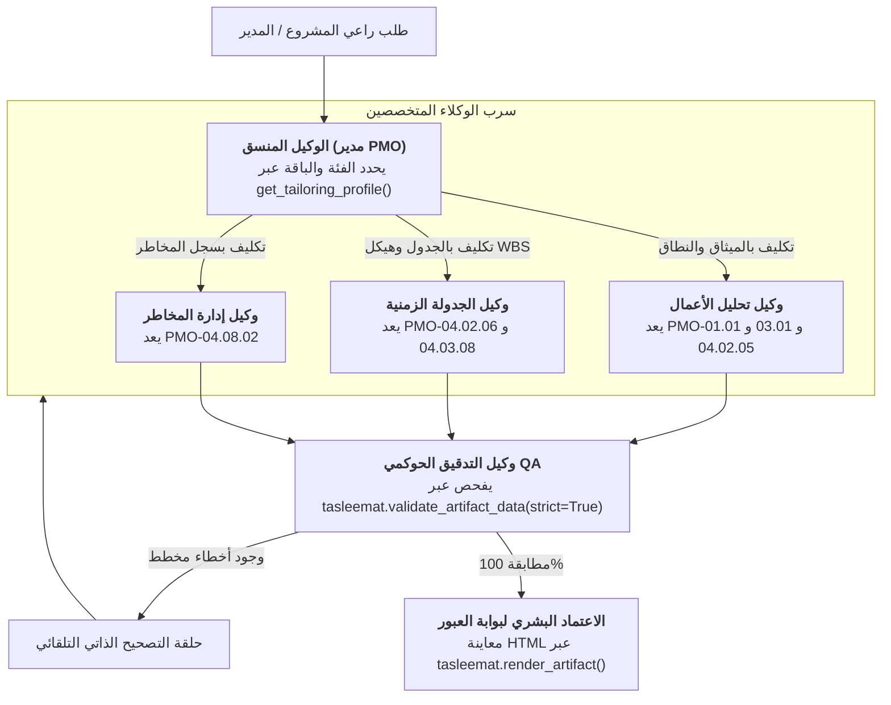

<!--
---
type: Guide
---
-->

<div class="lang-switch-bar">
  <span class="lang-switch-label">🌐 <strong>اللغة:</strong> الدليل التقني باللغة العربية</span>
  <div class="lang-switch-actions">
    <a class="lang-switch-btn github-btn" href="https://github.com/fakhruldeen/Tasleemat/blob/main/docs/ar/tech_agentic_and_multiagent_orchestration.md" target="_blank" rel="noopener noreferrer">🐙 عرض على GitHub ↗</a>
    <a class="lang-switch-btn" href="../en/tech_agentic_and_multiagent_orchestration.html">🇬🇧 Switch to English Version (النسخة الإنجليزية) ←</a>
  </div>
</div>

---

# 🤖 الدليل الهندسي: وكلاء الذكاء الاصطناعي والأنظمة متعددة الوكلاء (Agentic PMO)
**مرجع الوثيقة:** `TASLEEMAT-TECH-AGENTIC-MULTIAGENT-AR`  
**الفئات المستهدفة:** مطورو الوكلاء المستقلين (AI Agents)، معماريو الأنظمة متعددة الوكلاء، ومهندسو أتمتة PMO  
**أطر العمل المدعومة:** بروتوكول سياق النموذج (MCP)، CrewAI، LangGraph، AutoGen، و OpenAI Swarm  

---

## 🎯 المعمارية التشغيلية للوكلاء الأذكياء في إدارة المشاريع

في بيئات الأعمال الحديثة، أصبحت عمليات توثيق ومراجعة وحوكمة المشاريع تُدار بشكل متزايد عبر **الوكلاء المستقلين (Autonomous Single-Agent) والأنظمة متعددة الوكلاء (Multi-Agent Swarms)**. فبدلاً من النقل اليدوي للبيانات عبر عشرات الملفات، يقوم الوكلاء الأذكياء بالآتي:
1. استكشاف النماذج الإلزامية للمشروع برمجياً وفق حجمه ومنهجيته.
2. استيعاب محاضر الاجتماعات والقرارات التقنية.
3. تتبع وتتبع مخطط الاعتماديات المتجه غير الدائري (DAG) بين النماذج.
4. توليد وفحص وتصحيح الوثائق ذاتياً قبل تقديمها للمراجعة والاعتماد البشري.

يقدم هذا الدليل المخططات المعمارية والنماذج البرمجية لتشغيل تسليمات عبر **خادم MCP** و**أسراب الوكلاء المتعددة**.



---

## 🔌 1. تكامل الوكيل الفردي عبر بروتوكول سياق النموذج (MCP)

لبيئات البرمجة الذكية والمساعدات المستقلة (مثل **Claude Desktop** و **Cursor** و **OpenCode** و **Antigravity**)، توفر تسليمات خادماً رسمياً متوافقاً مع بروتوكول Model Context Protocol.

### ضبط إعدادات العميل (Stdio Configuration)
أضف الخادم إلى ملف إعدادات عميلك الذكي:

```json
{
  "mcpServers": {
    "tasleemat": {
      "command": "tasleemat",
      "args": ["mcp"]
    }
  }
}
```

### الأدوات الست الأساسية المتاحة للوكلاء

| اسم الأداة في MCP | المعاملات المدخلة | وظيفة الأداة البرمجية |
| :--- | :--- | :--- |
| `tasleemat_list_artifacts` | `category?: string`, `tier?: string` | استكشاف المخرجات المتاحة عبر مراحل دورة حياة المشروع الثماني. |
| `tasleemat_get_artifact` | `artifact_id: string` | استرجاع البيانات الوصفية وبصمة التجزئة والمخطط الهيكلي. |
| `tasleemat_get_asset` | `artifact_id: string`, `role: string`, `lang?: string` | جلب القالب الأصلي، أو الموجه، أو الدليل، أو المثال باللغة المطلوبة. |
| `tasleemat_get_lexicon` | `category?: string`, `query?: string` | استرجاع المصطلحات المعتمدة بالعربية والإنجليزية لمنع الانحراف الدلالي. |
| `tasleemat_validate_data` | `artifact_id: string`, `data: object`, `mode?: "strict" \| "draft"` | فحص صحة البيانات الهيكلية مقابل مخطط Draft 2020-12 المعتمد. |
| `tasleemat_render_artifact` | `artifact_id: string`, `data?: object`, `lang?: string` | تصيير الوثيقة المعتمدة إلى صفحة HTML منسقة ومستقلة للعرض. |

---

## 👥 2. معمارية سرب الوكلاء المتعددين (CrewAI / LangGraph Blueprint)

عند تنظيم العمل عبر أطر عمل الوكلاء المتعددين، يُقسّم الفريق إلى أربعة أدوار متخصصة:

### أ. الوكيل المنسق (مدير PMO الافتراضي)
- **الدور:** يحلل متطلبات المشروع، ويحدد الفئة والباقة عبر استدعاء `tasleemat.get_tailoring_profile(tier, pack)`، ويرتب تسلسل المهام وفق مخطط الاعتماديات في `docs/ar/07_document_dependencies.md`.
- **توجيه النظام (System Prompt):**
  > *"أنت المنسق العام لمكتب إدارة المشاريع. تلتزم بالاعتماديات الهيكلية للمشروع. لا تسمح بتوليد مخرجات لاحقة قبل اجتياز المخرجات السابقة لفحص التحقق البرمجي بنجاح."*

### ب. وكيل تحليل الأعمال (Business Analyst Agent)
- **الدور:** صياغة دراسة الجدوى (`PMO-01.01`)، ميثاق المشروع (`PMO-03.01`)، وبيان النطاق (`PMO-04.02.05`).
- **صلاحية الأدوات:** `get_artifact_asset(role="prompt")`, `get_artifact_asset(role="schema")`.

### ج. وكيل المخاطر والحوكمة (Risk & Governance Agent)
- **الدور:** بناء سجل المخاطر الشامل (`PMO-04.08.02`) وبطاقة نموذج الذكاء الاصطناعي (`PMO-02.05`) وضبط مصفوفات الاحتمالية والأثر.
- **صلاحية الأدوات:** `get_artifact_asset(role="dictionary")`, `validate_artifact_data`.

### د. وكيل الرقابة والتدقيق الحوكمي (QA Gatekeeper Agent)
- **الدور:** الحارس البرمجي لبوابات العبور. يلتقط مسودات الوكلاء، ويفحص بياناتها مقابل مخططات Draft 2020-12، ويصدر إما قرار الاعتماد أو توجيهات التصحيح الهيكلية.

---

## 🐍 3. نموذج برمجي لتنسيق الوكلاء عبر بايثون (LangGraph / Python Node)

```python
import tasleemat
from typing import Dict, Any

class PMOGatekeeperNode:
    """عقدة التدقيق الحوكمي الآلي في خط أنابيب الوكلاء الأذكياء."""
    
    def __init__(self, artifact_id: str):
        self.artifact_id = artifact_id

    def evaluate_agent_output(self, generated_payload: Dict[str, Any]) -> Dict[str, Any]:
        # التحقق البرمجي الصارم مقابل مخطط Draft 2020-12
        report = tasleemat.validate_artifact_data(
            artifact_id=self.artifact_id,
            data=generated_payload,
            strict=True
        )
        
        if report["valid"]:
            # تصيير الوثيقة كصفحة HTML للمعاينة البشرية
            html = tasleemat.render_artifact(
                artifact_id=self.artifact_id,
                data=generated_payload,
                format="html",
                lang="ar"
            )
            return {
                "status": "APPROVED",
                "html_preview": html,
                "remediation_instructions": None
            }
        else:
            # إرجاع تفاصيل الأخطاء للوكيل لتصحيح نفسه ذاتياً
            return {
                "status": "REJECTED",
                "html_preview": None,
                "remediation_instructions": {
                    "errors": report["errors"],
                    "guidance": "يرجى تصحيح الحقول وفق أخطاء مخطط Draft 2020-12 المرفقة."
                }
            }

# فحص تجريبي لمخرجات وكيل
gatekeeper = PMOGatekeeperNode("PMO-03.01")
agent_payload = {
    "project_name": "منصة التحول الرقمي السحابي",
    "project_code": "PRJ-2026-CLOUD-01",
    "start_date": "2026-11-01",
    "sponsor": "سعادة وكيل الوزارة"
}
result = gatekeeper.evaluate_agent_output(agent_payload)
print(f"نتيجة التدقيق الحوكمي: {result['status']}")
```

---

## 🔁 4. حلقة التصحيح الذاتي للوكلاء (Self-Correction Loop)

عندما ينتج وكيل التوليد بيانات لا تتطابق مع المخطط الهيكلي، يُحظر توقف النظام؛ بل يُفعّل نمط **التصحيح الذاتي التلقائي**:

```
الخطوة 1: يستدعي الوكيل أداة tasleemat_validate_data(artifact_id, payload, mode="draft")
الخطوة 2: يعيد المدقق تقريراً بالأخطاء: {"valid": false, "errors": [{"path": "/start_date", "message": "Expected format: date"}]}
الخطوة 3: يلتقط الوكيل الخطأ ويوجه نفسه:
         "الحقل '/start_date' يخالف صيغة RFC 3339. حوّل التاريخ إلى الصيغة المعيارية YYYY-MM-DD."
الخطوة 4: يحدّث الوكيل الكائن ويعيد الفحص بالوضع الصارم (strict=True).
الخطوة 5: عند الحصول على {"valid": true} فقط، يقوم الوكيل بكتابة المخرج النهائي في مساحة عمل المشروع.
```
