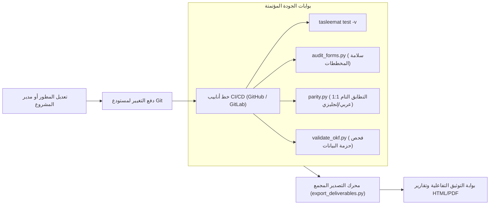

<!--
---
type: Guide
---
-->

<div class="lang-switch-bar">
  <span class="lang-switch-label">🌐 <strong>اللغة:</strong> الدليل التقني باللغة العربية</span>
  <div class="lang-switch-actions">
    <a class="lang-switch-btn github-btn" href="https://github.com/fakhruldeen/Tasleemat/blob/main/docs/ar/tech_cli_and_devops_automation.md" target="_blank" rel="noopener noreferrer">🐙 عرض على GitHub ↗</a>
    <a class="lang-switch-btn" href="../en/tech_cli_and_devops_automation.html">🇬🇧 Switch to English Version (النسخة الإنجليزية) ←</a>
  </div>
</div>

---

# ⚙️ الدليل الهندسي: أتمتة سطر الأوامر (CLI)، المعالجة المجمعة، وخطوط CI/CD
**مرجع الوثيقة:** `TASLEEMAT-TECH-CLI-DEVOPS-AR`  
**الفئات المستهدفة:** مهندسو DevOps، مهندسو البنية التحتية، مسؤولو أدوات PMO، ومطورو خطوط الأنابيب البرمجية  
**التقنيات الأساسية:** أداة `tasleemat` عبر الطرفية، سكربتات Bash، بايثون 3، خطوط GitHub Actions و GitLab CI، ومحركات تصدير HTML  

---

## 🎯 الأهداف المعمارية لفلسفة "الوثائق كشيفرة برمجية" (Docs-as-Code)

في بيئات العمل البرمجية المتقدمة، لا يمكن لحوكمة المشاريع أن تعتمد على النماذج الورقية أو برامج معالجة الكلمات المكتبية المنعزلة؛ بل يجب أن تتسم المنظومة بالتالي:
1. **القابلية للأتمتة عبر الطرفية بدون واجهة رسومية (Headless)**: تشغيل كافة العمليات عبر سكربتات دون الحاجة لتدخل يدوي.
2. **إدارة النسخ عبر Git**: حفظ وتتبع الوثائق جنباً إلى جنب مع الشيفرات البرمجية للتطبيقات.
3. **التدقيق الآلي في خطوط أنابيب CI/CD**: منع دمج أي طلب سحب (Pull Request) ما لم يستوفِ شروط ومخططات الحوكمة.
4. **التصدير المجمع للقيادات (HTML/PDF)**: تحويل وثائق ماركداون إلى صفحات وتقارير بصرية أنيقة تدعم الخطوط العربية والاتجاه من اليمين لليسار (RTL).

يقدم هذا الدليل السكربتات الميدانية وإعدادات خطوط الأنابيب لأتمتة تسليمات ضمن منظومتك التقنية.



---

## 💻 1. سكربتات الأتمتة المباشرة عبر الطرفية (CLI Automation)

توفر أداة `tasleemat` معاملات غير تفاعلية تتيح تشغيلها داخل السكربتات التلقائية:

### أ. تأسيس مساحة عمل المشروع آلياً (`init`)
توليد مجلد مشروع مخصص بالكامل بدون طرح أي أسئلة تفاعلية في الطرفية:

```bash
#!/usr/bin/env bash
set -euo pipefail

PROJECT_CODE="PRJ-2026-CLOUD-01"
PROJECT_NAME="مشروع التحول السحابي المؤسسي"
PM_NAME="سارة الأحمد"
SPONSOR_NAME="د. خالد المنصور"
OUTPUT_DIR="./workspaces/${PROJECT_CODE}"

# تأسيس مشروع من الفئة 2 (المتوسطة) مع باقة أجايل باللغتين العربية والإنجليزية
tasleemat init \
  --code "${PROJECT_CODE}" \
  --name "${PROJECT_NAME}" \
  --pm "${PM_NAME}" \
  --sponsor "${SPONSOR_NAME}" \
  --tier 2 \
  --pack agile \
  --lang both \
  --out "${OUTPUT_DIR}"

echo "✅ تم تأسيس مساحة عمل المشروع بنجاح في المجلد ${OUTPUT_DIR}"
```

### ب. البحث والاستعلام البرمجي في الفهرس (`list` & `search`)
البحث واستخراج معرفات النماذج برمجياً داخل سكربتات المعالجة:

```bash
# البحث عن نماذج إدارة المخاطر باللغة العربية
tasleemat search "مخاطر" --lang ar

# حساب إجمالي النماذج المعتمدة بالعربية
tasleemat list --lang ar | wc -l
```

### ج. ضبط مفاتيح الذكاء الاصطناعي برمجياً (`config`)
إعداد الحسابات والمفاتيح داخل بيئات البناء والحاويات (Docker Containers):

```bash
# ضبط مزود Gemini ومفتاحه في بيئة البناء
tasleemat config set \
  --provider gemini \
  --model gemini-2.5-flash \
  --key "${GEMINI_API_KEY}"

# استعراض الإعدادات النشطة
tasleemat config show
```

---

## 🖨️ 2. محرك التصدير المجمع للوثائق (`tools/export_deliverables.py`)

تحويل ملفات الماركداون إلى وثائق HTML احترافية متكاملة تتضمن التنسيقات وتدعم الاتجاه العربي (RTL) وخطوط Cairo:

```bash
# تصدير ميثاق المشروع باللغة العربية إلى صفحة HTML مستقلة
python3 tools/export_deliverables.py \
  forms/ar/03_البدء/01_ميثاق_المشروع/03_01_ميثاق_المشروع_قالب.md \
  -o ./dist/03_01_ميثاق_المشروع.html

# تصدير ميثاق المشروع باللغة الإنجليزية
python3 tools/export_deliverables.py \
  forms/en/03_Initiating/01_Project_Charter/03_01_Project_Charter_Template.md \
  -o ./dist/03_01_Project_Charter.html

# تصدير مجلد المشروع بأكمله بكافة مجلداته الفرعية دفعة واحدة
python3 tools/export_deliverables.py ./my_project_workspace/
```

---

## ⚙️ 3. إعداد خط أنابيب التكامل المستمر (GitHub Actions Pipeline)

ملف سير العمل `.github/workflows/governance_check.yml` للتحقق التلقائي مع كل عملية دفع:

```yaml
name: Enterprise Governance & Docs-as-Code Pipeline

on:
  push:
    branches: [ main, develop ]
  pull_request:
    branches: [ main ]

jobs:
  governance-validation:
    runs-on: ubuntu-latest
    steps:
      - name: فحص واسترجاع المستودع
        uses: actions/checkout@v4

      - name: إعداد بيئة بايثون
        uses: actions/setup-python@v5
        with:
          python-version: "3.12"
          cache: "pip"

      - name: تثبيت حزمة تسليمات ومكتبات الفحص
        run: |
          python -m pip install --upgrade pip
          pip install -e .
          pip install pytest typeguard pyyaml frictionless

      - name: فحص جداول الحوكمة وسلامة المخططات
        run: python3 tools/audit_forms.py

      - name: التحقق من التطابق التام 1:1 عربي/إنجليزي
        run: python3 tools/parity.py forms/en forms/ar

      - name: فحص حزمة البيانات المفتوحة Frictionless
        run: python3 tools/validate_okf.py

      - name: تشغيل حزمة الاختبارات الآلية الشاملة (130+ فحص)
        run: pytest tests/ -v

      - name: بناء بوابة التوثيق الثابتة التفاعلية
        run: python3 tools/generate_documentation_portal.py

      - name: رفع مخرجات البوابة كأصول معتمدة
        uses: actions/upload-artifact@v4
        with:
          name: enterprise-pmo-portal
          path: site/
```

---

## 🔒 4. أفضل الممارسات الأمنية لبيئات الإنتاج

1. **إدارة المفاتيح البرمجية**:
   - لا تضع مفاتيح الربط البرمجي داخل ملفات الشيفرة مطلقاً؛ مرر متغيرات `GEMINI_API_KEY` عبر خزائن الأسرار المشفرة (Secrets).
2. **فحوصات البناء غير المكلفة (Offline Mocking)**:
   - في الفحوصات المتكررة لطلبات السحب، شغّل التوليد بالخيار الوهمي `--mock` لضمان صحة المنطق دون استهلاك رصيد المفاتيح.
3. **التحقق من بصمات التجزئة الرقمية المشفرة (SHA-256)**:
   - في بيئات التدقيق، افحص البصمة الرقمية للوثائق وتأكد من مطابقتها لقرارات لجان التغيير المعتمدة.
