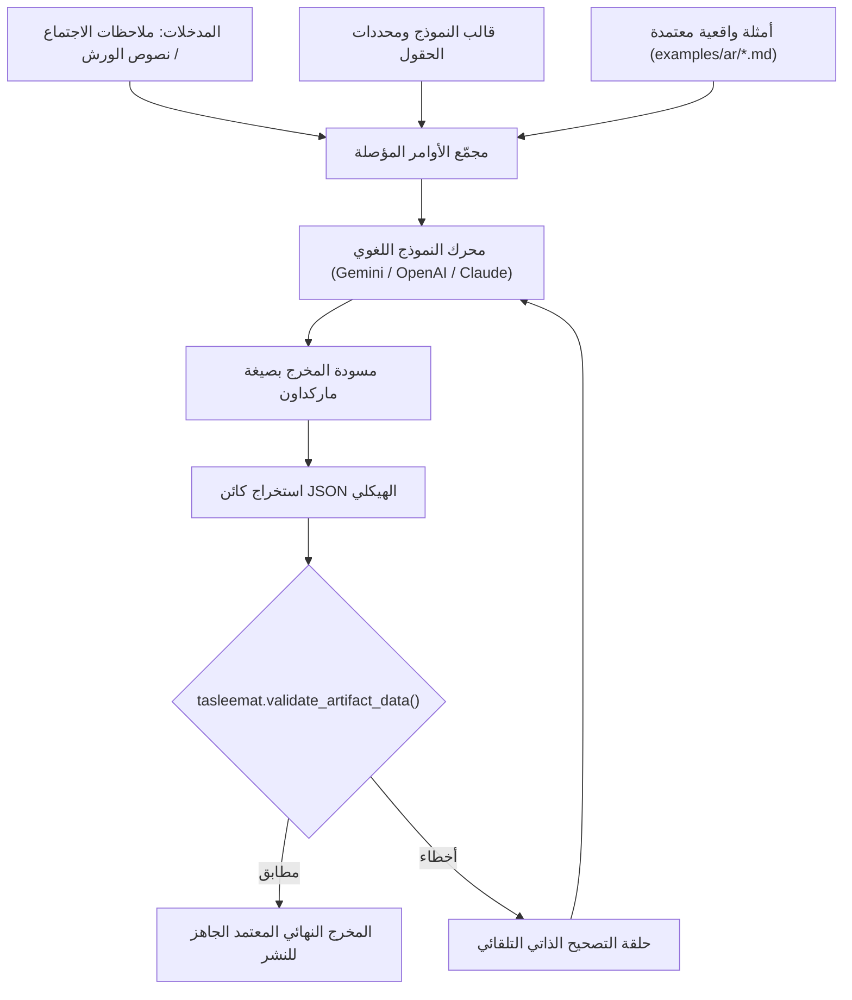

<!--
---
type: Guide
---
-->

<div class="lang-switch-bar">
  <span class="lang-switch-label">🌐 <strong>اللغة:</strong> الدليل التقني باللغة العربية</span>
  <div class="lang-switch-actions">
    <a class="lang-switch-btn github-btn" href="https://github.com/fakhruldeen/Tasleemat/blob/main/docs/ar/tech_llm_synthesis_and_prompting.md" target="_blank" rel="noopener noreferrer">🐙 عرض على GitHub ↗</a>
    <a class="lang-switch-btn" href="../en/tech_llm_synthesis_and_prompting.html">🇬🇧 Switch to English Version (النسخة الإنجليزية) ←</a>
  </div>
</div>

---

# 🤖 الدليل الهندسي: توليد وتأصيل وثائق PMO بالنماذج اللغوية (LLM Synthesis)
**مرجع الوثيقة:** `TASLEEMAT-TECH-LLM-SYNTHESIS-AR`  
**الفئات المستهدفة:** مهندسو الذكاء الاصطناعي، معماريو الحلول، مهندسو الأوامر (Prompt Engineers)، ومطورو البرمجيات  
**التقنيات الأساسية:** حزمة بايثون (`tasleemat.ai`)، نماذج OpenAI GPT-4o، Anthropic Claude 3.5، Google Gemini 2.5، ونماذج Ollama المحلية  

---

## 🎯 المعمارية الهندسية للتوليد والتأصيل المعرفي

يتطلب توليد مخرجات ووثائق إدارة المشاريع المؤسسية بالنماذج اللغوية الكبيرة معمارية أكثر انضباطاً من مجرد المحادثات التوليدية الساذجة. فالأوامر المباشرة غير المؤصلة تؤدي في الغالب إلى:
1. **هلوسة هيكلية**: تباين العناوين، غياب جداول ضبط المستندات، وفبركة رموز الاعتماد.
2. **عدم مطابقة المخططات البرمجية**: تنسيق التواريخ بشكل خاطئ، غياب الحقول الإلزامية، أو قلب حسابات مصفوفة المخاطر.
3. **لغة إنشائية غير مهنية**: أسلوب محادثة فضفاض لا يليق بالعرض على لجان التوجيه والرعاة التنفيذيين.

تحل **منظومة التوليد والتأصيل في تسليمات** هذه المشاكل عبر **معمارية التأصيل ثلاثية الطبقات (Three-Tier Grounding)**:
- **الطبقة 1: الهيكل المنضبط**: الاستناد إلى قوالب وموجهات مهندسة مسبقاً (`forms/ar/.../*.md`).
- **الطبقة 2: أمثلة السياق الواقعية**: التغذية بأمثلة من الـ 228 نموذجاً تطبيقياً المعتمدة في `examples/ar/`.
- **الطبقة 3: الفحص الهيكلي البرمجي**: التحقق الآلي الصارم مقابل مخططات JSON Schemas عبر دالة `tasleemat.validate_artifact_data`.



---

## 🚀 1. عميل الذكاء الاصطناعي الموحد في بايثون (`tasleemat.ai.AIClient`)

تتضمن تسليمات عميلاً برمجياً متعدداً للمزودين صُمم خصيصاً لتوليد مخرجات إدارة المشاريع، ويقرأ مفاتيح الربط تلقائياً من الإعدادات `~/.tasleemat/config.json` أو متغيرات البيئة القياسية (`GEMINI_API_KEY`, `OPENAI_API_KEY`, `ANTHROPIC_API_KEY`).

### المزودون والنماذج المدعومة

| رمز المزود | النموذج الافتراضي | دعم العناوين المخصصة | متغير البيئة المستدعى |
| :--- | :--- | :---: | :--- |
| `gemini` | `gemini-2.5-flash` | لا | `GEMINI_API_KEY` |
| `openai` | `gpt-4o` | نعم (`api_base`) | `OPENAI_API_KEY` |
| `anthropic` | `claude-3-5-sonnet` | لا | `ANTHROPIC_API_KEY` |
| `ollama` | `llama3.3:latest` | نعم (`http://localhost:11434`) | بدون (تشغيل محلي بالكامل) |
| `mock` | `offline-deterministic` | محلي | بدون (للاختبارات وخطوط CI/CD) |

### نموذج تطبيقي متكامل في بايثون

```python
import os
import tasleemat
from tasleemat.ai import AIClient

# 1. تهيئة العميل البرمجي مع دعم التبديل التلقائي
ai_client = AIClient(provider="gemini", model="gemini-2.5-flash")

# 2. استرجاع القالب والموجه المعتمد لميثاق المشروع (PMO-03.01) بالعربية
charter_def = tasleemat.get_artifact_definition("PMO-03.01")
charter_prompt_template = tasleemat.get_artifact_asset("PMO-03.01", role="prompt", lang="ar")

# 3. تجميع الموجه البرمجي المؤصل
user_meeting_notes = """
المشروع: منصة الحوكمة الرقمية الموحدة
الراعي التنفيذي: سعادة وكيل الوزارة للتحول الرقمي
الميزانية التقديرية: 8,500,000 ريال سعودي
المدة الزمنية: 10 أشهر، الانطلاق في 2026-11-01.
الهدف الرئيسي: أتمتة إجراءات التراخيص وربط 8 جهات حكومية عبر بنية تكامل سحابية آمنة.
أبرز المخاطر: تباين جاهزية واجهات الربط البرمجي (APIs) لدى بعض الجهات الشريكة.
"""

system_instruction = (
    "أنت خبير ومدير أول لمكتب إدارة المشاريع (PMO Director). قم بتوليد ميثاق مشروع رسمي واحترافي "
    "مطابق تماماً للقالب المرفق أدناه. تجنب تماماً المقدمات الحوارية أو العبارات الختامية الخارجة عن صلب الوثيقة."
)

full_prompt = f"""
{charter_prompt_template}

### ملاحظات الاجتماع ومعطيات المشروع:
{user_meeting_notes}
"""

# 4. توليد الوثيقة الرسمية
generated_charter = ai_client.generate(
    prompt=full_prompt,
    system_instruction=system_instruction
)

print(f"تم توليد ميثاق المشروع بنجاح ({len(generated_charter)} حرف)")
```

---

## 🛠️ 2. التوليد عبر سطر الأوامر (`tasleemat generate`)

لأتمتة العمليات عبر سكربتات Bash الطرفية:

```bash
# توليد ميثاق المشروع من ملف ملاحظات نصي
tasleemat generate \
  --form PMO-03.01 \
  --notes ./transcripts/meeting_notes_ar.txt \
  --lang ar \
  --out ./my_project/03_01_ميثاق_المشروع.md

# توليد سجل المخاطر بالعربية باستخدام نموذج OpenAI
tasleemat generate \
  --form PMO-04.08.02 \
  --notes ./risk_workshop_notes.txt \
  --lang ar \
  --provider openai \
  --model gpt-4o \
  --out ./my_project/04_08_02_سجل_المخاطر.md

# تشغيل وهمي بدون استهلاك رصيد (مفيد لخطوط أنابيب CI/CD)
tasleemat generate \
  --form PMO-03.01 \
  --notes "بيانات اختبار الفحص" \
  --mock \
  --out /tmp/mock_charter.md
```

---

## 🔒 3. هندسة الأوامر الدفاعية: منع الهلوسة وفبركة الأرقام

عند توجيه النماذج لكتابة وثائق PMO، يُنصح بتطبيق ثلاثة ضوابط دفاعية محكمة:

### الضابط 1: توجيه `[ يتطلب إدخالاً بشرياً ]`
تضمين الشرط الصارم التالي في التعليمات التأسيسية:
> *"في حال غياب أي معلومة رقمية أو تاريخ دقيق أو اسم مورد في الملاحظات المدخلة، يجب كتابة `[ يتطلب إدخالاً بشرياً: <وصف الحقل> ]` بدلاً من اختلاق أو تخمين أي بيانات مالية أو تعاقدية."*

### الضابط 2: إلزامية جدول ضبط المستند (Document Control)
إلزام النموذج بملء جدول البيانات الوصفية في بداية الوثيقة:
```markdown
| خاصية الوثيقة | القيمة المؤسسية |
| :--- | :--- |
| **رمز المشروع** | PRJ-2026-DIGITAL-01 |
| **معرف الوثيقة** | PMO-03.01-CHARTER-AR |
| **معد الوثيقة** | مساعد تسليمات الذكي (بإشراف مدير المشروع) |
| **الإصدار** | 1.0 (مسودة معتمدة) |
| **درجة السرية** | سري داخلي |
```

### الضابط 3: كتلة البصمة الرقمية للتدقيق
تتضمن قوالب تسليمات وسماً مخصصاً لبصمة التجزئة الرقمية:
```markdown
<!-- AUDIT_BLOCK_START -->
**البصمة الرقمية المشفرة للتدقيق:** `{{Audit_Trail_SHA256_Hash}}`
<!-- AUDIT_BLOCK_END -->
```
تقوم خطوط الأنابيب البرمجية باستبدال هذا الوسم ببصمة SHA-256 الرقمية للمستند قبل تقديمه لبوابة العبور، مما يضمن كشف أي تعديل لاحق غير مصرح به.
