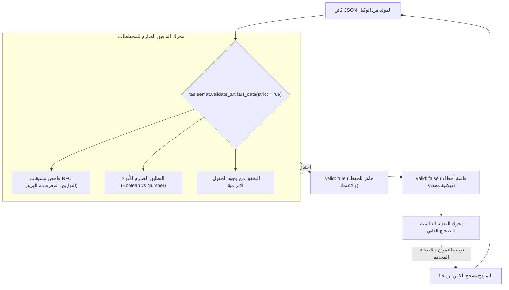

<!--
---
type: Guide
---
-->

<div class="lang-switch-bar">
  <span class="lang-switch-label">🌐 <strong>اللغة:</strong> الدليل التقني باللغة العربية</span>
  <div class="lang-switch-actions">
    <a class="lang-switch-btn github-btn" href="https://github.com/fakhruldeen/Tasleemat/blob/main/docs/ar/tech_schemas_and_validation_loops.md" target="_blank" rel="noopener noreferrer">🐙 عرض على GitHub ↗</a>
    <a class="lang-switch-btn" href="../en/tech_schemas_and_validation_loops.html">🇬🇧 Switch to English Version (النسخة الإنجليزية) ←</a>
  </div>
</div>

---

# 🛡️ الدليل الهندسي: مخططات Draft 2020-12 وتنسيقات RFC وحلقات التصحيح الذاتي
**مرجع الوثيقة:** `TASLEEMAT-TECH-SCHEMAS-VALIDATION-AR`  
**الفئات المستهدفة:** مهندسو البرمجيات، مطورو الواجهات الخلفية (Backend)، معماريو البيانات، ومهندسو خطوط أنابيب الذكاء الاصطناعي  
**التقنيات الأساسية:** مخططات JSON Schema Draft 2020-12، معايير RFC 3339، RFC 4122، RFC 3986، RFC 5322، ISO 8601، ومحرك الفحص في بايثون `tasleemat.validation`  

---

## 🎯 الأهمية المعمارية للتحقق الهيكلي الصارم

في خطوط أنابيب الوكلاء المستقلين وتبادل البيانات المؤتمت، يمثل قبول النصوص الإنشائية غير المقيدة ثغرة تقنية خطيرة. فالنماذج اللغوية غالباً ما تنتج مخرجات JSON تتضمن تشوهات طفيفة:
- تمرير نصوص برمجية في حقول رقمية تتطلب أعداداً صحيحة أو عشرية.
- كتابة القيم المنطقية كنصوص (`"true"` بدلاً من `true`).
- صياغة التواريخ بصيغ غير قياسية أو إغفال الطابع الزمني للمنطقة.
- إسقاط حقول الحوكمة الإلزامية غير المذكورة صراحة في نصوص الاجتماعات.

تحمي تسليمات سلامة الوثائق عبر **114 مخطط JSON Schema متوافق مع معيار Draft 2020-12** مدعومة بمحرك تحقق برمجي عالي السرعة (`tasleemat.validate_artifact_data`) يفرض قيود RFC الصارمة ويمكّن **حلقات التصحيح الذاتي للوكلاء الأذكياء**.



---

## 📐 1. معمارية مخططات Draft 2020-12 المرافقة

يحتوي كل نموذج من نماذج تسليمات الـ 114 على مخطط JSON مرافق مبني وفق مواصفة **JSON Schema Draft 2020-12**:

### نموذج المخطط الهيكلي المرافق لميثاق المشروع (`PMO-03.01.json`)

```json
{
  "$schema": "https://json-schema.org/draft/2020-12/schema",
  "$id": "https://tasleemat.org/schemas/pmo-03.01.json",
  "title": "مخطط ميثاق المشروع المعتمد",
  "type": "object",
  "required": [
    "project_code",
    "project_name",
    "start_date",
    "sponsor_name",
    "estimated_budget"
  ],
  "properties": {
    "project_code": {
      "type": "string",
      "pattern": "^PRJ-[0-9]{4}-[A-Z0-9_-]+$"
    },
    "project_name": {
      "type": "string",
      "minLength": 5,
      "maxLength": 120
    },
    "start_date": {
      "type": "string",
      "format": "date"
    },
    "sponsor_name": {
      "type": "string",
      "minLength": 3
    },
    "estimated_budget": {
      "type": "number",
      "minimum": 0
    }
  },
  "additionalProperties": false
}
```

---

## 🌐 2. تنسيقات RFC المدعومة في المحرك (`tasleemat.formats`)

يتضمن محرك الفحص فاحصات مدمجة مطابقة لمعايير الإنترنت الدولية:

| معرف التنسيق | المعيار الدولي الحاكم | مثال على القيمة الصحيحة | معايير الرفض الآلي |
| :--- | :--- | :--- | :--- |
| `date` | RFC 3339 / ISO 8601 | `"2026-11-01"` | الشهور غير المسبوقة بصفر، غياب الفواصل، أخطاء السنوات الكبيسة. |
| `date-time` | RFC 3339 | `"2026-11-01T09:30:00Z"` | غياب مؤشر النطاق الزمني (`Z` أو `+03:00`)، تجاوز خانات الساعات. |
| `time` | RFC 3339 | `"14:30:00"` | غياب خانة الثواني، استخدام نظام 12 ساعة صباحاً/مساءً. |
| `uuid` | RFC 4122 | `"550e8400-e29b-41d4-a716-446655440000"` | عدم صحة الفواصل، أحرف سداسية عشرية خاطئة، طول غير مطابق. |
| `uri` | RFC 3986 | `"https://pmo.tasleemat.org/api/v1"` | المسارات النسبية الخالية من البروتوكول، وجود مسافات غير مشفرة. |
| `uri-reference` | RFC 3986 | `"/docs/governance.html"` | الرموز غير المسموحة في الاستعلامات والمراجع النسبية. |
| `email` | RFC 5322 | `"pm.lead@tasleemat.org"` | غياب علامة `@`، غياب اسم النطاق، أو وجود رموز غير مسموحة. |
| `duration` | ISO 8601 Duration | `"P3M"`, `"P14D"`, `"PT2H30M"` | النصوص الوصفية الحرة (مثل `"3 أشهر"` أو `"أسبوعين"`). |

---

## 🔍 3. وضع الفحص الصارم مقابل وضع المسودة (Strict vs. Draft)

يدعم محرك الفحص وضعين تشغيليين حسب مرحلة المعالجة:

```python
import tasleemat

# 1. الوضع الصارم (Strict Mode - لبوابات العبور واختبارات CI/CD):
# يفرض وجود كافة الحقول الإلزامية ويحظر الحقول الإضافية غير المعرفة
strict_result = tasleemat.validate_artifact_data(
    artifact_id="PMO-03.01",
    data=payload,
    strict=True
)

# 2. وضع المسودة (Draft Mode - لمسودات الوكلاء والاستيفاء التدريجي):
# يفحص صحة أنواع الحقول المدخلة ولكنه يسمح بنقص الحقول الاختيارية أو المؤجلة
draft_result = tasleemat.validate_artifact_data(
    artifact_id="PMO-03.01",
    data=payload,
    strict=False
)
```

---

## 🔁 4. نموذج حلقة التصحيح الذاتي في بايثون (Self-Correction Loop)

لتمكين الوكلاء من تصحيح أخطائهم الهيكلية ذاتياً بدون توقف السكربت:

```python
import tasleemat
from tasleemat.ai import AIClient

def generate_and_validate_with_self_correction(artifact_id: str, prompt: str, max_retries: int = 3):
    client = AIClient(provider="gemini", model="gemini-2.5-flash")
    schema = tasleemat.get_artifact_asset(artifact_id, role="schema", lang="ar")
    
    current_prompt = f"{prompt}\nمخطط Draft 2020-12 المطلوب:\n{schema}"
    
    for attempt in range(1, max_retries + 1):
        # 1. توليد كائن JSON من النموذج اللغوي
        raw_json_str = client.generate(
            prompt=current_prompt,
            system_instruction="أخرج كائن JSON صالحاً ومطابقاً للمخطط بدقة تامة وبدون أي مقدمات نصية."
        )
        
        try:
            import json
            payload = json.loads(raw_json_str)
        except Exception as e:
            current_prompt += f"\nخطأ في صياغة JSON: {str(e)}. أعد الإخراج بصيغة صحيحة."
            continue
            
        # 2. التحقق البرمجي مقابل المخطط
        report = tasleemat.validate_artifact_data(artifact_id, payload, strict=True)
        
        if report["valid"]:
            print(f"✅ تم اجتياز الفحص بنجاح في المحاولة رقم {attempt}!")
            return payload
            
        # 3. صياغة توجيه التصحيح الذاتي الموجه بدقة
        error_messages = [f"- المسار '{err['path']}': {err['message']}" for err in report["errors"]]
        error_context = "\n".join(error_messages)
        
        print(f"⚠️ المحاولة {attempt} فشلت مع {len(report['errors'])} أخطاء. جاري إعادة المحاولة...")
        current_prompt = (
            f"مخرجات JSON السابقة تضمنت مخالفات لقواعد المخطط:\n"
            f"{error_context}\n\n"
            f"قم بتصحيح الحقول المذكورة أعلاه فقط وأعد إخراج كائن JSON المكتمل والصحيح."
        )
        
    raise ValueError(f"تعذر استيفاء شروط المخطط بعد {max_retries} محاولات تصحيح.")
```
