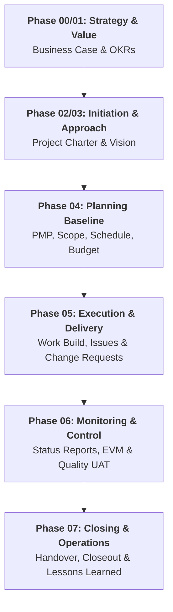

  🌐 <strong>Language:</strong> English Manual
  

    <a class="lang-switch-btn github-btn" href="https://github.com/fakhruldeen/Tasleemat/blob/main/docs/en/07_document_dependencies.md" target="_blank" rel="noopener noreferrer">🐙 View on GitHub ↗</a>
    <a class="lang-switch-btn" href="../ar/07_document_dependencies.html">🇸🇦 الانتقال للنسخة العربية (Arabic Manual) →</a>
  

---
type: Guide
token_pointer: /_tokens/docs/en/07_document_dependencies.npy
token_count: 7605
tokenizer_model_id: tiktoken/o200k_base
created_at: '2026-10-06T16:05:28.494351+00:00'
---

  

# 🔗 Tasleemat Document Dependencies & Lifecycle Network
**Document Reference:** `TASLEEMAT-DOC-DEPENDENCIES-v2.0`  
**Standards:** Aligned with PMI PMBOK® Guide 6th, 7th & 8th Editions

---

## 🎯 Executive Overview

In the **Tasleemat PMO Operating Framework**, no deliverable exists in isolation. Every artifact operates as a node in a **Directed Acyclic Graph (DAG)** connecting strategic drivers, baselines, execution logs, and closure assets across all 8 phases:

---

## 📋 Comprehensive Deliverable Dependency Index (All 114 Deliverables)

| Code | Deliverable Name | Lifecycle Gate / Phase | Primary Inputs (Predecessors) | Primary Outputs (Successors) |
| :---: | :--- | :--- | :--- | :--- |
| **`PMO-00.01`** | Portfolio Roadmap | Gate 0: Strategic Alignment | `Corporate Strategic Objectives, Mandates` | `Portfolio Roadmap, Program Charters` |
| **`PMO-00.02`** | Program Charter | Gate 0: Strategic Alignment | `Corporate Strategic Objectives, Mandates` | `Portfolio Roadmap, Program Charters` |
| **`PMO-00.03`** | Interdependency Register | Gate 0: Strategic Alignment | `Corporate Strategic Objectives, Mandates` | `Portfolio Roadmap, Program Charters` |
| **`PMO-00.04`** | Resource Capacity Matrix | Gate 0: Strategic Alignment | `Corporate Strategic Objectives, Mandates` | `Portfolio Roadmap, Program Charters` |
| **`PMO-00.05`** | PMO Maturity Assessment | Gate 0: Strategic Alignment | `Corporate Strategic Objectives, Mandates` | `Portfolio Roadmap, Program Charters` |
| **`PMO-00.06`** | OKR Alignment Matrix | Gate 0: Strategic Alignment | `Corporate Strategic Objectives, Mandates` | `Portfolio Roadmap, Program Charters` |
| **`PMO-01.01`** | Business Case | Gate 0: Concept & Feasibility | `Strategic Objectives, Problem Statement` | `Approved Business Case, Benefits Plan` |
| **`PMO-01.02`** | Benefits Management Plan | Gate 0: Concept & Feasibility | `Strategic Objectives, Problem Statement` | `Approved Business Case, Benefits Plan` |
| **`PMO-01.03`** | Value Realization Register | Gate 0: Concept & Feasibility | `Strategic Objectives, Problem Statement` | `Approved Business Case, Benefits Plan` |
| **`PMO-01.04`** | Gap Analysis Report | Gate 0: Concept & Feasibility | `Strategic Objectives, Problem Statement` | `Approved Business Case, Benefits Plan` |
| **`PMO-02.01`** | Tailoring Plan | Gate 1: Approach & Tailoring | `Business Case, Strategy Documents` | `Tailoring Plan, AI Governance Controls` |
| **`PMO-02.02`** | AI GOVERNANCE PLAN | Gate 1: Approach & Tailoring | `Business Case, Strategy Documents` | `Tailoring Plan, AI Governance Controls` |
| **`PMO-02.03`** | AI Readiness Assessment | Gate 1: Approach & Tailoring | `Business Case, Strategy Documents` | `Tailoring Plan, AI Governance Controls` |
| **`PMO-02.04`** | AI Use Case Canvas | Gate 1: Approach & Tailoring | `Business Case, Strategy Documents` | `Tailoring Plan, AI Governance Controls` |
| **`PMO-02.05`** | AI MODEL CARD AND FACT SHEET | Gate 1: Approach & Tailoring | `Business Case, Strategy Documents` | `Tailoring Plan, AI Governance Controls` |
| **`PMO-02.06`** | DATA PRIVACY AND ETHICS ASSESSMENT | Gate 1: Approach & Tailoring | `Business Case, Strategy Documents` | `Tailoring Plan, AI Governance Controls` |
| **`PMO-03.01`** | PROJECT CHARTER | Gate 1: Initiation & Charter | `Approved Business Case, Tailoring Plan` | `Signed Project Charter, Stakeholder Register` |
| **`PMO-03.02`** | PRODUCT VISION | Gate 1: Initiation & Charter | `Approved Business Case, Tailoring Plan` | `Signed Project Charter, Stakeholder Register` |
| **`PMO-03.03`** | ASSUMPTION LOG | Gate 1: Initiation & Charter | `Approved Business Case, Tailoring Plan` | `Signed Project Charter, Stakeholder Register` |
| **`PMO-03.04`** | Stakeholder Register | Gate 1: Initiation & Charter | `Approved Business Case, Tailoring Plan` | `Signed Project Charter, Stakeholder Register` |
| **`PMO-03.05`** | STAKEHOLDER ANALYSIS | Gate 1: Initiation & Charter | `Approved Business Case, Tailoring Plan` | `Signed Project Charter, Stakeholder Register` |
| **`PMO-04.01.01`** | PROJECT MANAGEMENT PLAN | Gate 2: Planning Baseline | `Project Charter, Stakeholder Register` | `Approved Baseline Plans (Scope, Schedule, Budget)` |
| **`PMO-04.01.02`** | CHANGE MANAGEMENT PLAN | Gate 2: Planning Baseline | `Project Charter, Stakeholder Register` | `Approved Baseline Plans (Scope, Schedule, Budget)` |
| **`PMO-04.01.03`** | PROJECT ROADMAP | Gate 2: Planning Baseline | `Project Charter, Stakeholder Register` | `Approved Baseline Plans (Scope, Schedule, Budget)` |
| **`PMO-04.02.01`** | SCOPE MANAGEMENT PLAN | Gate 2: Planning Baseline | `Project Charter, Stakeholder Register` | `Approved Baseline Plans (Scope, Schedule, Budget)` |
| **`PMO-04.02.02`** | REQUIREMENTS MANAGEMENT PLAN | Gate 2: Planning Baseline | `Project Charter, Stakeholder Register` | `Approved Baseline Plans (Scope, Schedule, Budget)` |
| **`PMO-04.02.03`** | REQUIREMENTS DOCUMENTATION | Gate 2: Planning Baseline | `Project Charter, Stakeholder Register` | `Approved Baseline Plans (Scope, Schedule, Budget)` |
| **`PMO-04.02.04`** | REQUIREMENTS TRACEABILITY MATRIX | Gate 2: Planning Baseline | `Project Charter, Stakeholder Register` | `Approved Baseline Plans (Scope, Schedule, Budget)` |
| **`PMO-04.02.05`** | PROJECT SCOPE STATEMENT | Gate 2: Planning Baseline | `Project Charter, Stakeholder Register` | `Approved Baseline Plans (Scope, Schedule, Budget)` |
| **`PMO-04.02.06`** | WORK BREAKDOWN STRUCTURE | Gate 2: Planning Baseline | `Project Charter, Stakeholder Register` | `Approved Baseline Plans (Scope, Schedule, Budget)` |
| **`PMO-04.02.07`** | WBS DICTIONARY | Gate 2: Planning Baseline | `Project Charter, Stakeholder Register` | `Approved Baseline Plans (Scope, Schedule, Budget)` |
| **`PMO-04.02.08`** | PRODUCT BACKLOG | Gate 2: Planning Baseline | `Project Charter, Stakeholder Register` | `Approved Baseline Plans (Scope, Schedule, Budget)` |
| **`PMO-04.02.09`** | USER STORY MAPPING CANVAS | Gate 2: Planning Baseline | `Project Charter, Stakeholder Register` | `Approved Baseline Plans (Scope, Schedule, Budget)` |
| **`PMO-04.03.01`** | SCHEDULE MANAGEMENT PLAN | Gate 2: Planning Baseline | `Project Charter, Stakeholder Register` | `Approved Baseline Plans (Scope, Schedule, Budget)` |
| **`PMO-04.03.02`** | ACTIVITY LIST | Gate 2: Planning Baseline | `Project Charter, Stakeholder Register` | `Approved Baseline Plans (Scope, Schedule, Budget)` |
| **`PMO-04.03.03`** | ACTIVITY ATTRIBUTES | Gate 2: Planning Baseline | `Project Charter, Stakeholder Register` | `Approved Baseline Plans (Scope, Schedule, Budget)` |
| **`PMO-04.03.04`** | MILESTONE LIST | Gate 2: Planning Baseline | `Project Charter, Stakeholder Register` | `Approved Baseline Plans (Scope, Schedule, Budget)` |
| **`PMO-04.03.05`** | NETWORK DIAGRAM | Gate 2: Planning Baseline | `Project Charter, Stakeholder Register` | `Approved Baseline Plans (Scope, Schedule, Budget)` |
| **`PMO-04.03.06`** | DURATION ESTIMATES | Gate 2: Planning Baseline | `Project Charter, Stakeholder Register` | `Approved Baseline Plans (Scope, Schedule, Budget)` |
| **`PMO-04.03.07`** | DURATION ESTIMATING WORKSHEET | Gate 2: Planning Baseline | `Project Charter, Stakeholder Register` | `Approved Baseline Plans (Scope, Schedule, Budget)` |
| **`PMO-04.03.08`** | PROJECT SCHEDULE | Gate 2: Planning Baseline | `Project Charter, Stakeholder Register` | `Approved Baseline Plans (Scope, Schedule, Budget)` |
| **`PMO-04.03.09`** | RELEASE PLAN | Gate 2: Planning Baseline | `Project Charter, Stakeholder Register` | `Approved Baseline Plans (Scope, Schedule, Budget)` |
| **`PMO-04.03.10`** | SPRINT PLANNING LOG | Gate 2: Planning Baseline | `Project Charter, Stakeholder Register` | `Approved Baseline Plans (Scope, Schedule, Budget)` |
| **`PMO-04.04.01`** | COST MANAGEMENT PLAN | Gate 2: Planning Baseline | `Project Charter, Stakeholder Register` | `Approved Baseline Plans (Scope, Schedule, Budget)` |
| **`PMO-04.04.02`** | COST ESTIMATES | Gate 2: Planning Baseline | `Project Charter, Stakeholder Register` | `Approved Baseline Plans (Scope, Schedule, Budget)` |
| **`PMO-04.04.03`** | COST ESTIMATING WORKSHEET | Gate 2: Planning Baseline | `Project Charter, Stakeholder Register` | `Approved Baseline Plans (Scope, Schedule, Budget)` |
| **`PMO-04.04.04`** | COST BASELINE | Gate 2: Planning Baseline | `Project Charter, Stakeholder Register` | `Approved Baseline Plans (Scope, Schedule, Budget)` |
| **`PMO-04.05.01`** | QUALITY MANAGEMENT PLAN | Gate 2: Planning Baseline | `Project Charter, Stakeholder Register` | `Approved Baseline Plans (Scope, Schedule, Budget)` |
| **`PMO-04.05.02`** | QUALITY METRICS | Gate 2: Planning Baseline | `Project Charter, Stakeholder Register` | `Approved Baseline Plans (Scope, Schedule, Budget)` |
| **`PMO-04.05.03`** | Definition of Ready and Done Standard | Gate 2: Planning Baseline | `Project Charter, Stakeholder Register` | `Approved Baseline Plans (Scope, Schedule, Budget)` |
| **`PMO-04.06.01`** | RESOURCE MANAGEMENT PLAN | Gate 2: Planning Baseline | `Project Charter, Stakeholder Register` | `Approved Baseline Plans (Scope, Schedule, Budget)` |
| **`PMO-04.06.02`** | RESOURCE REQUIREMENTS | Gate 2: Planning Baseline | `Project Charter, Stakeholder Register` | `Approved Baseline Plans (Scope, Schedule, Budget)` |
| **`PMO-04.06.03`** | RESOURCE BREAKDOWN STRUCTURE | Gate 2: Planning Baseline | `Project Charter, Stakeholder Register` | `Approved Baseline Plans (Scope, Schedule, Budget)` |
| **`PMO-04.06.04`** | RESPONSIBILITY ASSIGNMENT MATRIX | Gate 2: Planning Baseline | `Project Charter, Stakeholder Register` | `Approved Baseline Plans (Scope, Schedule, Budget)` |
| **`PMO-04.06.05`** | TEAM CHARTER | Gate 2: Planning Baseline | `Project Charter, Stakeholder Register` | `Approved Baseline Plans (Scope, Schedule, Budget)` |
| **`PMO-04.06.06`** | Team Psychological Safety and Wellbeing Index | Gate 2: Planning Baseline | `Project Charter, Stakeholder Register` | `Approved Baseline Plans (Scope, Schedule, Budget)` |
| **`PMO-04.07.01`** | COMMUNICATIONS MANAGEMENT PLAN | Gate 2: Planning Baseline | `Project Charter, Stakeholder Register` | `Approved Baseline Plans (Scope, Schedule, Budget)` |
| **`PMO-04.07.02`** | COMMUNICATIONS DISTRIBUTION MATRIX | Gate 2: Planning Baseline | `Project Charter, Stakeholder Register` | `Approved Baseline Plans (Scope, Schedule, Budget)` |
| **`PMO-04.08.01`** | RISK MANAGEMENT PLAN | Gate 2: Planning Baseline | `Project Charter, Stakeholder Register` | `Approved Baseline Plans (Scope, Schedule, Budget)` |
| **`PMO-04.08.02`** | RISK REGISTER | Gate 2: Planning Baseline | `Project Charter, Stakeholder Register` | `Approved Baseline Plans (Scope, Schedule, Budget)` |
| **`PMO-04.08.03`** | PROBABILITY AND IMPACT ASSESSMENT | Gate 2: Planning Baseline | `Project Charter, Stakeholder Register` | `Approved Baseline Plans (Scope, Schedule, Budget)` |
| **`PMO-04.08.04`** | PROBABILITY AND IMPACT MATRIX | Gate 2: Planning Baseline | `Project Charter, Stakeholder Register` | `Approved Baseline Plans (Scope, Schedule, Budget)` |
| **`PMO-04.08.05`** | RISK DATA SHEET | Gate 2: Planning Baseline | `Project Charter, Stakeholder Register` | `Approved Baseline Plans (Scope, Schedule, Budget)` |
| **`PMO-04.08.06`** | RISK REPORT | Gate 2: Planning Baseline | `Project Charter, Stakeholder Register` | `Approved Baseline Plans (Scope, Schedule, Budget)` |
| **`PMO-04.08.07`** | RISK MITIGATION ACTION PLAN | Gate 2: Planning Baseline | `Project Charter, Stakeholder Register` | `Approved Baseline Plans (Scope, Schedule, Budget)` |
| **`PMO-04.09.01`** | PROCUREMENT MANAGEMENT PLAN | Gate 2: Planning Baseline | `Project Charter, Stakeholder Register` | `Approved Baseline Plans (Scope, Schedule, Budget)` |
| **`PMO-04.09.02`** | PROCUREMENT STRATEGY | Gate 2: Planning Baseline | `Project Charter, Stakeholder Register` | `Approved Baseline Plans (Scope, Schedule, Budget)` |
| **`PMO-04.09.03`** | SOURCE SELECTION CRITERIA | Gate 2: Planning Baseline | `Project Charter, Stakeholder Register` | `Approved Baseline Plans (Scope, Schedule, Budget)` |
| **`PMO-04.09.04`** | Statement of Work | Gate 2: Planning Baseline | `Project Charter, Stakeholder Register` | `Approved Baseline Plans (Scope, Schedule, Budget)` |
| **`PMO-04.09.05`** | Request for Proposal | Gate 2: Planning Baseline | `Project Charter, Stakeholder Register` | `Approved Baseline Plans (Scope, Schedule, Budget)` |
| **`PMO-04.10.01`** | STAKEHOLDER ENGAGEMENT PLAN | Gate 2: Planning Baseline | `Project Charter, Stakeholder Register` | `Approved Baseline Plans (Scope, Schedule, Budget)` |
| **`PMO-04.10.02`** | STAKEHOLDER ENGAGEMENT ASSESSMENT MATRIX | Gate 2: Planning Baseline | `Project Charter, Stakeholder Register` | `Approved Baseline Plans (Scope, Schedule, Budget)` |
| **`PMO-04.11.01`** | OCM Strategy and Plan | Gate 2: Planning Baseline | `Project Charter, Stakeholder Register` | `Approved Baseline Plans (Scope, Schedule, Budget)` |
| **`PMO-04.11.02`** | Training Plan and Log | Gate 2: Planning Baseline | `Project Charter, Stakeholder Register` | `Approved Baseline Plans (Scope, Schedule, Budget)` |
| **`PMO-04.12.01`** | Sustainability and ESG Management Plan | Gate 2: Planning Baseline | `Project Charter, Stakeholder Register` | `Approved Baseline Plans (Scope, Schedule, Budget)` |
| **`PMO-04.13.01`** | INFORMATION SECURITY AND COMPLIANCE PLAN | Gate 2: Planning Baseline | `Project Charter, Stakeholder Register` | `Approved Baseline Plans (Scope, Schedule, Budget)` |
| **`PMO-05.01`** | ISSUE LOG | Gate 3: Execution & Coordination | `Baseline Plans, Work Packages` | `Completed Work Packages, Operational Logs` |
| **`PMO-05.02`** | DECISION LOG | Gate 3: Execution & Coordination | `Baseline Plans, Work Packages` | `Completed Work Packages, Operational Logs` |
| **`PMO-05.03`** | CHANGE REQUEST | Gate 3: Execution & Coordination | `Baseline Plans, Work Packages` | `Completed Work Packages, Operational Logs` |
| **`PMO-05.04`** | CHANGE LOG | Gate 3: Execution & Coordination | `Baseline Plans, Work Packages` | `Completed Work Packages, Operational Logs` |
| **`PMO-05.05`** | QUALITY AUDIT REPORT | Gate 3: Execution & Coordination | `Baseline Plans, Work Packages` | `Completed Work Packages, Operational Logs` |
| **`PMO-05.06`** | TEAM PERFORMANCE ASSESSMENT | Gate 3: Execution & Coordination | `Baseline Plans, Work Packages` | `Completed Work Packages, Operational Logs` |
| **`PMO-05.07`** | LESSONS LEARNED REGISTER | Gate 3: Execution & Coordination | `Baseline Plans, Work Packages` | `Completed Work Packages, Operational Logs` |
| **`PMO-05.08`** | RETROSPECTIVE | Gate 3: Execution & Coordination | `Baseline Plans, Work Packages` | `Completed Work Packages, Operational Logs` |
| **`PMO-05.09`** | Prompt Library Log | Gate 3: Execution & Coordination | `Baseline Plans, Work Packages` | `Completed Work Packages, Operational Logs` |
| **`PMO-05.10`** | Impediment Log | Gate 3: Execution & Coordination | `Baseline Plans, Work Packages` | `Completed Work Packages, Operational Logs` |
| **`PMO-05.11`** | Meeting Minutes | Gate 3: Execution & Coordination | `Baseline Plans, Work Packages` | `Completed Work Packages, Operational Logs` |
| **`PMO-05.12`** | Team Onboarding Checklist | Gate 3: Execution & Coordination | `Baseline Plans, Work Packages` | `Completed Work Packages, Operational Logs` |
| **`PMO-05.13`** | ACTION ITEMS LOG | Gate 3: Execution & Coordination | `Baseline Plans, Work Packages` | `Completed Work Packages, Operational Logs` |
| **`PMO-05.14`** | WORKSTREAM COORDINATION AND STANDUP LOG | Gate 3: Execution & Coordination | `Baseline Plans, Work Packages` | `Completed Work Packages, Operational Logs` |
| **`PMO-05.15`** | DELIVERABLE TECHNICAL INSPECTION CHECKLIST | Gate 3: Execution & Coordination | `Baseline Plans, Work Packages` | `Completed Work Packages, Operational Logs` |
| **`PMO-06.01`** | PROJECT STATUS REPORT | Gate 3: Monitoring & EVM | `Work Performance Data, Deliverables` | `Status Reports, EVM Metrics, Acceptance Forms` |
| **`PMO-06.02`** | TEAM MEMBER STATUS REPORT | Gate 3: Monitoring & EVM | `Work Performance Data, Deliverables` | `Status Reports, EVM Metrics, Acceptance Forms` |
| **`PMO-06.03`** | CONTRACTOR STATUS REPORT | Gate 3: Monitoring & EVM | `Work Performance Data, Deliverables` | `Status Reports, EVM Metrics, Acceptance Forms` |
| **`PMO-06.04`** | VARIANCE ANALYSIS | Gate 3: Monitoring & EVM | `Work Performance Data, Deliverables` | `Status Reports, EVM Metrics, Acceptance Forms` |
| **`PMO-06.05`** | EARNED VALUE ANALYSIS REPORT | Gate 3: Monitoring & EVM | `Work Performance Data, Deliverables` | `Status Reports, EVM Metrics, Acceptance Forms` |
| **`PMO-06.06`** | RISK AUDIT REPORT | Gate 3: Monitoring & EVM | `Work Performance Data, Deliverables` | `Status Reports, EVM Metrics, Acceptance Forms` |
| **`PMO-06.07`** | PROCUREMENT AUDIT REPORT | Gate 3: Monitoring & EVM | `Work Performance Data, Deliverables` | `Status Reports, EVM Metrics, Acceptance Forms` |
| **`PMO-06.08`** | PRODUCT ACCEPTANCE FORM | Gate 3: Monitoring & EVM | `Work Performance Data, Deliverables` | `Status Reports, EVM Metrics, Acceptance Forms` |
| **`PMO-06.09`** | Vendor Performance Scorecard | Gate 3: Monitoring & EVM | `Work Performance Data, Deliverables` | `Status Reports, EVM Metrics, Acceptance Forms` |
| **`PMO-06.10`** | User Acceptance Testing Signoff | Gate 3: Monitoring & EVM | `Work Performance Data, Deliverables` | `Status Reports, EVM Metrics, Acceptance Forms` |
| **`PMO-06.11`** | Project Health Check Matrix | Gate 3: Monitoring & EVM | `Work Performance Data, Deliverables` | `Status Reports, EVM Metrics, Acceptance Forms` |
| **`PMO-06.12`** | Flow Metrics and Value Stream Dashboard | Gate 3: Monitoring & EVM | `Work Performance Data, Deliverables` | `Status Reports, EVM Metrics, Acceptance Forms` |
| **`PMO-06.13`** | EXECUTIVE STEERING COMMITTEE DASHBOARD | Gate 3: Monitoring & EVM | `Work Performance Data, Deliverables` | `Status Reports, EVM Metrics, Acceptance Forms` |
| **`PMO-06.14`** | MILESTONE TREND ANALYSIS AND SLIP CHART | Gate 3: Monitoring & EVM | `Work Performance Data, Deliverables` | `Status Reports, EVM Metrics, Acceptance Forms` |
| **`PMO-06.15`** | DEFECT AND BUG TRACKING LOG | Gate 3: Monitoring & EVM | `Work Performance Data, Deliverables` | `Status Reports, EVM Metrics, Acceptance Forms` |
| **`PMO-06.16`** | RISK AND ISSUE ESCALATION REPORT | Gate 3: Monitoring & EVM | `Work Performance Data, Deliverables` | `Status Reports, EVM Metrics, Acceptance Forms` |
| **`PMO-07.01`** | LESSONS LEARNED SUMMARY | Gate 4/5: Handover & Closeout | `Verified Deliverables, Acceptance Signoffs` | `Closed Contracts, Handover Records, Lessons Learned` |
| **`PMO-07.02`** | CONTRACT CLOSEOUT REPORT | Gate 4/5: Handover & Closeout | `Verified Deliverables, Acceptance Signoffs` | `Closed Contracts, Handover Records, Lessons Learned` |
| **`PMO-07.03`** | PROJECT OR PHASE CLOSEOUT | Gate 4/5: Handover & Closeout | `Verified Deliverables, Acceptance Signoffs` | `Closed Contracts, Handover Records, Lessons Learned` |
| **`PMO-07.04`** | Transition to Operations Checklist | Gate 4/5: Handover & Closeout | `Verified Deliverables, Acceptance Signoffs` | `Closed Contracts, Handover Records, Lessons Learned` |
| **`PMO-07.05`** | Post-Implementation Review Report | Gate 4/5: Handover & Closeout | `Verified Deliverables, Acceptance Signoffs` | `Closed Contracts, Handover Records, Lessons Learned` |
| **`PMO-07.06`** | KNOWLEDGE TRANSFER AND ASSET ARCHIVAL SIGNOFF | Gate 4/5: Handover & Closeout | `Verified Deliverables, Acceptance Signoffs` | `Closed Contracts, Handover Records, Lessons Learned` |
| **`PMO-07.07`** | ADMINISTRATIVE AND RESOURCE RELEASE FORM | Gate 4/5: Handover & Closeout | `Verified Deliverables, Acceptance Signoffs` | `Closed Contracts, Handover Records, Lessons Learned` |

---

> [!NOTE] **Proposed Governance Framework Disclaimer**
> The lifecycle predecessor and successor relationships defined in this matrix represent a recommended operational reference flow aligned with PMI / PMBOK® standards. Enterprise PMOs should adjust and tailor these dependencies according to project methodology, contractual arrangements, and internal workflow requirements.