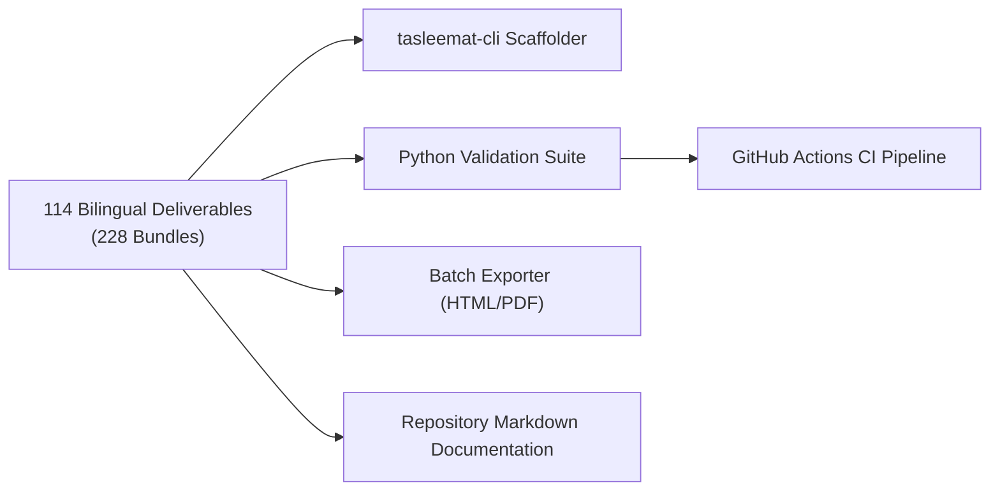

<div class="lang-switch-bar">
  <span class="lang-switch-label">🌐 <strong>Language:</strong> English Manual</span>
  <div class="lang-switch-actions">
    <a class="lang-switch-btn github-btn" href="https://github.com/fakhruldeen/Tasleemat/blob/main/docs/en/11_tools_and_automation.md" target="_blank" rel="noopener noreferrer">🐙 View on GitHub ↗</a>
    <a class="lang-switch-btn" href="../ar/11_tools_and_automation.html">🇸🇦 الانتقال للنسخة العربية (Arabic Manual) →</a>
  </div>
</div>

---
type: Guide
token_pointer: /_tokens/docs/en/11_tools_and_automation.npy
token_count: 1753
tokenizer_model_id: tiktoken/o200k_base
created_at: '2026-10-06T16:05:28.492539+00:00'
---

<p align="center">
  
</p>

---

# 🛠️ Developer Tools, Automation, & CI/CD Integration Guide
**Document ID:** `TASLEEMAT-GUIDE-11-TOOLS-AUTOMATION`  
**Version:** 2.0  
**Target Audience:** DevOps Engineers, PMO Tool Administrators, Software Developers, Project Managers  

---

## 🎯 Automation Capabilities

Tasleemat is built with a **Docs-as-Code** and **Governance-as-Code** philosophy. Everything is version-controllable, programmatically verifiable, and pipeline-friendly.



---

## 🚀 1. Official Tasleemat CLI & TUI Workstation (`tasleemat`)

Tasleemat provides an official Python SDK, CLI tool, and visual Terminal User Interface (TUI) designed to streamline project initialization, offline catalog browsing, and AI agent integration. You can install it globally via PyPI:

```bash
# Standard installation
pip install tasleemat

# Full TUI Workstation (with Textual & Arabic BiDi text shaping)
pip install "tasleemat[tui]"
```

### 🖥️ Interactive Terminal User Interface (TUI Workstation)
Launch the full-screen terminal workstation:
```bash
# Launch interactive TUI (English Default)
tasleemat tui

# Launch directly in Arabic with BiDi shaping
tasleemat tui --lang ar
```

The TUI provides 7 tabs:
1. **🚀 Scaffolder Wizard**: 5-step stepper to generate tailored project workspaces.
2. **📋 Deliverables Explorer**: Split-pane browser of all 114 deliverables with syntax-highlighted Markdown and JSON schema preview.
3. **🚪 Stage-Gate Navigator**: Gate 0–5 checklist and RACI matrix review.
4. **📖 Bilingual Lexicon**: Instant search across 114 PMI & Saudi DGA standardized terms.
5. **🤖 AI Studio**: Interactive drafting playground using configured LLMs.
6. **🔑 LLM API Manager**: Unrestricted model selection supporting OpenRouter, Gemini, OpenAI, Claude, Ollama, and OpenAI-compatible endpoints.
7. **🔌 Agent Hub**: 1-click configuration for Cursor, Antigravity (AGY), Claude Desktop, VS Code, OpenCode, Cline, Windsurf, and OpenAI CLI replicas.

---

### A. Scaffolding a New Tailored Project (`init`)
Generate a complete, ready-to-use project workspace tailored to your exact governance tier and methodology pack:

```bash
# Interactive Wizard Mode (prompts you step-by-step)
tasleemat init

# Fast-Track Flag Mode: Tier 2 (Standard) with Agile Pack in Arabic
tasleemat init \
  --tier 2 \
  --pack agile \
  --lang ar \
  --name "منصة الخدمات الرقمية الموحدة" \
  --code "PRJ-2026-DIGITAL-01" \
  --pm "سارة الأحمد" \
  --sponsor "خالد المنصور" \
  --out ./my_new_project

# Enterprise Tier 1 Project in both English and Arabic
tasleemat init \
  --tier 1 \
  --pack hybrid \
  --lang both \
  --name "Enterprise Core Transformation" \
  --code "PRJ-2026-CORE-01" \
  --pm "John Doe" \
  --sponsor "Jane Smith" \
  --out ./enterprise_workspace
```

#### What `init` Does Automatically:
1. Filters the 114 deliverables down to the exact mandatory subset for your selected tier (1, 2, or 3) and pack (`agile`, `ai`, `predictive`, `hybrid`).
2. Copies all templates, guides, JSON schemas, and CSV field dictionaries.
3. Automatically pre-populates document headers (Project Name, Code, PM Name, Sponsor, Date) across all generated files.
4. Creates a custom `PROJECT_README.md` with an actionable Stage-Gate checklist and direct deliverable links.

---

### B. Searching the Forms Catalog (`search`)
Search across all 114 deliverables by keyword in Arabic or English:

```bash
# Search in English
tasleemat search "Risk" --lang en
tasleemat search "Sprint" --lang en
tasleemat search "Model Card" --lang en

# Search in Arabic
tasleemat search "مخاطر" --lang ar
tasleemat search "ميثاق" --lang ar
tasleemat search "ذكاء اصطناعي" --lang ar
```

---

### C. Listing All Available Forms (`list`)
Inspect the complete 114-deliverable catalog with IDs and folder mappings:

```bash
tasleemat list --lang en
tasleemat list --lang ar
```

### D. Managing LLM Account Credentials (`config`)
Configure default Large Language Model (LLM) API credentials and providers for automated document generation:

```bash
# View active configuration
tasleemat config show

# Set default provider and model (supports: gemini, openai, anthropic, ollama, mock)
tasleemat config set --provider gemini --model gemini-2.5-flash
tasleemat config set --provider openai --model gpt-4o

# Pass API key directly (or set GEMINI_API_KEY / OPENAI_API_KEY in environment)
tasleemat config set --provider gemini --key "AIzaSy..."
```

---

### E. AI-Powered Artifact Auto-Filling (`generate`)
Automatically generate and auto-fill publication-ready PMO deliverables using your configured LLM API account and project notes:

```bash
# Auto-fill Project Charter (PMO-03.01) using raw meeting notes
tasleemat generate --form PMO-03.01 --notes ./meeting_notes.txt --out ./03_01_Project_Charter.md

# Auto-fill Risk Register in Arabic using OpenAI
tasleemat generate --form PMO-04.08.02 --notes ./risk_workshop_notes.txt --lang ar --provider openai --out ./04_08_02_Risk_Register.md

# Run mock generation test without consuming API tokens
tasleemat generate --form PMO-03.01 --notes "Enterprise cloud migration project" --mock
```

---

### F. Running the Automated Test Suite (`test`)
Run the entire automated verification suite (including AI Client tests) directly from the CLI:

```bash
# Run tests with summary
tasleemat test

# Run tests with verbose output
tasleemat test -v

# Or run via standard Python unittest
python3 -m unittest discover -s tests -v
```

---

### G. Model Context Protocol (MCP) Server (`mcp`)
Run the official Model Context Protocol (MCP) server over standard input/output (stdio) to expose all 114 deliverables, Draft 2020-12 schemas, and governance tools to AI agent runtimes (such as Claude Desktop, Cursor, and Antigravity):

```bash
# Run via tasleemat CLI subcommand
tasleemat mcp

# Or run via standalone console script entrypoint
tasleemat-mcp
```

---

## 🐍 2. Official Python SDK Reference (`import tasleemat`)

The `tasleemat` package exposes a stable, programmatic Python API designed for workflow automation, governance pipelines, and AI agent integration.

### Core SDK Functions

| Function | Parameters | Return Type | Description |
| :--- | :--- | :--- | :--- |
| `list_artifacts()` | `category: str = None` | `list[dict]` | Returns all 114 deliverable definitions, optionally filtered by phase or category. |
| `get_artifact_definition(artifact_id)` | `artifact_id: str` | `dict` | Retrieves canonical metadata, title, and schema definitions for a specific deliverable ID (e.g., `"PMO-03.01"`). |
| `get_artifact_assets(artifact_id, lang)` | `artifact_id: str`, `lang: str = "en"` | `list[dict]` | Returns structured file asset descriptors (`template`, `schema`, `dictionary`, `guide`, `example`) for the given language. |
| `get_artifact_asset(artifact_id, role, lang)` | `artifact_id: str`, `role: str`, `lang: str = "en"` | `str \| dict` | Fetches the raw content or parsed JSON of a specific asset role (`"template"`, `"schema"`, `"dictionary"`). |
| `get_tailoring_profile(tier, pack)` | `tier: int \| str`, `pack: str` | `dict` | Resolves required and optional deliverables for a specific Governance Sizing Tier (1, 2, or 3) and Methodology Pack (`general`, `agile`, `ai`, `predictive`, `hybrid`). |
| `get_lexicon(lang)` | `lang: str = "en"` | `dict` | Returns bilingual PMO terminology, stage-gate definitions, and standard status taxonomies. |
| `validate_artifact_data(artifact_id, data, strict)` | `artifact_id: str`, `data: dict`, `strict: bool = True` | `dict` | Validates project deliverable data against Draft 2020-12 JSON Schema. In strict mode, unknown fields trigger errors. |
| `render_artifact(artifact_id, data, format, lang)` | `artifact_id: str`, `data: dict`, `format: str = "html"`, `lang: str = "en"` | `str` | Renders deliverable content into clean standalone HTML or formatted text offline. |

### Supported Draft 2020-12 Data Formats

The built-in validator (`tasleemat.formats`) provides full RFC-compliant format checking across all companion schemas:
- `date`: Full date string formatted according to RFC 3339 (`YYYY-MM-DD`).
- `date-time`: Combined date and time timestamp according to RFC 3339 (`YYYY-MM-DDTHH:MM:SSZ`).
- `time`: Time string formatted according to RFC 3339 (`HH:MM:SS`).
- `uuid`: Universally Unique Identifier conforming to RFC 4122.
- `uri`: Uniform Resource Identifier conforming to RFC 3986.
- `uri-reference`: Relative or absolute URI reference conforming to RFC 3986.
- `email`: Electronic mail address conforming to RFC 5322.
- `duration`: Duration specification conforming to ISO 8601 (e.g., `P3M`, `P14D`).

### Python SDK Quickstart Example

```python
import tasleemat

# 1. Discover deliverables for Tier 2 Agile projects
profile = tasleemat.get_tailoring_profile(tier=2, pack="agile")
print(f"Required deliverables: {len(profile['artifacts'])}")

# 2. Retrieve Project Charter metadata and schema
charter_def = tasleemat.get_artifact_definition("PMO-03.01")
charter_schema = tasleemat.get_artifact_asset("PMO-03.01", role="schema", lang="en")

# 3. Validate deliverable payload against Draft 2020-12 Schema
payload = {
    "project_name": "Cloud Transformation Platform",
    "project_code": "PRJ-2026-CLOUD",
    "start_date": "2026-11-01",
    "sponsor": "Jane Doe",
    "estimated_budget": 2500000.00
}
result = tasleemat.validate_artifact_data("PMO-03.01", payload, strict=True)
if result["valid"]:
    print("Payload conforms to Draft 2020-12 governance schema!")

# 4. Render deliverable offline to standalone HTML
html_output = tasleemat.render_artifact("PMO-03.01", payload, format="html", lang="en")
with open("Project_Charter_Preview.html", "w", encoding="utf-8") as f:
    f.write(html_output)
```

---

## 🖨️ 3. Batch Deliverable Exporter (`tools/export_deliverables.py`)

Convert single Markdown forms or entire project directories into executive, print-ready HTML documents with embedded CSS and full Arabic RTL typography support:

```bash
# Export a single document to HTML
python3 tools/export_deliverables.py forms/en/03_Initiating/01_Project_Charter/03_01_Project_Charter_Template.md -o output.html

# Export an Arabic deliverable with native RTL styling
python3 tools/export_deliverables.py forms/ar/03_البدء/01_ميثاق_المشروع/03_01_ميثاق_المشروع_قالب.md -o charter.html

# Batch export an entire directory
python3 tools/export_deliverables.py my_project_workspace/
```

---

## 🌐 4. Repository-First Documentation Architecture

Tasleemat maintains all governance guides, operational manuals, and bilingual templates directly within the GitHub repository as structured Markdown. The previous web portal has been retired to keep documentation version-controlled, auditable, and directly accessible alongside code and templates. All guides can be navigated starting from [`docs/README.md`](../README.md).

---

## 🛡️ 5. Python Quality & Parity Audit Suite

The repository includes built-in verification scripts and full unit test coverage executed automatically by our CI/CD pipeline:

### 1. Master Test Suite (`tests/`)
- **Execution:** `pytest -v tests` or `python3 -m unittest discover -s tests -v`
- **Coverage:** **130 automated tests across 15 test modules** (`test_parity.py`, `test_schemas.py`, `test_okf_datapackage.py`, `test_governance_templates.py`, `test_fictional_compliance.py`, `test_cli_and_exporters.py`, `test_documentation.py`, `test_mcp_server.py`, `test_mcp_advanced.py`, `test_mcp_audit.py`, `test_mcp_stdio_e2e.py`, `test_validation_modes.py`, `test_edge_cases.py`, etc.).

### 2. Form Quality & Schema Auditor (`tools/audit_forms.py`)
- **Execution:** `python3 tools/audit_forms.py`
- **Function:** Scans all 228 form files for governance table compliance, section depth, and formatting.

### 3. Open Knowledge Foundation Frictionless Validator (`tools/validate_okf.py`)
- **Execution:** `python3 tools/validate_okf.py`
- **Function:** Validates `datapackage.json` and all 228 frictionless JSON schemas against international open data standards.

### 4. Bilingual Parity Checker (`tools/parity.py`)
- **Execution:** `python3 tools/parity.py forms/en forms/ar`
- **Function:** Ensures exact 1:1 structural symmetry between English and Arabic deliverable catalogs.

---

## ⚙️ 6. GitHub Actions CI/CD Pipeline (`.github/workflows/ci.yml`)

Every push and pull request to the `main` branch triggers an automated GitHub Actions workflow that:
1. Validates schema integrity across all 228 form bundles (`audit_forms.py`).
2. Checks web rendering syntax (`check_rendering.py`).
3. Enforces 1:1 English-Arabic structural parity (`parity.py`).
4. Validates Frictionless Open Data Package (`validate_okf.py`).
5. Executes the complete 130-test automated test suite (`tests/`).
6. Runs end-to-end integration tests on `tasleemat_cli.py` and the MCP server.