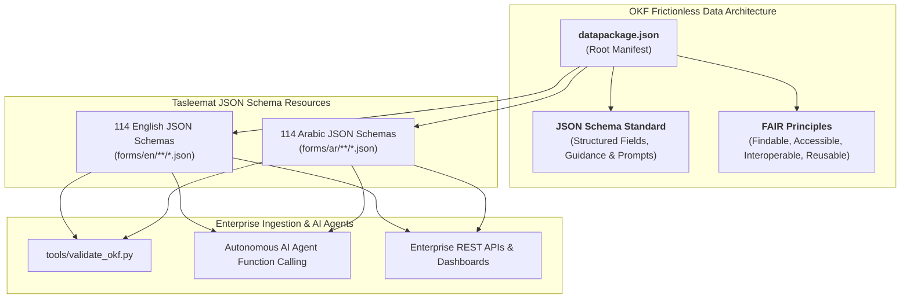

<div class="lang-switch-bar">
  <span class="lang-switch-label">🌐 <strong>Language:</strong> English Manual</span>
  <div class="lang-switch-actions">
    <a class="lang-switch-btn github-btn" href="https://github.com/fakhruldeen/Tasleemat/blob/main/docs/en/12_open_knowledge_framework.md" target="_blank" rel="noopener noreferrer">🐙 View on GitHub ↗</a>
    <a class="lang-switch-btn" href="../ar/12_open_knowledge_framework.html">🇸🇦 الانتقال للنسخة العربية (Arabic Manual) →</a>
  </div>
</div>

---
type: Guide
token_pointer: /_tokens/docs/en/12_open_knowledge_framework.npy
token_count: 1070
tokenizer_model_id: tiktoken/o200k_base
created_at: '2026-10-06T16:05:28.497172+00:00'
---

<p align="center">
  <picture>
    <source media="(prefers-color-scheme: dark)" srcset="../img/logo-dark.jpeg">
    <source media="(prefers-color-scheme: light)" srcset="../img/logo-white.jpeg">
    
  </picture>
</p>

---

# 🌐 Open Knowledge Foundation (OKF) & JSON Schema Architecture
**Document ID:** `TASLEEMAT-GUIDE-12-OPEN-KNOWLEDGE`  
**Version:** 2.0  
**Compliance Standards:** Open Knowledge Foundation (OKF) Frictionless Data Package Standard, JSON Schema (Draft 2020-12), FAIR Data Principles  

---

## 🎯 Executive Overview

**Tasleemat (تسليمات)** conforms to the **Open Knowledge Foundation (OKF)** Frictionless Data Package specification using **native JSON Schemas**, making it one of the world's first fully open, machine-readable, bilingual Project Management Office (PMO) operating frameworks.

By providing a root [`datapackage.json`](../../datapackage.json), Tasleemat enables data scientists, AI engineers, and enterprise architects to query, validate, and integrate all 228 deliverable JSON schemas directly into REST APIs, autonomous AI agent toolchains, and project analytics pipelines.



---

## 🗂️ The Four Distinct Data & Schema Layers

To prevent architectural conflation between form definitions and runtime project payloads, Tasleemat enforces four distinct data and schema layers:

1. **Layer 1: Form Section Schemas (`forms/{en,ar}/**/*.json`):** Form-level section definitions, fields, labels, guidance, and default placeholders used for template scaffolding.
2. **Layer 2: OKF Frictionless Data Package (`datapackage.json`):** Repository-level open data catalog referencing all 228 bilingual form schema resources.
3. **Layer 3: Draft 2020-12 Companion Schemas (`schemas/completed/PMO-*.schema.json`):** High-integrity validation contracts covering completed runtime deliverable payloads in `strict` and `draft` modes.
4. **Layer 4: Runtime Project Payloads:** Actual business data submitted by users, CLI scaffolds, or AI agents, validated against Layer 3 companion schemas.

---

## 📦 The `datapackage.json` Specification

Located at the repository root, [`datapackage.json`](../../datapackage.json) indexes all 228 deliverable schemas as Frictionless JSON Resources:

```json
{
  "profile": "data-package",
  "name": "tasleemat-pmo-framework",
  "title": "Tasleemat: Enterprise Bilingual (English & Arabic) Project Management Framework",
  "version": "2.0.0",
  "licenses": [{"name": "MIT", "path": "https://opensource.org/licenses/MIT"}],
  "resources": [
    {
      "name": "en-03-01-project-charter",
      "title": "PROJECT CHARTER",
      "reference": "PMO-03.01",
      "path": "forms/en/03_Initiating/01_Project_Charter/03_01_Project_Charter.json",
      "format": "json",
      "mediatype": "application/json",
      "encoding": "utf-8",
      "language": "en",
      "direction": "ltr",
      "schema": {
        "$schema": "https://json-schema.org/draft/2020-12/schema",
        "type": "object",
        "required": ["form_name", "document_reference", "fields"]
      }
    }
  ]
}
```

---

## 🛠️ Validating OKF JSON Compliance

The repository includes a dedicated validator script:

```bash
# Run the built-in OKF JSON Schema validator
python3 tools/validate_okf.py
```

---

## 💡 Why JSON Schemas in OKF?

1. **AI Agent Tool Calling:** Modern LLMs (Gemini, Claude, GPT-4) consume JSON schemas natively for function calling and structured document generation.
2. **Hierarchical Field Metadata:** Each field carries explicit `section`, `label`, `guidance`, and target `value` properties.
3. **Bilingual Symmetry (en / ar-SA):** Preserves bidirectional text orientation flags (`ltr` and `rtl`) and UTF-8 encoding across all 228 schemas.

---

## 🤖 Practical LLM Integration with OKF Schemas

### 1. Function Calling & Tool Definition (OpenAI & Anthropic Claude)
By passing Tasleemat schemas directly into LLM tool definitions, you constrain model responses to guaranteed structured data:

```python
import tasleemat

# 1. Fetch schema definition from Tasleemat
schema = tasleemat.get_artifact_asset("PMO-03.01", role="schema", lang="en")

# 2. Define tool for Claude / OpenAI API
pmo_tool = {
    "name": "generate_project_charter",
    "description": "Generate a formal PMI PMBOK® Project Charter document payload",
    "input_schema": schema  # Conforms to Draft 2020-12 / OpenAPI
}
```

### 2. In-Context Self-Correction Feedback Loop
When LLMs draft complex project data, schema validation can be coupled with automated retry loops:

```python
import tasleemat

def generate_and_validate(llm_client, user_notes):
    # Prompt LLM for structured output
    raw_payload = llm_client.generate_json(user_notes)

    # Validate against Tasleemat strict companion contract
    report = tasleemat.validate_artifact_data("PMO-03.01", raw_payload, mode="strict")

    if not report.valid:
        # Construct surgical feedback prompt with exact JSON pointer paths
        corrections = [f"Field: {err.field_path} -> {err.message}" for err in report.errors]
        feedback = f"The generated payload had schema errors:\n" + "\n".join(corrections)
        # LLM self-corrects based on exact validation errors
        return llm_client.generate_json(feedback)

    return raw_payload
```