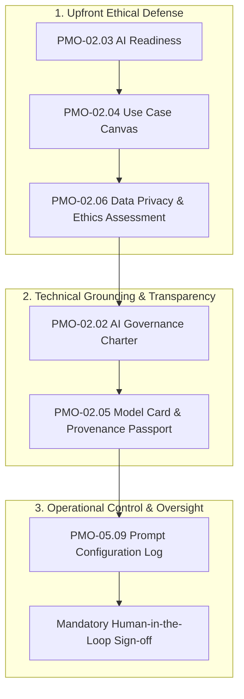

<!--
---
type: Guide
---
-->

<div class="lang-switch-bar">
  <span class="lang-switch-label">🌐 <strong>Language:</strong> English Executive Manual</span>
  <div class="lang-switch-actions">
    <a class="lang-switch-btn github-btn" href="https://github.com/fakhruldeen/Tasleemat/blob/main/docs/en/managerial_ai_risk_and_ethics.md" target="_blank" rel="noopener noreferrer">🐙 View on GitHub ↗</a>
    <a class="lang-switch-btn" href="../ar/managerial_ai_risk_and_ethics.html">🇸🇦 الانتقال للنسخة العربية (Arabic Version) →</a>
  </div>
</div>

---

# 🤖 Executive AI Risk Management & Ethical Governance
**Document ID:** `TASLEEMAT-EXEC-AI-RISK-ETHICS`  
**Target Audience:** Chief Technology Officers (CTO), Chief Information Security Officers (CISO), Legal Counsel, PMO Directors, AI Ethics Committees  
**Regulatory Standards:** NIST AI Risk Management Framework (AI RMF 1.0), ISO/IEC 42001, EU AI Act, Saudi SDAIA AI Ethics Principles  

---

> [!NOTE]
> **Proposed Organizational Governance Model**  
> AI risk tiers and oversight cadences described herein represent institutional best practices for enterprise governance. Organizations should harmonize these guidelines with local data jurisdiction laws and industry-specific compliance bodies.

---

## 🎯 Executive Imperative: Responsible Enterprise AI

Artificial Intelligence (AI), Foundation Models, and Autonomous Agent systems offer unprecedented operational velocity. However, deploying AI within mission-critical enterprise workflows introduces hazards fundamentally distinct from traditional software:
- **Non-deterministic outputs**: Identical inputs may yield variable results across model updates.
- **Algorithmic bias & discrimination**: Systematic distortions present in training datasets impacting hiring, credit scoring, or resource distribution.
- **Hallucination & factuality decay**: Fabricated citations, metrics, or factual statements presented with high statistical confidence.
- **Intellectual property & privacy leakage**: Inadvertent disclosure of proprietary trade secrets or protected citizen data (PII) to public cloud foundation models.

The **Tasleemat Executive AI Governance Suite** establishes a proactive defense-in-depth model that protects brand reputation, complies with sovereign regulatory standards (such as Saudi SDAIA principles), and ensures human accountability across all automated decisions.



---

## 🛡️ The 3-Tier Enterprise AI Risk Classification

Tasleemat classifies AI initiatives into three operational risk tiers, establishing mandatory oversight gates:

| Risk Classification | Risk Profile & Typical Use Cases | Governance Requirements | Human-in-the-Loop (HITL) Policy |
| :--- | :--- | :--- | :--- |
| **Tier 1: High Risk** | Automated credit scoring, employment applicant filtering, medical/clinical diagnostics, critical national infrastructure operations, facial biometric access control. | **All 6 AI Governance Deliverables** + External Independent Legal & Ethics Audit + Cryptographic Dataset Attestation. | **Mandatory Human-in-the-Loop (HITL)**: An authorized human expert must formally review and approve every high-stakes decision prior to execution. Fully autonomous execution is strictly prohibited. |
| **Tier 2: Limited Risk** | Customer-facing conversational agents (chatbots), internal knowledge-base retrieval (RAG), predictive maintenance alerts, translation services. | AI Canvas (`PMO-02.04`), Model Card (`PMO-02.05`), Prompt Version Log (`PMO-05.09`). | **Human-on-the-Loop (Exception Escalation)**: Automated operation with mandatory real-time human escalation whenever confidence thresholds drop below $85\%$. |
| **Tier 3: Minimal Risk** | Internal text summarization, brainstorming aids, automated code documentation generation, sentiment aggregation on public reviews. | AI Use Case Canvas (`PMO-02.04`). | **Periodic Human Review**: Sample-based quarterly auditing of system logs to ensure output quality and absence of drift. |

---

## 🏛️ Sovereign Regulatory & Ethical Compliance Mapping

Tasleemat's governance deliverables map directly to key sovereign and global AI compliance mandates:

```
┌───────────────────────────────────────┬────────────────────────────────────────┐
│ SDAIA AI Ethics & NIST AI RMF Domain  │ Mandatory Tasleemat Governance Control │
├───────────────────────────────────────┼────────────────────────────────────────┤
│ Fairness & Non-Discrimination         │ PMO-02.06 Data Privacy & Ethics Check  │
│ Transparency & Explainability         │ PMO-02.05 AI Model Card & Fact Sheet   │
│ Safety & Reliability                  │ PMO-02.02 AI Governance Charter        │
│ Accountability & Responsibility       │ PMO-03.01 Charter (Identified Sponsor) │
│ Privacy & Security (Personal Data)    │ PMO-02.06 Protected Attribute Audit    │
│ Continuous Monitoring & Drift Control │ PMO-05.09 Prompt Library Version Log   │
└───────────────────────────────────────┴────────────────────────────────────────┘
```

1. **Fairness & Non-Discrimination**:
   - Deliverable `PMO-02.06` requires explicit statistical testing across protected demographic attributes before models enter production.
2. **Transparency & Model Provenance**:
   - `PMO-02.05` acts as a mandatory "model passport", documenting training dataset origins, known boundary conditions, parameter counts, and out-of-scope usages.
3. **Configuration & Prompt Reproducibility**:
   - `PMO-05.09` tracks all system instructions, temperature settings, and top-p parameters under strict version control, preventing unmonitored behavioral regressions.

---

## 🔒 Enterprise Data Protection & Private Foundation Models

To ensure compliance with corporate data protection mandates, executive leadership must enforce four non-negotiable operational rules:

1. **Zero Public Ingestion**:
   - Prohibit the entry of confidential business contracts, employee records, or customer PII into public consumer LLM interfaces (e.g., free tiers of consumer chatbots).
2. **Private API Guarantees**:
   - All programmatic AI utilization must route through commercial enterprise endpoints with contractual zero-data-retention and zero-model-training clauses.
3. **Structured Verification Over Free Text**:
   - Whenever AI agents synthesize project deliverables, enforce Draft 2020-12 companion schema validation via `tasleemat.validate_artifact_data` to ensure outputs adhere to verified organizational formats.
4. **Cryptographic Traceability**:
   - Every AI-assisted document must retain the standard document control block identifying the prompting engineer, foundation model version, and date of synthesis.
