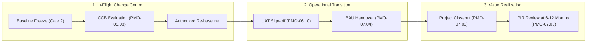

<!--
---
type: Guide
---
-->

<div class="lang-switch-bar">
  <span class="lang-switch-label">🌐 <strong>Language:</strong> English Executive Manual</span>
  <div class="lang-switch-actions">
    <a class="lang-switch-btn github-btn" href="https://github.com/fakhruldeen/Tasleemat/blob/main/docs/en/managerial_audit_and_benefits.md" target="_blank" rel="noopener noreferrer">🐙 View on GitHub ↗</a>
    <a class="lang-switch-btn" href="../ar/managerial_audit_and_benefits.html">🇸🇦 الانتقال للنسخة العربية (Arabic Version) →</a>
  </div>
</div>

---

# 📈 Audit Readiness, Change Governance & Benefits Realization
**Document ID:** `TASLEEMAT-EXEC-AUDIT-BENEFITS`  
**Target Audience:** Chief Financial Officers (CFO), Internal Audit Directors, Value Realization Leads, Change Control Board (CCB) Chairs  
**Standard Alignment:** PMI Standard for Program Management, ISO 21500, COBIT 2019  

---

> [!NOTE]
> **Proposed Organizational Governance Model**  
> Operational tolerances, variance escalation thresholds, and benefits realization cadences described in this guide are institutional benchmarks. They should be formally integrated into organizational procurement policies and financial delegation of authority charters.

---

## 🎯 Executive Focus: Sustaining Value Beyond Delivery

In corporate leadership, completing a project on time and within budget is an incomplete measure of success. A project is only truly successful if it:
1. **Withstands institutional audit**: Demonstrates flawless compliance, transparent decision provenance, and auditable financial records.
2. **Controls mid-flight baseline changes**: Prevents silent scope creep through a formal Change Control Board (CCB).
3. **Achieves operational handover**: Seamlessly transitions assets to Business-As-Usual (BAU) with confirmed SLAs.
4. **Realizes long-term strategic value**: Measures tangible financial and operational returns (ROI/NPV) months after project closeout.

The **Tasleemat Audit & Benefits Architecture** bridges the gap between capital execution and permanent business value.



---

## 🏛️ Change Control Board (CCB) Operational Mandate

The Change Control Board (CCB) is the supreme governing authority for project baseline adjustments. It does not manage daily task assignments; its sole mandate is evaluating proposed modifications to the approved Scope, Schedule, or Cost baselines.

### Quantitative Change Escalation Thresholds

```
┌─────────────────────────────────┬──────────────────────────────────┬─────────────────────────────────┐
│ Metric Variance                 │ Operational Level                │ Required Approval Authority     │
├─────────────────────────────────┼──────────────────────────────────┼─────────────────────────────────┤
│ Cost Variance: < 5%             │ Normal Project Variance          │ Delegated to Project Manager    │
│ Cost Variance: 5% to 10%        │ Elevated Project Variance        │ Project Sponsor & PMO Lead      │
│ Cost Variance: > 10%            │ Baseline Breach                  │ Full Change Control Board (CCB) │
│ Schedule Variance: < 10%        │ Routine Schedule Fluctuation     │ Delegated to Project Manager    │
│ Schedule Variance: 10% to 15%   │ Milestone Slip                   │ Project Sponsor & PMO Lead      │
│ Schedule Variance: > 15%        │ Critical Path Compromise         │ Full Change Control Board (CCB) │
│ Scope: Non-critical Work Package│ Functional Trade-off             │ Project Manager & Sponsor       │
│ Scope: Core Deliverable Removal │ Strategic Value Alteration       │ Full Change Control Board (CCB) │
└─────────────────────────────────┴──────────────────────────────────┴─────────────────────────────────┘
```

### The 4-Step CCB Decision Lifecycle
1. **Logging & Impact Analysis (`PMO-05.03`)**:
   - The Lead PM documents the change proposal, analyzing cross-functional impacts on schedule, cost, risk, and dependencies.
2. **Preliminary Review**:
   - The PMO Director reviews documentation completeness. Changes lacking quantified financial estimates are returned without review.
3. **Formal CCB Convening**:
   - The board convenes (monthly or ad-hoc) to approve, reject, or request modification.
4. **Baseline Update & Audit Logging**:
   - Approved changes update official baselines (`PMO-04.03.08`, `PMO-04.04.04`), with the change authorization ID attached to prevent unapproved scope leakage.

---

## 🏁 Operational Handover Protocol (Gate 4 to BAU)

Many high-profile initiatives fail during transition because operational teams were not prepared to operate the new asset. Tasleemat enforces an auditable **Transition to Operations Checklist (`PMO-07.04`)**:

1. **Complete UAT Acceptance (`PMO-06.10`)**:
   - $100\%$ pass rate on critical operational scenarios; zero open Sev-1 defects.
2. **Service Level Agreement (SLA) Execution**:
   - Formal operational response times, vendor warranty terms, and incident escalation tiers established.
3. **Knowledge Transfer & Documentation Delivery**:
   - Operational runbooks, user manuals, and training logs formally transferred to the permanent operations team.
4. **Asset & License Transfer**:
   - Software repositories, hardware assets, software licenses, and cloud billing accounts formally re-assigned to the permanent operating department.

---

## 📊 Post-Implementation Review (PIR) & Benefits Tracking

Project closure (**Gate 5**) marks the end of temporary project spending, but the real return on investment begins in operations. The **Post-Implementation Review (`PMO-07.05`)** tracks ongoing value delivery:

```
┌─────────────────────────────────┬──────────────────────────────────┬─────────────────────────────────┐
│ Original Business Case Target   │ Review at 6 Months (PIR 1)       │ Review at 12 Months (PIR 2)     │
├─────────────────────────────────┼──────────────────────────────────┼─────────────────────────────────┤
│ Target Cost Reduction: $2.5M    │ Actual Reduction: $1.8M (72%)    │ Actual Reduction: $2.7M (108%)  │
│ Target Process Cycle: < 2 Hours │ Actual Cycle: 2.4 Hours          │ Actual Cycle: 1.8 Hours         │
│ Target Adoption: 10,000 Users   │ Actual Adoption: 8,200 Users     │ Actual Adoption: 11,400 Users   │
└─────────────────────────────────┴──────────────────────────────────┴─────────────────────────────────┘
```

- **Cadence:** PIR reviews are conducted at **6 months** and **12 months** post-handover.
- **Ownership:** Led by the **Business Value Lead / Department Head**, with PMO audit participation.
- **Closure:** If benefits deviate negatively by $>20\%$, a formal remediation review is conducted to identify operational bottlenecks and capture corrective actions in the enterprise lessons learned repository.
