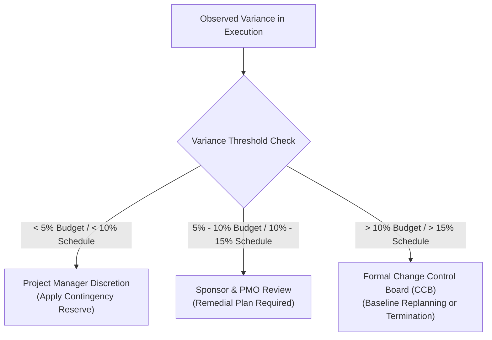

<!--
---
type: Guide
---
-->

  🌐 <strong>Language:</strong> English Executive Manual
  

    <a class="lang-switch-btn github-btn" href="https://github.com/fakhruldeen/Tasleemat/blob/main/docs/en/managerial_stage_gates_playbook.md" target="_blank" rel="noopener noreferrer">🐙 View on GitHub ↗</a>
    <a class="lang-switch-btn" href="../ar/managerial_stage_gates_playbook.html">🇸🇦 الانتقال للنسخة العربية (Arabic Version) →</a>
  

---

# 🏛️ Executive Stage-Gate Governance Playbook
**Document ID:** `TASLEEMAT-EXEC-STAGE-GATES-PLAYBOOK`  
**Target Audience:** Project Sponsors, PMO Directors, Steering Committee Members, Executive Leadership  
**Standard Alignment:** PMI PMBOK® 6th/7th/8th Editions, ISO 21500 / ISO 21502:2021  

---

> [!NOTE]
> **Proposed Organizational Governance Model**  
> This document outlines a standard organizational governance model requiring formal institutional adoption and tailoring. It does not establish universal statutory authority, legal mandates, or rigid certification requirements for every organization.

---

## 🎯 Executive Summary & Purpose

In modern capital and digital delivery environments, project failure rarely stems from a lack of engineering talent; it stems from **governance drift, ambiguous sign-off authority, and unmonitored capital release**. Traditional project management often treats governance as a bureaucratic after-the-fact compliance exercise rather than an active risk-management mechanism.

The **Tasleemat Stage-Gate Governance Framework** institutes a structured, auditable checkpoint system spanning the complete initiative lifecycle from initial concept exploration (**Gate 0**) through post-project contract settlement and value realization (**Gate 5**).

Each stage-gate acts as a **decision checkpoint** where authorized leadership evaluates validated deliverables, assesses strategic fit and fiscal health, and formally determines whether subsequent budget tranches and operational mandates should be released.

```mermaid
flowchart LR
    G0["<b>Gate 0</b><br/>Concept Review"] -->|Authorize Initiation| G1["<b>Gate 1</b><br/>Charter & Auth"]
    G1 -->|Authorize Planning| G2["<b>Gate 2</b><br/>Baseline Approval"]
    G2 -->|Release Execution Capital| G3["<b>Gate 3</b><br/>Execution Health"]
    G3 -->|Authorize Deployment| G4["<b>Gate 4</b><br/>Operational UAT"]
    G4 -->|Authorize Operational Handoff| G5["<b>Gate 5</b><br/>Final Closeout"]

    style G0 fill:#f0fdf4,stroke:#10b981,stroke-width:2px
    style G1 fill:#eff6ff,stroke:#2563eb,stroke-width:2px
    style G2 fill:#eff6ff,stroke:#2563eb,stroke-width:2px
    style G3 fill:#fef3c7,stroke:#f59e0b,stroke-width:2px
    style G4 fill:#f0fdf4,stroke:#10b981,stroke-width:2px
    style G5 fill:#f8fafc,stroke:#0b132b,stroke-width:2px
```

---

## 🚦 The Three Executive Gate Decisions

At each formal gate review, the governing authority must render one of three formal outcomes:

| Gate Decision | Definition & Operational Impact | Capital & Mandate Effect |
| :--- | :--- | :--- |
| 🟢 **Proceed (Go)** | Deliverables fully satisfy exit criteria. Technical baselines, risk registers, and fiscal metrics are acceptable. | Authorizes immediate progression to the next phase; releases the subsequent budget tranche. |
| 🟡 **Conditional Approval (Go with Actions)** | Minor deficiencies or manageable variances identified. The overall strategic trajectory remains sound. | Releases partial funding or allows phase initiation subject to mandatory remediation actions completed within **14 calendar days**. |
| 🔴 **Redirect / Terminate (No-Go)** | Critical variances detected (e.g., severe cost overruns, strategic obsolescence, insurmountable risks). | Halts the project immediately. Initiates either formal replanning, scope de-scoping, or orderly termination. |

---

## 🚪 Detailed Stage-Gate Specifications

### Gate 0: Strategic Concept & Portfolio Alignment
*Validating the Idea Before Allocating Capital*

- **Lifecycle Phases Covered:** Phase 00 (Discovery) & Phase 01 (Ideation).
- **Governing Body:** Investment Review Board, Chief Financial Officer (CFO), Portfolio Steering Committee.
- **Core Purpose:** To verify that the proposed initiative aligns directly with organizational strategic goals (e.g., Vision 2030 objectives, corporate OKRs) and presents a compelling return on investment before teams are staffed or significant budgets allocated.
- **Mandatory Executive Exit Criteria:**
  1. [ ] Strategic linkage explicitly established with corporate OKRs.
  2. [ ] Business Case includes quantified Cost of Inaction and initial Financial Valuation (NPV/IRR/Payback).
  3. [ ] Strategic Feasibility confirms high-level technical, legal, and operational viability.
- **Key Deliverables Reviewed:**
  - `PMO-00.06`: OKR Alignment Assessment
  - `PMO-01.01`: Business Case
  - `PMO-01.02`: Feasibility Study

---

### Gate 1: Project Charter & Formal Authorization
*Empowering Leadership & Authorizing Team Mobilization*

- **Lifecycle Phases Covered:** Phase 02 (Preparation) & Phase 03 (Initiation).
- **Governing Body:** Executive Project Sponsor & Enterprise PMO Director.
- **Core Purpose:** Formally authorizes the project's existence, designates the Project Manager with formal spending and resource authority, and approves the initial project boundaries.
- **Mandatory Executive Exit Criteria:**
  1. [ ] Project Charter signed by Executive Sponsor and Lead Project Manager.
  2. [ ] Core stakeholder register identifies primary decision-makers, champions, and regulatory bodies.
  3. [ ] Tailoring Plan designates the project sizing tier (Tier 1 Mega, Tier 2 Standard, or Tier 3 Lean) and methodology pack (`general`, `agile`, `ai`, `predictive`, or `hybrid`).
- **Key Deliverables Reviewed:**
  - `PMO-02.01`: Tailoring Plan
  - `PMO-03.01`: Project Charter
  - `PMO-03.04`: Stakeholder Register

---

### Gate 2: Integrated Baseline & Planning Approval
*Locking the Scope, Schedule, Cost, and Risk Contracts*

- **Lifecycle Phases Covered:** Phase 04 (Planning - 12 Management Domains).
- **Governing Body:** Project Steering Committee & PMO Leadership.
- **Core Purpose:** Freezes the foundational performance measurement baselines (Scope Baseline, Schedule Baseline, Cost Baseline) against which project performance will be measured.
- **Mandatory Executive Exit Criteria:**
  1. [ ] Scope statement and Work Breakdown Structure (WBS) fully decomposed down to work packages.
  2. [ ] Critical path schedule established with milestone dependencies verified.
  3. [ ] Detailed bottom-up cost budget approved with management and contingency reserves clearly distinguished.
  4. [ ] Quantitative and qualitative Risk Register completed with funded risk response strategies.
- **Key Deliverables Reviewed:**
  - `PMO-04.01.01`: Project Management Plan
  - `PMO-04.02.05`: Scope Statement
  - `PMO-04.02.06`: WBS & WBS Dictionary
  - `PMO-04.03.08`: Schedule Baseline
  - `PMO-04.04.04`: Cost Baseline & Budget
  - `PMO-04.08.02`: Risk Register

---

### Gate 3: Mid-Execution Performance & Health Review
*Monitoring Execution Integrity & Variance Control*

- **Lifecycle Phases Covered:** Phase 05 (Executing) & Phase 06 (Monitoring & Controlling).
- **Governing Body:** Project Sponsor & PMO Performance Lead.
- **Core Purpose:** Evaluates intermediate milestone delivery, Earned Value Analysis (EVA) indicators, major vendor deliverables, and escalated risk/issue items.
- **Mandatory Executive Exit Criteria:**
  1. [ ] Cost Performance Index (CPI) and Schedule Performance Index (SPI) within approved governance tolerances ($0.90 \le \text{CPI, SPI} \le 1.10$).
  2. [ ] Critical change requests evaluated and approved through the formal Change Control Board (CCB).
  3. [ ] No unmitigated critical (red) issues open without an active, funded remediation plan.
- **Key Deliverables Reviewed:**
  - `PMO-05.01`: Issue Log
  - `PMO-05.03`: Change Request Register
  - `PMO-06.01`: Executive Project Status Report
  - `PMO-06.05`: Earned Value Analysis (EVA) Report

---

### Gate 4: Operational Readiness & User Acceptance (UAT)
*Validating Value Delivery Prior to Operational Handoff*

- **Lifecycle Phases Covered:** Phase 06 (Controlling) & Phase 07 (Closing).
- **Governing Body:** Operations Director (Business-As-Usual Owner) & Customer Sponsor.
- **Core Purpose:** Confirms that deliverables satisfy all operational, technical, and quality requirements before releasing products or systems to end users and operational teams.
- **Mandatory Executive Exit Criteria:**
  1. [ ] 100% of critical User Acceptance Testing (UAT) test cases successfully executed and formally signed off.
  2. [ ] Operational Handover Protocol executed, establishing operational service level agreements (SLAs).
  3. [ ] Operations and customer support teams trained with technical maintenance manuals delivered.
- **Key Deliverables Reviewed:**
  - `PMO-06.10`: User Acceptance Testing (UAT) Sign-off
  - `PMO-07.04`: Transition to Operations Checklist & Handover

---

### Gate 5: Contract Closeout, Archival & Value Realization
*Closing the Books & Establishing Long-Term Benefit Tracking*

- **Lifecycle Phases Covered:** Phase 07 (Closing).
- **Governing Body:** Executive Sponsor, CFO & Enterprise Audit Committee.
- **Core Purpose:** Formally closes procurement contracts, releases project staff and equipment, archives institutional lessons learned, and establishes post-implementation review (PIR) milestones.
- **Mandatory Executive Exit Criteria:**
  1. [ ] All procurement contracts closed with final financial reconciliations and vendor release letters signed.
  2. [ ] Project Closeout Report and Lessons Learned Register archived into the organizational knowledge repository.
  3. [ ] Post-Implementation Review (PIR) schedule established with the Business Value Owner to assess actual vs. projected benefits 6–12 months post-transition.
- **Key Deliverables Reviewed:**
  - `PMO-07.01`: Lessons Learned Summary
  - `PMO-07.02`: Contract Closeout Report
  - `PMO-07.03`: Project Closeout Report
  - `PMO-07.05`: Post-Implementation Review Plan

---

## ⚖️ Governance Escalation & CCB Mandates

When project performance diverges from approved baselines, managerial governance relies on pre-authorized variance thresholds rather than subjective discretion:

1. **Within Operational Tolerances:**
   - Variances under **$5\%$ of budget** and **$10\%$ of milestone duration** remain under the delegated authority of the Project Manager, funded via authorized project contingency reserves.
2. **Elevated Variances:**
   - Variances between **$5\%$–$10\%$ of budget** or **$10\%$–$15\%$ of duration** require formal notification to the Executive Sponsor and an actionable corrective action plan within 7 calendar days.
3. **Breach of Baseline (CCB Escalation):**
   - Any cost variance exceeding **$10\%$** or schedule deviation exceeding **$15\%$** triggers a mandatory CCB review. The CCB must convene to determine whether to authorize an updated project baseline, allocate management reserves, or redirect capital to alternative portfolio priorities.
