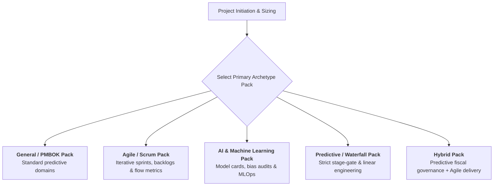

<!--
---
type: Guide
---
-->

  🌐 <strong>Language:</strong> English Executive Manual
  

    <a class="lang-switch-btn github-btn" href="https://github.com/fakhruldeen/Tasleemat/blob/main/docs/en/managerial_tailoring_and_sizing.md" target="_blank" rel="noopener noreferrer">🐙 View on GitHub ↗</a>
    <a class="lang-switch-btn" href="../ar/managerial_tailoring_and_sizing.html">🇸🇦 الانتقال للنسخة العربية (Arabic Version) →</a>
  

---

# ⚖️ Portfolio Sizing & Governance Tailoring Guide
**Document ID:** `TASLEEMAT-EXEC-TAILORING-SIZING`  
**Target Audience:** Project Sponsors, PMO Directors, Portfolio Managers, Delivery Executives  
**Standard Alignment:** PMI PMBOK® 6th/7th/8th Editions, ISO 21500  

---

> [!NOTE]
> **Proposed Organizational Governance Model**  
> Tailoring thresholds, budgetary envelopes, and deliverable counts presented here are benchmark recommendations. They must be formally reviewed and tailored by enterprise leadership to match specific organizational risk appetites and procurement regulations.

---

## 🎯 Executive Purpose: Eliminating Governance Waste

One of the most persistent failure modes in enterprise delivery is applying **one-size-fits-all governance**:
- Forcing a fast-track internal software update to generate 50 formal PMO deliverables paralyzes delivery teams in bureaucratic overhead.
- Permitting a \$15M multi-vendor infrastructure program to operate with minimal fast-track documentation introduces catastrophic fiscal and legal vulnerabilities.

The **Tasleemat Sizing & Tailoring Architecture** solves this dual problem by decoupling project governance into two independent dimensions:
1. **Governance Sizing Tiers (Scale & Fiscal Exposure)**: Determines **how many** mandatory control deliverables are required (3 Tiers).
2. **Methodology Archetype Packs (Delivery Lifecycle)**: Determines **which specialized techniques and artifacts** are activated (5 Packs).

---

## 🏛️ The 3 Governance Sizing Tiers

Tasleemat categorizes initiatives into three distinct enterprise tiers based on budget, duration, stakeholder complexity, and organizational risk:

| Dimension | Tier 1: Mega / Strategic | Tier 2: Standard Enterprise | Tier 3: Lean / Fast-Track |
| :--- | :--- | :--- | :--- |
| **Budget Envelope (USD)** | **Over \$10,000,000** | **\$1,000,000 to \$10,000,000** | **Under \$1,000,000** |
| **Budget Envelope (SAR)** | **Over 40,000,000 SAR** | **4,000,000 to 40,000,000 SAR** | **Under 4,000,000 SAR** |
| **Duration Envelope** | $> 12\text{ months}$ (Multi-year) | $3\text{ to }12\text{ months}$ | $< 3\text{ months}$ |
| **Complexity Level** | Multi-vendor, high regulatory scrutiny, core business disruption | Cross-departmental, dedicated external vendors, standard compliance | Single department, minor vendor dependency, low organizational risk |
| **Mandatory Deliverables** | **35 to 50 Deliverables** | **18 to 25 Deliverables** | **7 to 9 Deliverables** |
| **Review Cadence** | Bi-weekly flash updates; Monthly formal Steering Committee | Monthly formal PMO status reports | Bi-weekly lightweight milestone check-ins |
| **Sign-Off Authority** | SteerCo, CFO, Enterprise PMO Director | Project Sponsor & PMO Performance Lead | Project Sponsor & Lead Project Manager |

---

## 📦 The 5 Methodology Archetype Packs

While sizing dictates depth, delivery archetypes dictate execution rhythm. An organization selects one primary methodology pack per initiative:

### 1. General Pack (`general`)
- **Profile:** Balanced, standard PMBOK-aligned governance suitable for business process improvement, organizational restructuring, and standard corporate initiatives.
- **Core Deliverables:** Charter, Scope, Schedule, Budget, Risk Register, Status Reports, Handover.

### 2. Agile Pack (`agile`)
- **Profile:** Fast-cycle software development, product discovery, and user-centric iterative roadmaps.
- **Specialized Deliverables:** Product Vision Canvas, Sprint Backlog, Flow Metrics & Value Stream (`PMO-06.12`), Retrospective Logs, Definition of Done (DoD) Checklists.

### 3. AI Governance & Engineering Pack (`ai`)
- **Profile:** Machine learning models, large language models, generative AI deployments, and data pipelines.
- **Specialized Deliverables:** AI Readiness Assessment (`PMO-02.03`), AI Use Case Canvas (`PMO-02.04`), Model Cards & Fact Sheets (`PMO-02.05`), Data Privacy & Ethics Assessment (`PMO-02.06`), Prompt Library & Version Logs (`PMO-05.09`).

### 4. Predictive / Waterfall Pack (`predictive`)
- **Profile:** Civil engineering, telecommunications infrastructure, hardware manufacturing, and heavily audited regulatory submissions.
- **Specialized Deliverables:** Detailed WBS Dictionary, Critical Path CPM worksheets, Formal Quality Metric Acceptance, Multi-tranche Procurement contracts.

### 5. Hybrid Pack (`hybrid`)
- **Profile:** The modern enterprise standard—predictive governance at the portfolio and financial layer paired with agile execution at the team delivery layer.
- **Specialized Deliverables:** Combines Executive Charter and Earned Value tracking (`PMO-06.05`) with Sprint Backlogs and Iteration Reviews.

---

## 🧮 Portfolio Tailoring Decision Flow

To establish the appropriate tier and pack during Gate 1 authorization, leadership follows this four-step decision logic:

1. **Assess Capital Exposure:**
   - Does total commitment exceed \$10M (40M SAR)? $\rightarrow$ **Mandatory Tier 1**.
   - Is total commitment under \$1M (4M SAR) and duration under 90 days? $\rightarrow$ **Eligible for Tier 3**.
   - All other initiatives default to **Tier 2**.
2. **Evaluate Regulatory & External Audit Scrutiny:**
   - Initiatives subject to external audits (e.g., SAMA, DGA, National Cybersecurity Authority) are automatically elevated by one tier (e.g., Tier 2 becomes Tier 1).
3. **Select Execution Cadence:**
   - Select the methodology pack matching team structure.
4. **Lock Tailoring in `PMO-02.01`:**
   - Record chosen tier, pack, and justified omissions in the project's official **Tailoring Plan** prior to Gate 1 sign-off.
