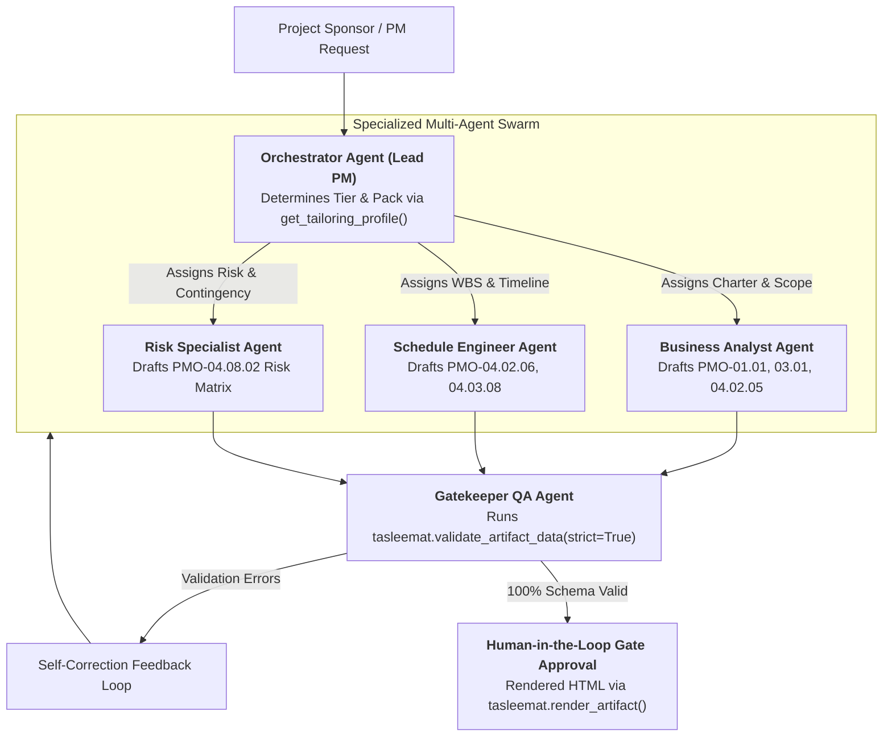

<!--
---
type: Guide
---
-->

<div class="lang-switch-bar">
  <span class="lang-switch-label">🌐 <strong>Language:</strong> English Technical Manual</span>
  <div class="lang-switch-actions">
    <a class="lang-switch-btn github-btn" href="https://github.com/fakhruldeen/Tasleemat/blob/main/docs/en/tech_agentic_and_multiagent_orchestration.md" target="_blank" rel="noopener noreferrer">🐙 View on GitHub ↗</a>
    <a class="lang-switch-btn" href="../ar/tech_agentic_and_multiagent_orchestration.html">🇸🇦 الانتقال للنسخة العربية (Arabic Version) →</a>
  </div>
</div>

---

# 🤖 Technical Guide: Agentic PMO & Multi-Agent Orchestration
**Document ID:** `TASLEEMAT-TECH-AGENTIC-MULTIAGENT`  
**Target Audience:** Autonomous Agent Developers, Multi-Agent System Architects, PMO Automation Engineers  
**Ecosystems Supported:** Model Context Protocol (MCP), CrewAI, LangGraph, AutoGen, OpenAI Swarm  

---

## 🎯 Architectural Purpose

In next-generation enterprise environments, PMO documentation and governance checks are increasingly handled by **autonomous single-agent and multi-agent systems**. Instead of human practitioners manually copying data across dozens of templates, autonomous software agents:
1. Discover required project artifacts dynamically.
2. Ingest meeting notes and architectural decisions.
3. Traverse document dependency directed acyclic graphs (DAGs).
4. Synthesize, validate, and self-correct project deliverables before requesting executive human sign-off.

This guide provides technical reference blueprints for integrating Tasleemat into **Single-Agent MCP Runtimes** and **Multi-Agent Orchestration Swarms**.



---

## 🔌 1. Single-Agent Integration via Model Context Protocol (MCP)

For autonomous coding assistants and single-agent environments (such as **Claude Desktop**, **Cursor**, **OpenCode**, and **Antigravity**), Tasleemat provides an official Model Context Protocol server.

### Connecting via Stdio Configuration
Add Tasleemat to your agent client configuration file:

```json
{
  "mcpServers": {
    "tasleemat": {
      "command": "tasleemat",
      "args": ["mcp"]
    }
  }
}
```

### The 6 Core Exposed MCP Tools

| Tool Name | Parameters | Machine Role |
| :--- | :--- | :--- |
| `tasleemat_list_artifacts` | `category?: string`, `tier?: string` | Discovers available deliverable codes across the 8 lifecycle phases. |
| `tasleemat_get_artifact` | `artifact_id: string` | Retrieves canonical metadata, title, and schema definition. |
| `tasleemat_get_asset` | `artifact_id: string`, `role: string`, `lang?: string` | Fetches template, prompt, guide, schema, or example files. |
| `tasleemat_get_lexicon` | `category?: string`, `query?: string` | Resolves official bilingual PMO terminology to prevent semantic drift. |
| `tasleemat_validate_data` | `artifact_id: string`, `data: object`, `mode?: "strict" \| "draft"` | Validates structured payload against Draft 2020-12 companion schema. |
| `tasleemat_render_artifact` | `artifact_id: string`, `data?: object`, `lang?: string` | Renders validated deliverable to standalone styled HTML. |

---

## 👥 2. Multi-Agent PMO Swarm Blueprint (CrewAI / LangGraph)

When coordinating complex delivery across multi-agent frameworks, divide responsibilities across four specialized agent personas:

### A. The Orchestrator Agent (Virtual PMO Director)
- **Role:** Analyzes user requirements, resolves the tailoring tier and methodology pack using `tasleemat.get_tailoring_profile(tier, pack)`, and sequences task dependencies according to `docs/en/07_document_dependencies.md`.
- **System Prompt Directive:**
  > *"You are the Lead PMO Orchestrator. You manage the project DAG. Never allow downstream deliverables to be drafted before upstream prerequisites have passed schema validation."*

### B. The Business Analyst Agent
- **Role:** Synthesizes `PMO-01.01` (Business Case), `PMO-03.01` (Project Charter), and `PMO-04.02.05` (Scope Statement).
- **Tool Access:** `get_artifact_asset(role="prompt")`, `get_artifact_asset(role="schema")`.

### C. The Risk & Governance Agent
- **Role:** Formulates the Risk Register (`PMO-04.08.02`) and AI Model Card (`PMO-02.05`), ensuring strict probability/impact matrix alignment.
- **Tool Access:** `get_artifact_asset(role="dictionary")`, `validate_artifact_data`.

### D. The Gatekeeper / QA Auditor Agent
- **Role:** Programmatic gate enforcer. Intercepts draft deliverables, parses embedded data tables against the 114 Draft 2020-12 companion schemas, and either approves or issues structured remediation directives.

---

## 🐍 3. LangGraph / Python Multi-Agent Coordination Code Sample

```python
import tasleemat
from typing import Dict, Any

class PMOGatekeeperNode:
    """Automated Quality Gatekeeper node in an agentic pipeline."""
    
    def __init__(self, artifact_id: str):
        self.artifact_id = artifact_id

    def evaluate_agent_output(self, generated_payload: Dict[str, Any]) -> Dict[str, Any]:
        # Perform strict Draft 2020-12 schema validation
        report = tasleemat.validate_artifact_data(
            artifact_id=self.artifact_id,
            data=generated_payload,
            strict=True
        )
        
        if report["valid"]:
            # Render deliverable to HTML for human review
            html = tasleemat.render_artifact(
                artifact_id=self.artifact_id,
                data=generated_payload,
                format="html"
            )
            return {
                "status": "APPROVED",
                "html_preview": html,
                "remediation_instructions": None
            }
        else:
            # Generate structured remediation feedback for drafting agent
            return {
                "status": "REJECTED",
                "html_preview": None,
                "remediation_instructions": {
                    "errors": report["errors"],
                    "guidance": "Correct payload according to Draft 2020-12 schema violations."
                }
            }

# Example validation check
gatekeeper = PMOGatekeeperNode("PMO-03.01")
agent_payload = {
    "project_name": "Cloud Data Hub",
    "project_code": "PRJ-2026-001",
    "start_date": "2026-11-01",
    "sponsor": "Executive Sponsor"
}
result = gatekeeper.evaluate_agent_output(agent_payload)
print(f"Gatekeeper Outcome: {result['status']}")
```

---

## 🔁 4. The Agentic Self-Correction Loop

When an autonomous drafting agent produces invalid schema outputs, your architecture must not crash or ask a human for help. Instead, implement the **Self-Correction Feedback Loop**:

```
Step 1: Agent calls tasleemat_validate_data(artifact_id, payload, mode="draft")
Step 2: Validator returns {"valid": false, "errors": [{"path": "/start_date", "message": "Expected format: date"}]}
Step 3: Agent catches errors and re-prompts itself:
        "Field '/start_date' violated RFC 3339 format. Convert date value to YYYY-MM-DD."
Step 4: Agent updates payload and re-validates in strict mode.
Step 5: Only upon {"valid": true} does the agent write output to the workspace.
```
