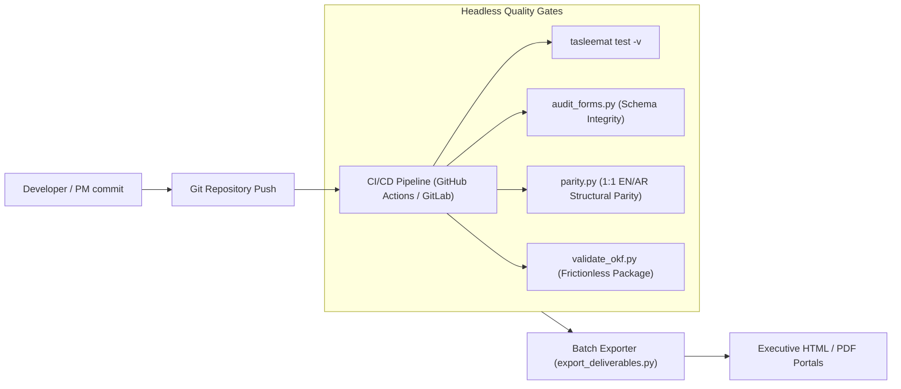

<!--
---
type: Guide
---
-->

<div class="lang-switch-bar">
  <span class="lang-switch-label">🌐 <strong>Language:</strong> English Technical Manual</span>
  <div class="lang-switch-actions">
    <a class="lang-switch-btn github-btn" href="https://github.com/fakhruldeen/Tasleemat/blob/main/docs/en/tech_cli_and_devops_automation.md" target="_blank" rel="noopener noreferrer">🐙 View on GitHub ↗</a>
    <a class="lang-switch-btn" href="../ar/tech_cli_and_devops_automation.html">🇸🇦 الانتقال للنسخة العربية (Arabic Version) →</a>
  </div>
</div>

---

# ⚙️ Technical Guide: CLI Automation, Batch Processing & CI/CD Pipelines
**Document ID:** `TASLEEMAT-TECH-CLI-DEVOPS`  
**Target Audience:** DevOps Engineers, Platform Engineers, PMO Tool Administrators, CI/CD Developers  
**Core Technologies:** `tasleemat` CLI, Bash, Python 3, GitHub Actions, GitLab CI/CD, Static HTML Exporters  

---

## 🎯 Architectural Purpose

In a mature Docs-as-Code ecosystem, project governance cannot rely on manual web forms or desktop word processors. Everything must be:
1. **Scriptable in headless environments** (zero interactive prompts required).
2. **Version-controlled alongside source code** in Git repositories.
3. **Audited in CI/CD build pipelines** before pull requests can be merged into production branches.
4. **Exportable to executive formats** (HTML/PDF) with embedded styling and full Arabic RTL typography support.

This technical guide provides actionable shell scripts, pipeline configurations, and headless recipes for automating Tasleemat across your enterprise toolchain.



---

## 💻 1. Headless CLI Scripting Recipes

The `tasleemat` CLI provides non-interactive flags designed for deployment scripts and automated workspace initialization.

### A. Non-Interactive Project Workspace Scaffolding (`init`)
Generate a fully tailored project folder with zero interactive prompts:

```bash
#!/usr/bin/env bash
set -euo pipefail

PROJECT_CODE="PRJ-2026-CLOUD-01"
PROJECT_NAME="Enterprise Cloud Transformation"
PM_NAME="Sarah Al-Ahmad"
SPONSOR_NAME="Dr. Khalid Al-Mansour"
OUTPUT_DIR="./workspaces/${PROJECT_CODE}"

# Scaffold Tier 2 (Standard Enterprise) with Agile Pack in English and Arabic
tasleemat init \
  --code "${PROJECT_CODE}" \
  --name "${PROJECT_NAME}" \
  --pm "${PM_NAME}" \
  --sponsor "${SPONSOR_NAME}" \
  --tier 2 \
  --pack agile \
  --lang both \
  --out "${OUTPUT_DIR}"

echo "✅ Project workspace successfully scaffolded at ${OUTPUT_DIR}"
```

### B. Automated Catalog Extraction in Scripts (`list` & `search`)
Query and parse deliverables inside automation workflows:

```bash
# Extract all risk-related deliverable IDs in JSON/Text format
tasleemat search "Risk" --lang en

# Count available Arabic templates
tasleemat list --lang ar | wc -l
```

### C. Headless AI Configuration (`config`)
Configure LLM accounts in containerized build agents without user interaction:

```bash
# Configure Gemini provider in CI agent
tasleemat config set \
  --provider gemini \
  --model gemini-2.5-flash \
  --key "${GEMINI_API_KEY}"

# View active configuration state
tasleemat config show
```

---

## 🖨️ 2. Batch Deliverable HTML & PDF Exporter (`tools/export_deliverables.py`)

Convert markdown deliverables into self-contained, publication-ready HTML documents with embedded CSS, typography fonts, and native Arabic Right-to-Left (RTL) styling:

```bash
# Export single English charter
python3 tools/export_deliverables.py \
  forms/en/03_Initiating/01_Project_Charter/03_01_Project_Charter_Template.md \
  -o ./dist/03_01_Project_Charter.html

# Export Arabic deliverable with native RTL styling
python3 tools/export_deliverables.py \
  forms/ar/03_البدء/01_ميثاق_المشروع/03_01_ميثاق_المشروع_قالب.md \
  -o ./dist/03_01_ميثاق_المشروع.html

# Batch export an entire project workspace directory recursively
python3 tools/export_deliverables.py ./my_project_workspace/
```

---

## ⚙️ 3. Enterprise CI/CD Pipeline Configuration

### GitHub Actions Workflow Recipe (`.github/workflows/governance_check.yml`)

Implement this workflow to enforce that all project deliverables checked into Git pass structural parity, schema validity, and unit tests:

```yaml
name: Enterprise Governance & Docs-as-Code Pipeline

on:
  push:
    branches: [ main, develop ]
  pull_request:
    branches: [ main ]

jobs:
  governance-validation:
    runs-on: ubuntu-latest
    steps:
      - name: Checkout Code Repository
        uses: actions/checkout@v4

      - name: Set up Python Environment
        uses: actions/setup-python@v5
        with:
          python-version: "3.12"
          cache: "pip"

      - name: Install Tasleemat & Quality Dependencies
        run: |
          python -m pip install --upgrade pip
          pip install -e .
          pip install pytest typeguard pyyaml frictionless

      - name: Run Schema & Governance Table Auditor
        run: python3 tools/audit_forms.py

      - name: Run 1:1 English-Arabic Parity Checker
        run: python3 tools/parity.py forms/en forms/ar

      - name: Run Open Knowledge Foundation (OKF) Data Package Validator
        run: python3 tools/validate_okf.py

      - name: Run Automated Master Test Suite (130+ Tests)
        run: pytest tests/ -v

      - name: Compile Executive Static Portal Site
        run: python3 tools/generate_documentation_portal.py

      - name: Upload Static Portal Artifacts
        uses: actions/upload-artifact@v4
        with:
          name: enterprise-pmo-portal
          path: site/
```

---

## 🔒 4. Production Security & Environment Best Practices

1. **API Key Hygiene**:
   - Never commit raw API keys into Git. Inject `GEMINI_API_KEY` or `OPENAI_API_KEY` through CI/CD environment secrets or HashiCorp Vault.
2. **Deterministic Offline CI**:
   - For pull request builds that must not incur API costs or external network dependencies, execute generation tests using the `--mock` flag (`tasleemat generate --mock`).
3. **Immutable Baseline Checks**:
   - In production audit workflows, compute SHA-256 hashes of approved baseline markdown files and assert that no modifications occur outside formal CCB change request pull requests.
