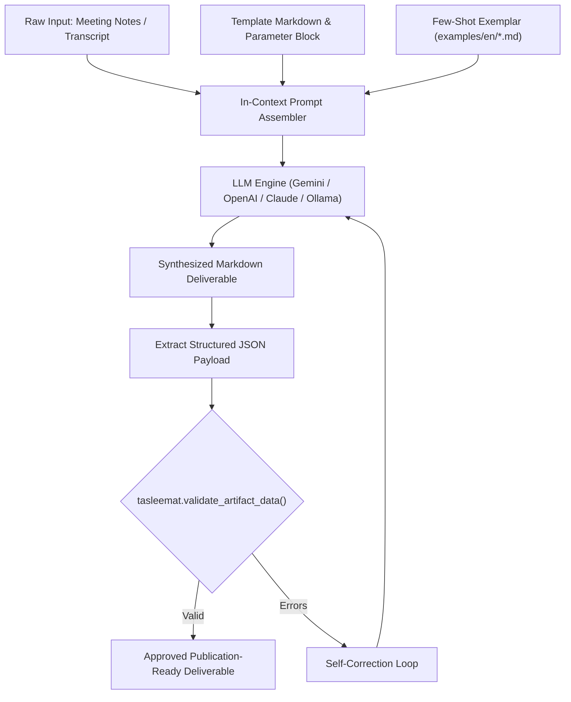

<!--
---
type: Guide
---
-->

<div class="lang-switch-bar">
  <span class="lang-switch-label">🌐 <strong>Language:</strong> English Technical Manual</span>
  <div class="lang-switch-actions">
    <a class="lang-switch-btn github-btn" href="https://github.com/fakhruldeen/Tasleemat/blob/main/docs/en/tech_llm_synthesis_and_prompting.md" target="_blank" rel="noopener noreferrer">🐙 View on GitHub ↗</a>
    <a class="lang-switch-btn" href="../ar/tech_llm_synthesis_and_prompting.html">🇸🇦 الانتقال للنسخة العربية (Arabic Version) →</a>
  </div>
</div>

---

# 🤖 Technical Guide: LLM Synthesis, Grounding & In-Context Generation
**Document ID:** `TASLEEMAT-TECH-LLM-SYNTHESIS`  
**Target Audience:** AI Engineers, Solution Architects, Prompt Engineers, Full-Stack Developers  
**Core Technologies:** Python SDK (`tasleemat.ai`), OpenAI GPT-4o, Anthropic Claude 3.5 Sonnet, Google Gemini 2.5, Local Ollama  

---

## 🎯 Architectural Purpose

Synthesizing formal PMO deliverables using Large Language Models (LLMs) requires much more than naive zero-shot chat prompts. Naive generation frequently produces:
1. **Hallucinated structure**: Inconsistent markdown headings, missing document control blocks, and fabricated compliance codes.
2. **Schema non-conformance**: Numerical dates formatted improperly, missing mandatory project fields, or inverted risk scoring.
3. **Stylistic dissonance**: Conversational, non-authoritative prose unfit for executive and steering committee review.

The **Tasleemat LLM Synthesis Pipeline** solves this through **Three-Tier Grounding**:
- **Layer 1: Structural Scaffolding**: Grounded against pre-engineered system prompts and template parameters (`forms/en/.../*.md` and `forms/ar/.../*.md`).
- **Layer 2: Authentic Few-Shot Exemplars**: Conditioned on 228 verified real-world project deliverables in `examples/en/` and `examples/ar/`.
- **Layer 3: Programmatic Schema Enforcement**: Validated against companion JSON Schemas via `tasleemat.validate_artifact_data` prior to persistent storage.



---

## 🚀 1. The Unified Python AI Client (`tasleemat.ai.AIClient`)

Tasleemat includes a built-in multi-provider LLM client designed specifically for enterprise document drafting. It automatically resolves credentials from `~/.tasleemat/config.json` or standard environment variables (`GEMINI_API_KEY`, `OPENAI_API_KEY`, `ANTHROPIC_API_KEY`).

### Supported Providers & Models

| Provider Code | Default Model | Custom Endpoints Supported | Environment Variable |
| :--- | :--- | :---: | :--- |
| `gemini` | `gemini-2.5-flash` | No | `GEMINI_API_KEY` |
| `openai` | `gpt-4o` | Yes (`api_base`) | `OPENAI_API_KEY` |
| `anthropic` | `claude-3-5-sonnet` | No | `ANTHROPIC_API_KEY` |
| `ollama` | `llama3.3:latest` | Yes (`http://localhost:11434`) | None (Local execution) |
| `mock` | `offline-deterministic` | Local | None (Testing & CI pipelines) |

### Programmatic Python Synthesis Example

```python
import os
import tasleemat
from tasleemat.ai import AIClient

# 1. Initialize client with automatic failover support
ai_client = AIClient(provider="gemini", model="gemini-2.5-flash")

# 2. Retrieve authoritative template instructions for Project Charter (PMO-03.01)
charter_def = tasleemat.get_artifact_definition("PMO-03.01")
charter_prompt_template = tasleemat.get_artifact_asset("PMO-03.01", role="prompt", lang="en")

# 3. Assemble Grounded In-Context Prompt
user_meeting_notes = """
Project: Enterprise Data Mesh Migration
Sponsor: Dr. Khalid Al-Mansour, VP of Digital Technology
Budget Envelope: $3,200,000 USD
Timeline: 9 months, kickoff on 2026-11-01.
Primary Objective: Transition 14 legacy departmental databases into a unified, decentralized data mesh architecture with real-time governance.
Key Risks: Resistance from legacy database administrators, data quality disparities.
"""

system_instruction = (
    "You are a Senior Enterprise PMO Director. Generate a formal, publication-ready "
    "Project Charter strictly adhering to the template format below. "
    "Do not include conversational conversational introductions or concluding remarks."
)

full_prompt = f"""
{charter_prompt_template}

### INPUT PROJECT NOTES:
{user_meeting_notes}
"""

# 4. Synthesize Deliverable
generated_charter = ai_client.generate(
    prompt=full_prompt,
    system_instruction=system_instruction
)

print(f"Synthesized Charter ({len(generated_charter)} characters generated)")
```

---

## 🛠️ 2. CLI Automated Synthesis (`tasleemat generate`)

For automated shell scripts and local developer workflows, the CLI provides the `generate` command:

```bash
# Basic generation using notes file
tasleemat generate \
  --form PMO-03.01 \
  --notes ./raw_transcripts/kickoff_notes.txt \
  --out ./my_project/03_01_Project_Charter.md

# Generate in Arabic using OpenAI GPT-4o
tasleemat generate \
  --form PMO-04.08.02 \
  --notes ./workshop_notes_ar.txt \
  --lang ar \
  --provider openai \
  --model gpt-4o \
  --out ./my_project/04_08_02_سجل_المخاطر.md

# Offline CI/CD Mock Generation (Zero token expenditure)
tasleemat generate \
  --form PMO-03.01 \
  --notes "Unit test payload" \
  --mock \
  --out /tmp/mock_charter.md
```

---

## 🔒 3. Defensive Prompt Engineering: Preventing Hallucination

When prompting models to write PMO deliverables, apply these four architectural guardrails:

### Guardrail 1: The `[ Requires Human Input ]` Directive
Explicitly instruct the LLM in system instructions:
> *"Whenever specific project data (such as exact financial amounts, vendor names, or milestone dates) is absent from the provided notes, output `[ Requires Human Input: <Description> ]`. Never invent metrics or financial figures."*

### Guardrail 2: Enforcing Document Control Headers
Ensure the model formats the metadata header with standardized variable slots:
```markdown
| Document Attribute | Specification |
| :--- | :--- |
| **Project Code** | PRJ-2026-MESH-01 |
| **Document ID** | PMO-03.01-CHARTER |
| **Author** | Tasleemat AI Assistant (Supervised by PM Lead) |
| **Version** | 1.0 (Draft) |
| **Security Classification** | Internal Confidential |
```

### Guardrail 3: Cryptographic Audit Stamping
Tasleemat templates embed an audit placeholder block. Direct the LLM to preserve the placeholder:
```markdown
<!-- AUDIT_BLOCK_START -->
**Cryptographic Integrity Stamp:** `{{Audit_Trail_SHA256_Hash}}`
<!-- AUDIT_BLOCK_END -->
```
Prior to gate submission, your pipeline replaces this placeholder with the SHA-256 hash of the sanitized text body, ensuring immutable change detection.
