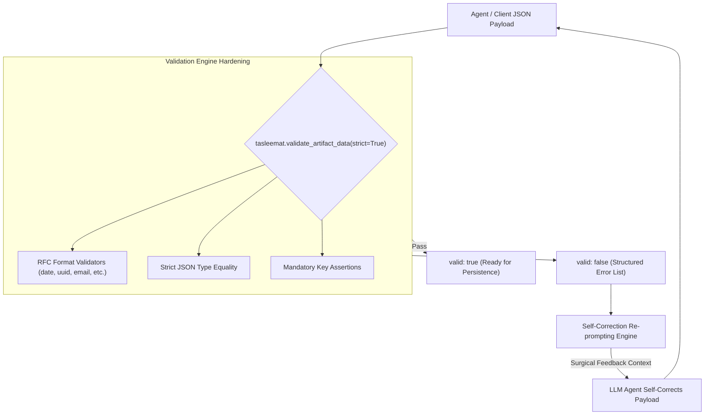

<!--
---
type: Guide
---
-->

<div class="lang-switch-bar">
  <span class="lang-switch-label">🌐 <strong>Language:</strong> English Technical Manual</span>
  <div class="lang-switch-actions">
    <a class="lang-switch-btn github-btn" href="https://github.com/fakhruldeen/Tasleemat/blob/main/docs/en/tech_schemas_and_validation_loops.md" target="_blank" rel="noopener noreferrer">🐙 View on GitHub ↗</a>
    <a class="lang-switch-btn" href="../ar/tech_schemas_and_validation_loops.html">🇸🇦 الانتقال للنسخة العربية (Arabic Version) →</a>
  </div>
</div>

---

# 🛡️ Technical Guide: Draft 2020-12 Schemas, RFC Formats & Self-Correction Loops
**Document ID:** `TASLEEMAT-TECH-SCHEMAS-VALIDATION`  
**Target Audience:** Software Engineers, Backend Developers, Data Architects, AI Pipeline Engineers  
**Core Technologies:** Draft 2020-12 JSON Schema, RFC 3339, RFC 4122, RFC 3986, RFC 5322, ISO 8601, Python `tasleemat.validation`  

---

## 🎯 Architectural Purpose

In autonomous agent workflows and automated data exchange pipelines, accepting unstructured natural language text without validation is a major vulnerability. LLM-generated JSON often contains subtle type corruption:
- Strings passed where integers or floats are expected.
- Inverted booleans or boolean values formatted as strings (`"true"` vs. `true`).
- Unformatted timestamps and invalid RFC date strings.
- Omission of critical mandatory governance keys.

Tasleemat safeguards document integrity via **114 Companion Draft 2020-12 JSON Schemas** paired with an offline, high-speed validation engine (`tasleemat.validate_artifact_data`) that enforces exact RFC constraints and powers **autonomous agent self-correction loops**.



---

## 📐 1. The Draft 2020-12 Companion Schema Architecture

Every one of the 114 deliverables in Tasleemat defines a companion JSON Schema adhering to the latest **JSON Schema Draft 2020-12** specification.

### Anatomy of a Companion Schema (`PMO-03.01.json`)

```json
{
  "$schema": "https://json-schema.org/draft/2020-12/schema",
  "$id": "https://tasleemat.org/schemas/pmo-03.01.json",
  "title": "Project Charter Deliverable Schema",
  "type": "object",
  "required": [
    "project_code",
    "project_name",
    "start_date",
    "sponsor_name",
    "estimated_budget"
  ],
  "properties": {
    "project_code": {
      "type": "string",
      "pattern": "^PRJ-[0-9]{4}-[A-Z0-9_-]+$"
    },
    "project_name": {
      "type": "string",
      "minLength": 5,
      "maxLength": 120
    },
    "start_date": {
      "type": "string",
      "format": "date"
    },
    "sponsor_name": {
      "type": "string",
      "minLength": 3
    },
    "estimated_budget": {
      "type": "number",
      "minimum": 0
    }
  },
  "additionalProperties": false
}
```

---

## 🌐 2. Supported RFC Formats in `tasleemat.formats`

The validation engine features built-in, RFC-compliant format validators. Payloads violating these formats are immediately rejected with actionable diagnostic messages:

| Format Identifier | Governing Specification | Example Valid Value | Rejection Criteria |
| :--- | :--- | :--- | :--- |
| `date` | RFC 3339 / ISO 8601 | `"2026-11-01"` | Non-zero-padded months, non-hyphenated strings, leap-year errors. |
| `date-time` | RFC 3339 | `"2026-11-01T09:30:00Z"` | Missing timezone designator (`Z` or `+03:00`), invalid hour boundaries. |
| `time` | RFC 3339 | `"14:30:00"` | Missing seconds segment, 12-hour AM/PM formats. |
| `uuid` | RFC 4122 | `"550e8400-e29b-41d4-a716-446655440000"` | Incorrect hyphens, invalid hexadecimal characters, wrong length. |
| `uri` | RFC 3986 | `"https://pmo.tasleemat.org/api/v1"` | Relative paths without URI scheme, unescaped whitespace. |
| `uri-reference` | RFC 3986 | `"/docs/governance.html"` | Invalid URI query or fragment characters. |
| `email` | RFC 5322 | `"pm.lead@tasleemat.org"` | Missing `@` domain delimiter, invalid characters. |
| `duration` | ISO 8601 Duration | `"P3M"`, `"P14D"`, `"PT2H30M"` | Arbitrary prose durations (`"3 months"`, `"two weeks"`). |

---

## 🔍 3. Strict vs. Draft Validation Modes

The validation engine supports two modes depending on pipeline stage:

```python
import tasleemat

# STRICT MODE (For Stage-Gate Audits and CI/CD Build Gates):
# Enforces all required fields AND rejects undeclared properties (additionalProperties: false)
strict_result = tasleemat.validate_artifact_data(
    artifact_id="PMO-03.01",
    data=payload,
    strict=True
)

# DRAFT MODE (For Mid-Stream Agent Drafting & Partial Note Ingestion):
# Validates present fields against types/formats, but permits missing optional attributes
draft_result = tasleemat.validate_artifact_data(
    artifact_id="PMO-03.01",
    data=payload,
    strict=False
)
```

---

## 🔁 4. The Agentic Self-Correction Loop Pattern

When an autonomous agent generates data that fails schema validation, the agent should not fail or crash. Instead, capture the machine-readable error report and re-prompt the model with surgical error feedback:

```python
import tasleemat
from tasleemat.ai import AIClient

def generate_and_validate_with_self_correction(artifact_id: str, prompt: str, max_retries: int = 3):
    client = AIClient(provider="gemini", model="gemini-2.5-flash")
    schema = tasleemat.get_artifact_asset(artifact_id, role="schema", lang="en")
    
    current_prompt = f"{prompt}\nTarget Draft 2020-12 Schema:\n{schema}"
    
    for attempt in range(1, max_retries + 1):
        # 1. LLM Synthesizes JSON Output
        raw_json_str = client.generate(
            prompt=current_prompt,
            system_instruction="Output valid JSON matching the schema precisely. Zero conversational filler."
        )
        
        try:
            import json
            payload = json.loads(raw_json_str)
        except Exception as e:
            current_prompt += f"\nJSON Syntax Error: {str(e)}. Fix and re-output."
            continue
            
        # 2. Run Programmatic Schema Validation
        report = tasleemat.validate_artifact_data(artifact_id, payload, strict=True)
        
        if report["valid"]:
            print(f"✅ Success on Attempt {attempt}!")
            return payload
            
        # 3. Formulate Surgical Feedback for Self-Correction
        error_messages = [f"- Path '{err['path']}': {err['message']}" for err in report["errors"]]
        error_context = "\n".join(error_messages)
        
        print(f"⚠️ Attempt {attempt} failed validation with {len(report['errors'])} errors. Retrying...")
        current_prompt = (
            f"Your previous JSON output violated schema validation constraints:\n"
            f"{error_context}\n\n"
            f"Fix ONLY the affected fields and re-output the corrected complete JSON."
        )
        
    raise ValueError(f"Failed to achieve schema compliance after {max_retries} attempts.")
```

By packaging diagnostic feedback directly into the prompt loop, autonomous agents achieve near-$100\%$ schema compliance without human intervention.
